# ulogin — 범용 로그인 · SSO 서버

**로컬 HTML/AI 앱의 JS에서 API 키를 없애기 위해, 로그인만 서버로 분리하고 인증된 사용자에게 등급에 맞는 시크릿만 반환하는 인증 서버.**
PHP 7.2+ / MySQL·MariaDB / PDO. **Composer 없음, 빌드 도구 없음, 외부 의존 0개.** 공용 호스팅에 폴더째 올리면 동작한다.

> 이 문서는 **"어떻게, 왜 그렇게 결정했는가"** 를 다룬다.
> "무엇을 만들었는가"는 저장소 루트의 `README.md`, "어떻게 설치하는가"는 `INSTALL.md`에 있다.
>
> **English readers → [English Summary](#english-summary)** (문서 맨 아래).

---

## 목차

| 절 | 내용 |
|---|---|
| [1. 최종 목표와 배경](#1-최종-목표와-배경) | 왜 이 문제가 생기는가, 기존 대안으로 왜 안 되는가 |
| [2. 요구사항에서 설계 결정까지](#2-요구사항에서-설계-결정까지) | 결정마다 "왜" |
| [3. 아키텍처](#3-아키텍처) | 계층 · 17 테이블 · 엔드포인트 계수 · SSO 플로우 |
| [4. 기능별 상세](#4-기능별-상세) | 설계 결정이 화면에서 어떤 모습으로 나타났는가 (스크린샷) |
| [5. 보안 설계와 실제로 막은 것](#5-보안-설계와-실제로-막은-것) | 재현 시나리오 포함 |
| [6. 검증 방법론](#6-검증-방법론) | 정적 검사로 못 잡는 것을 어떻게 잡았는가 |
| [7. 개발 과정](#7-개발-과정) | 라운드 구성과 결정 추적 |
| [8. 정량 지표](#8-정량-지표) | 측정 명령과 값 |
| [9. 알려진 제한과 다음 단계](#9-알려진-제한과-다음-단계) | 정직하게 |
| [English Summary](#english-summary) | 영문 요약 |

---

## 1. 최종 목표와 배경

### 1-1. 출발점 — 배포하는 순간 키가 공개된다

로컬에서 도는 AI 서비스를 HTML 한 파일로 만들었다. 잘 돌아간다. 그런데 그것을 남에게 주려고
배포하면 문제가 하나 생긴다.

```html
<!-- 이 한 줄이 배포와 동시에 공개된다 -->
<script>const OPENAI_KEY = "sk-...";</script>
```

**개발자도구를 여는 누구나 그 키를 가져간다.** 난독화는 대책이 아니다 — 브라우저가 실행하려면
평문이어야 하고, Network 탭에는 `Authorization` 헤더가 그대로 찍힌다. 키가 유출되면 과금은
키 소유자에게 청구된다.

그러면 서버를 두면 되는데, 그 순간 만들어야 하는 것이 갑자기 늘어난다 — 회원가입, 로그인,
비밀번호 찾기, 세션 관리, 사용량 과금, 관리자 화면. **정작 만들고 싶었던 것은 AI 앱이었다.**

### 1-2. 그래서 만든 것 — "로그인만" 서버로 분리한다

```
기존:   [로컬 앱 JS]  ── sk-xxxx 하드코딩 ──→  [AI API]        ← 키가 공개된다

ulogin: [로컬 앱 JS]  ── 로그인 ──→ [ulogin 서버]
                                      ↓ 등급 판정
                      ←── 등급을 통과한 시크릿만 ──┘
             └── 받은 키로 직접 호출 ──→ [AI API]
             └── 호출마다 포인트 차감 ──→ [ulogin 서버]
```

앱은 여전히 **정적 HTML 한 장**이다. 빌드도 서버사이드 렌더링도 없다.
바뀐 것은 키의 출처다 — 하드코딩이 아니라 **로그인 응답**에서 온다.
그리고 서버는 "누가 어떤 키를 받을 수 있는가"를 등급으로 판정한다.
등급이 모자라면 그 키는 응답에서 **에러 없이 빠진다.**

이 한 가지 요구 — **"인증된 사용자에게만, 그 사용자의 등급에 맞는 시크릿을 반환한다"** — 가
이 프로젝트의 존재 이유이고, 아래 모든 설계 결정의 기준점이다.

### 1-3. 기존 대안으로 안 되는 이유

가장 먼저 검토한 것이 기성 IdP를 쓰는 것이다. 결론은 **쓸 수 없다**였고, 이유는 셋이다.

| 대안 | 왜 안 되는가 |
|---|---|
| **Firebase Authentication** | 로그인은 해결한다. **그런데 "AI 키를 등급별로 반환한다"를 하려면 Cloud Functions가 필요하다** — 즉 서버를 또 만드는 것이고, 그 순간 "공용 호스팅 하나로 끝낸다"는 전제가 깨진다. 무료 한도를 넘으면 과금이 붙고, 프로젝트 전체가 특정 벤더에 묶인다 |
| **Auth0** | 무료 티어의 월간 활성 사용자 한도를 넘으면 유료다. Actions/Rules로 토큰에 커스텀 클레임을 넣을 수는 있지만 **JWT에 AI 키를 실으면 그 키가 클라이언트 저장소에 그대로 남는다** — 하드코딩을 JWT로 옮긴 것뿐이다. 회원 등급·포인트 같은 도메인 데이터는 결국 내 DB에 따로 둬야 한다 |
| **Keycloak** | 오픈소스이고 기능은 충분하다. **JVM 프로세스를 상주시켜야 한다.** 공용 호스팅에는 그런 권한이 없다 — Docker도, systemd도, 포트 바인딩도 못 쓴다 |
| **직접 구현 + Composer 라이브러리** | 공용 호스팅에 **SSH가 없다.** `composer install`을 돌릴 곳이 없고, `vendor/`를 로컬에서 만들어 FTP로 올리는 방식은 PHP 버전이 다르면 조용히 깨진다 |

**그리고 세 IdP 전부에 공통으로 걸리는 것이 하나 있다.**

> 표준 IdP의 역할은 **"이 사람이 누구인지"** 를 증명하는 것이다.
> 이 프로젝트가 필요한 것은 **"이 사람에게 어떤 비밀값을 내려줄 것인지"** 다.
> 후자는 IdP의 역할 밖이다. OIDC의 `id_token`은 신원 주장을 담는 그릇이고,
> **거기에 서비스 시크릿을 담으면 그 시크릿은 토큰이 가는 모든 곳으로 함께 간다.**

그래서 시크릿 반환은 **별도의 1회용 교환 단계**여야 했고(→ [2-2](#2-2-sso에-일회용-code-교환-단계를-왜-뒀는가)),
그 단계에 등급 판정을 붙일 수 있어야 했다. 기성 IdP에 붙이면 그 판정 로직이 다시 내 서버에
있어야 하므로, 결국 서버를 만드는 것과 같은 일이 된다.

### 1-4. 환경 제약이 설계를 결정했다

여기에 배포 환경 제약이 겹친다. 이 제약이 아키텍처의 절반을 결정했다.

| 제약 | 사실 | 설계에 준 영향 |
|---|---|---|
| **DB 1개만 제공** | 호스팅이 데이터베이스를 하나만 준다 | 테이블 **prefix `app_ulogin_`** 로 다른 서비스와 한 DB를 공유한다. prefix는 상수이며 정규식 검증 후 치환된다 |
| **Composer 없음** | SSH·CLI 접근이 없다 | **외부 의존 0개.** PDO·OpenSSL·mbstring — PHP 내장 확장만 쓴다 |
| **빌드 도구 없음** | npm·webpack을 돌릴 곳이 없다 | 프론트는 **Vanilla JS + 정적 HTML.** 그 결과 CSP의 `script-src`에서 `'unsafe-inline'`을 지울 수 없다 — 대가는 [9절](#9-알려진-제한과-다음-단계)에 적었다 |
| **`mod_rewrite` 불확실** | `.htaccess` 오버라이드가 막혀 있을 수 있다 | **파일 경로 = URL 경로.** 단일 라우터를 기각했다(→ [2-3](#2-3-파일--url--단일-라우터를-기각했다)) |
| **PHP 7.2.34** | 실제 호스팅의 인터프리터 버전 | 최소 요구 버전을 7.2로 내리고 **7.2 ~ 8.x 양방향 호환**으로 만들었다. 그 과정에서 실제 결함 1건을 잡았다(→ [5-6](#5-6-php-72에서-쿠키-보호-속성이-조용히-사라지던-문제)) |
| **HTTPS 여부 불확실** | 평문 HTTP 운영 가능성이 있다 | 쿠키 `Secure`·HTTPS 강제를 설정으로 분리하고, **모순된 설정은 500으로 세운다**(→ [2-5](#2-5-fail-closed--잘못된-설정을-왜-500으로-세우는가)) |

---

## 2. 요구사항에서 설계 결정까지

이 절의 각 항목은 프로젝트의 판정 문서에 번호(`D-n`)로 기록되어 있다.
판정 문서 운용 방식은 [7-2](#7-2-판정-문서로-결정을-추적한다)에 있다.

### 2-1. 3축 권한 모델 — 왜 하나로 합치지 않았는가

세 가지 질문이 **서로 독립**이라는 것이 출발점이다.

| 축 | 컬럼 | 값과 **랭크** | 답하는 질문 |
|---|---|---|---|
| **계정등급** | `account_level` | `guest`(0) · `basic`(10) · `verified`(20) · `vip`(30) · `staff`(90) | 이 회원은 어느 단계까지 검증됐나 |
| **역할** | `role` | `user`(0) · `manager`(10) · `admin`(20) · `superadmin`(30) | 이 사람은 서버를 관리할 수 있나 |
| **결제등급** | `billing_tier` | `free`(0) · `lite`(10) · `pro`(20) · `enterprise`(30) | 이 사람은 유료 기능을 쓸 수 있나 |

하나로 합치면 곧바로 표현할 수 없는 상태가 생긴다 —
**"이메일 미인증이지만 결제한 사용자"**, **"관리자인데 무료 등급"**,
**"결제등급은 만료됐지만 계정은 여전히 `verified`"**. 실제 운영에서 전부 발생하는 조합이다.
축을 합치면 이 조합을 표현하려고 등급 값이 곱셈으로 늘어난다.

#### 왜 `*_rank` 정수를 따로 두는가 — 문자열 비교가 실제로 틀린다

값이 문자열이면 **비교가 조용히 틀린다.** 이것이 랭크 정수를 도입한 직접적 이유다.

```js
// 틀림 — 사전순 비교가 된다
'pro'        >= 'lite'   //  true  (우연히 맞다)
'enterprise' >= 'lite'   //  false ← 최상위 등급이 게이트를 통과하지 못한다
'verified'   >  'vip'    //  false ← 사전순 v-e < v-i. 랭크로는 20 < 30 이므로 참이어야 한다
```

`enterprise` 사용자가 `lite` 게이트에서 막히는 것이 사전순 비교의 결과다.
그리고 이 실패는 **예외를 던지지 않는다.** 최상위 고객만 기능을 못 쓰는 상태로 배포된다.

```js
var BILLING_TIER_RANK = { free: 0, lite: 10, pro: 20, enterprise: 30 };
function rankOf(map, v) { return Object.prototype.hasOwnProperty.call(map, v) ? map[v] : 0; }

// 올바름 — 정수 비교. 모르는 값은 0으로 떨어지므로 fail-closed 다
if (rankOf(BILLING_TIER_RANK, user.billing_tier) >= BILLING_TIER_RANK.lite) { … }
```

랭크 사이를 10씩 띄운 것도 의도다. 중간 등급을 추가할 때 기존 값을 재배치하지 않아도 된다.
그리고 **`0`은 "전원 통과"** 를 뜻한다 — 이 성질이 뒤에서 보안 판정에 쓰인다([5-4](#5-4-c-3--기본-설치가-ai-키를-무조건-공개하고-있었다)의 "랭크 0 게이트로 위장").

### 2-2. SSO에 일회용 code 교환 단계를 왜 뒀는가

로컬 앱이 로그인하려면 사용자를 로그인 서버로 보냈다가 되돌려받아야 한다.
**되돌려받는 방법이 곧 보안 경계다.**

가장 단순한 방법은 리다이렉트 URL에 결과를 실어 보내는 것이다. 그러면 안 된다.

> **시크릿을 URL에 실을 수 없다.** URL은 다음 전부에 남는다 —
> 브라우저 히스토리, 북마크, `Referer` 헤더, **웹서버 액세스 로그**, 프록시 로그, 화면 공유.
> 액세스 로그는 애플리케이션 코드로 지울 수 없다. 서버가 요청 라인을 기록하는 것은
> 애플리케이션이 실행되기 전의 일이다.

그래서 **두 단계로 나눴다.**

1. **`authorize`** — 자격증명을 검증하고 **1회용 `code`** 를 발급한다. 수명 60초.
   `code`는 리다이렉트 URL에 실려 돌아온다. 이것이 로그에 남아도 무해하다 —
   60초가 지나면 죽고, 한 번 쓰면 죽는다.
2. **`exchange`** — 앱이 그 `code`를 **POST 본문**으로 보내고, 응답 본문으로
   토큰과 `payload`(시크릿)를 받는다. **POST 본문은 액세스 로그에 남지 않는다.**

`code` 재사용은 `SSO_CODE_INVALID`(400)로 거부된다. 즉 공격자가 로그에서 `code`를 주워도
정당한 앱이 이미 교환한 뒤라면 쓸 수 없고, 아직 교환되지 않았다면 60초 안에 이겨야 한다.

#### PKCE(S256)를 왜 쓰는가

위의 60초 창을 닫는 장치다. 앱은 로그인을 시작할 때 난수 `code_verifier`를 만들어
**메모리에만** 두고, 그 SHA-256 해시(`code_challenge`)만 서버에 보낸다.
`exchange` 때 원본 `code_verifier`를 함께 보내야 교환이 성립한다.

**결과:** `code`를 훔친 공격자는 `code_verifier`를 모르므로 교환할 수 없다.
`code`가 로그에 남았든 리다이렉트로 새어 나갔든 상관없다.
클라이언트 시크릿을 앱에 심을 수 없는 **퍼블릭 클라이언트**(= 정적 HTML)에서
가로채기를 막는 표준 수단이 이것이다.

**정직하게 적을 것:** PKCE는 강제되지 않는다. `crypto.subtle`은 **보안 컨텍스트**(HTTPS 또는
`localhost`)에서만 동작하므로, `file://`로 데모를 열면 클라이언트가 PKCE를 생략한다.
그 상태에서도 `state` 검증과 `redirect_whitelist` 완전 일치는 그대로 동작한다.
잔여 위험으로 남겨 두었다([9절](#9-알려진-제한과-다음-단계) `M-7`).

#### `redirect_whitelist`는 완전 일치다

접두사 매칭을 쓰지 않는다. `https://app.example.com`을 접두사로 허용하면
`https://app.example.com.evil.test`가 통과한다. 오픈 리다이렉트를 스스로 만들지 않기 위해
**문자열 완전 일치**만 인정한다. 대가는 편의성이다 — 한 글자만 달라도 등록해야 한다.
그 대가를 문서에 명시하는 쪽을 택했다.

### 2-3. 파일 = URL — 단일 라우터를 기각했다

설계 단계에서 아키텍트가 제안한 것은 단일 진입점(`api/index.php` + `lib/`)이었다.
**기각했다**(`D-0`).

| 방식 | rewrite가 동작할 때 | **rewrite가 죽으면** |
|---|---|---|
| 단일 라우터 (`api/index.php`) | 깔끔한 경로 | **API 전체가 통째로 404** |
| **파일 경로 = URL 경로** | 같이 동작한다 (rewrite는 확장자 생략 편의용) | `.php` 확장자를 붙이면 **그대로 동작한다** |

공용 호스팅에서 `mod_rewrite`가 없거나 `AllowOverride None`인 것은 흔하다.
그리고 그때 나오는 증상은 **오류가 아니라 404**다 — 배포자는 무엇이 잘못됐는지 알 수 없다.
**실패 모드의 크기로 고른 결정이다.** 단일 라우터의 실패는 전면 장애이고,
파일=URL의 실패는 "경로가 조금 지저분하다"에 그친다.

두 가지 귀결이 따라온다.

- **동적 세그먼트를 쓰지 않는다.** `/users/{uuid}` 같은 경로 파라미터는 rewrite 없이는
  받을 수 없으므로 전부 **쿼리 파라미터**로 바꿨다 — `admin/user_detail.php?uuid=…`.
- **한 파일이 여러 메서드를 처리한다.** `me/index.php`가 GET·PUT을,
  `me/sessions.php`가 GET·DELETE를 처리한다. 그래서 "엔드포인트 개수"에 두 가지
  계수 기준이 생긴다(→ [3-3](#3-3-엔드포인트--계수-기준을-먼저-밝힌다)).

### 2-4. 시크릿 금고 — 등급 게이트와 "조용한 생략"

시크릿은 DB에 **AES-256-CBC**로 암호화 저장된다(값마다 랜덤 IV, 키는 `config.php`의
`SECRET_ENC_KEY`). 시크릿마다 **최소 등급 3개**(`min_account_level` / `min_role` /
`min_billing_tier`)를 걸 수 있고, 로그인 시 그 게이트를 통과한 것만 `payload`에 담긴다.

#### 왜 미달 키를 조용히 생략하는가 — 에러를 던지지 않는 이유

`payload`는 한 응답에 여러 키를 담는다. 예를 들어 `ai_api_key`(민감) · `api_base`(공개) ·
`model`(공개) 세 개다. 사용자의 등급이 `ai_api_key`에만 미달일 때 선택지는 둘이다.

| 방식 | 결과 |
|---|---|
| 403으로 응답 전체를 거부 | 게이트가 걸린 키가 하나만 있어도 **로그인 자체가 실패**한다. 무료 사용자는 앱에 들어가지도 못한다 |
| **미달 키를 생략하고 나머지를 반환** | 무료 사용자는 로그인해서 앱을 쓰고, AI 기능만 비활성이 된다. **등급별 기능 차등이 그대로 표현된다** |

후자를 택했다. 대신 **클라이언트에 의무가 생긴다** — 키의 부재를 반드시 분기해야 한다.

```js
var p = ulogin.getPayload();
if (!p.ai_api_key) {
  // 등급 미달이면 에러가 아니라 키가 조용히 빠진다. 반드시 부재를 분기하라.
  showUpgradeNotice();
  return;
}
```

이 의무를 문서에 넣지 않으면 연동 개발자는 `undefined`를 `Bearer undefined`로 보내고
AI 제공자의 401을 보게 된다. 그래서 이 규칙은 연동 가이드(`AI_INTEGRATION_GUIDE.md`)의
함정 목록과 데모 코드 양쪽에 들어 있다.

#### `payload`를 저장하지 못하게 만든다

연동 클라이언트(`ulogin-client.js`)는 `payload`를 **메모리 변수에만** 둔다.
`localStorage`에 넣는 코드가 없고, 새로고침 후에는 `getSession()`으로 다시 받는다.
`localStorage`에 저장하면 **이 시스템을 만든 이유가 사라진다** — 앱의 XSS 한 건이
키를 그대로 가져간다. 금지 규칙에는 항상 이유를 붙였다. 이유가 없으면 편의를 위해 어긴다.

#### 등급 게이트에 걸린 첫 번째 함정

이 게이트가 **기본 설치에서 비어 있었다.** 보안 감사 2회차가 잡은 Critical이고,
이 프로젝트에서 가장 값진 발견이었다. 상세는 [5-4](#5-4-c-3--기본-설치가-ai-키를-무조건-공개하고-있었다)에 있다.

### 2-5. fail-closed — 잘못된 설정을 왜 500으로 세우는가

이 프로젝트에서 가장 많이 반복한 판단이다. **"응답은 200인데 실제로는 동작하지 않는 상태"** 를
제거하는 것.

세 가지 경로를 명시적 500으로 바꿨다.

| # | 조건 | 그전에는 어떻게 됐나 | 지금 |
|---|---|---|---|
| **D-53** | `FORCE_HTTPS=true` 인데 `BASE_URL` 미설정 | `Host` 헤더로 폴백해 **공격자가 지정한 호스트로 301** (오픈 리다이렉트) | **500** + 로그 `FORCE_HTTPS is on but BASE_URL is not configured` |
| **D-67** | `TRUST_PROXY=true` 인데 `TRUSTED_PROXIES`가 빈 목록 | **누구의 `X-Forwarded-Proto`든 신뢰** → HTTPS 강제가 헤더 한 줄로 우회됨 | **500** + 로그 `TRUST_PROXY is on but TRUSTED_PROXIES is empty` |
| **D-75** | 평문 HTTP 요청에 `Secure` 쿠키를 발급하려 함 | 서버는 `Set-Cookie`를 정상 발송하고 **브라우저가 조용히 버린다.** 로그인 API는 200인데 세션이 안 붙는다 | **500** + 로그 `COOKIE_SECURE is on but the request is not HTTPS` |

**왜 자동 보정이 아닌가.** D-75에서 `Secure`를 자동으로 떼면 세션 쿠키가 평문 연결로 흐른다.
그것이 이 프로젝트가 막으려는 것 자체다. **설정을 조용히 약화시키는 대신 배포자에게 알린다.**

**왜 500인가.** 사용자에게 "로그인을 눌렀는데 다시 로그인 화면"만 보이는 상태는 진단이 불가능하다.
원인이 서버 로그에도 없다. 500은 최소한 **어디서 멈췄는지**를 남긴다.
응답 본문에는 원인을 넣지 않았다(내부 정보 노출 방지). **원인은 로그에만 있다** —
그래서 문서에 로그 검색어를 문자 그대로 실었다.

**500의 범위를 좁힌 것도 결정이다.** D-75 판정은 전역(`bootstrap.php`)이 아니라
**쿠키 발급 경로 안**에 있다. 전역에서 막으면 쿠키를 쓰지 않는 Bearer 전용 요청까지 함께 죽는다.
그 결과 증상이 비대칭으로 나타난다 — **브라우저 로그인은 깨지는데 로컬 AI 앱의 Bearer 조회는
계속 동작한다.** 이 비대칭 자체가 진단 단서가 되도록 문서화했다.

### 2-6. 의도적 마찰 — 콘솔에 넣지 않은 컨트롤

게이트 없는 민감 시크릿을 만드는 것은 API에서는 가능하다(`allow_public: true`).
**관리자 콘솔에는 그 체크박스를 넣지 않았다**(`D-55`).

> **체크박스를 두면 눌린다.**
> 게이트 없는 민감 시크릿은 이 시스템의 존재 이유를 무너뜨리는 설정이므로,
> 콘솔에서 한 번의 클릭으로 도달할 수 있으면 안 된다.
> 의도가 확실한 운영자는 API 직접 호출로 도달할 수 있다 — **의도적 마찰**이다.

같은 판단이 설치기 잠금 해제에도 적용됐다. `.install.lock`을 해제하는 파라미터는
구현하지 않았다. 재설치가 필요하면 FTP로 락 파일을 지워야 한다 —
**파일 접근 권한이 곧 재설치 권한**이 된다.

### 2-7. 설정 번들 (v1.6.0) — 기능의 사용 흐름 자체가 위협 모델이었다

사용자 요청은 단순했다. *"셋팅이 복잡하니 AI로 생성해서 한 번에 import하고 싶다."*
설계에서 가장 오래 붙든 질문은 **"내보내는 파일에 시크릿 값을 담을 것인가"** 였다.

**담지 않기로 했다. 근거는 「일반적으로 위험하다」가 아니다.**

> **이 기능 자신의 사용 흐름이 유출 경로다.**
> 사용자가 원하는 흐름이 「AI에게 JSON을 만들게 한다」이므로,
> **내보낸 파일의 가장 자연스러운 다음 행동은 그것을 AI 대화창에 붙여 "고쳐 줘"라고 하는 것**이다.
> 파일에 평문 키가 있으면 그 순간 전 서비스의 AI API 키가 제3자 LLM으로 넘어간다.

그리고 그것은 **이 프로젝트의 존재 이유와 정면 충돌한다.** 이 시스템이 하는 약속은
「JS 소스에 키가 없다」이고, 그 약속은 **키가 어디에 글자로 남는지**에 관한 것이다.
그 약속을 지키는 시스템이 **키를 글자로 담은 파일을 운영자 다운로드 폴더에 만들어 주는 것**은
같은 약속을 다른 자리에서 깨는 일이다.

**검토했다가 기각·연기한 두 갈래를 남긴다** — 버린 이유가 남아 있지 않으면 다음 라운드가 뒤집는다.

| 갈래 | 판정 | 이유 |
|---|---|---|
| **최고관리자 + 명시적 opt-in + 감사 기록으로 평문을 싣는다** | **기각** | opt-in과 감사 기록은 **유출을 줄이지 않고 사후에 기록만 한다.** 한 건씩 보는 경로는 이미 있다(`?action=reveal`, 최고관리자 + 감사 기록). 그러므로 이 갈래가 새로 주는 것은 **능력이 아니라 대량 편의**뿐이고, **대량 편의는 침해된 관리자 세션의 승리 조건 그 자체**다. N번의 개별 조회보다 1번의 덤프가 엄격히 더 나쁘다 |
| **패스프레이즈로 재암호화해 싣는다** | **연기** (기각이 아니다) | 값이 있다 — `SECRET_ENC_KEY` 회전 경로도, 시크릿 백업 수단도 지금 **없다.** 그러나 제대로 하려면 KDF 반복수 선택 · 인증 암호화(현재 `enc()`는 AES-256-CBC로 MAC이 없다) · 포맷 버전 · 그 자체의 테스트 티어가 필요하고, 그것은 「설정 import/export」와 **다른 기능**이다. **결정적으로: 이 번들에 섞으면 「내보낸 파일은 AI 대화창에 붙여도 안전하다」는 성질이 사라진다** — 그 성질이 AI용 가이드 문서를 성립시키는 전제다 |

**대가를 문서에 그대로 적었다.** import는 값을 **받는다**(그것이 값을 넣는 유일한 경로다).
그래서 비대칭이 남는다 — **내보낼 때는 안 주고, 넣을 때는 받는다.**
이 비대칭을 "불일치"로 두지 않고 원칙으로 설명했다:

> **시크릿은 서버가 생성했고 그것이 볼 수 있는 유일한 기회일 때만 응답에 싣는다.**
> 서비스 생성 API는 서버가 시크릿을 만들므로, 돌려주지 않으면 운영자가 영원히 알 수 없다 — 싣는다.
> 번들 적용은 **번들이 값을 줬으므로** 운영자가 이미 갖고 있고, 싣는 것은
> 응답 본문·프록시 로그·브라우저 히스토리에 **자격증명 사본을 하나 더** 만들면서 얻는 정보가 0이다.

**그리고 사용자의 요청이 절반만 충족된다는 사실을 숨기지 않았다.**
번들은 시크릿의 **자리**까지 한 번에 만들고, **값**은 사람이 채운다.
그 절충을 화면 · `INSTALL.md` · AI용 가이드 **세 곳에 같은 문장으로** 적었다.
값이 빈 시크릿은 `active` 로 두지 않고 **`disabled` 로 강제**한다 —
값이 빈 `active` 행은 로그인 응답에서 **조용히 빠지고** 연동 앱에는 「키가 없다」로만 보이기 때문이다.
`disabled` 는 같은 결과를 **의도된 상태로** 만들고, 응답의 `secrets_pending_value` 목록이
채워야 할 항목을 명시적으로 준다.

**AI가 오류 메시지를 읽는 방식까지 설계에 넣었다.**
게이트 없는 민감 시크릿을 만드는 우회로(`allow_public`)의 기존 오류 문구는
사람에게 「의도한 공개라면 그 플래그를 함께 보내십시오」라고 알려 준다. 사람에게는 맞는 문구다.
**그러나 AI는 오류 메시지를 읽고 가장 짧은 통과 경로를 택한다** — 게이트를 거는 대신 플래그를 붙인다.
그대로 두면 이 기능이 **「민감 키의 게이트를 자동으로 벗기는 도구」** 가 된다.
그래서 번들 검증기는 세 가지를 한다:

1. `allow_public` 을 **해법으로 제시하지 않는다.** 게이트를 거는 것만 알려 준다
2. 그 우회로의 **존재 자체를, 이미 그것을 쓴 요청에만** 알린다
3. 통과에 **두 곳**을 요구한다 — 시크릿 객체의 플래그와 번들 최상위의 승인 목록.
   한 곳이면 오류 메시지에 대한 패턴 반응으로 채워지고, 두 곳이면 **번들 전체를 보고
   사람이 의도적으로 적어야** 한다

이것은 2-6절의 「의도적 마찰」과 같은 판단을, **독자가 사람이 아니라 AI일 때**로 옮긴 것이다.

### 2-8. 절차를 권고가 아니라 기계로 강제한다 — `expect_plan_hash`

설정을 대량으로 쓰는 화면에는 「적용 전에 계획을 확인하세요」가 필요하다.
문제는 **그것을 어떻게 지키게 하는가**다.

**이 프로젝트에서 절차 의존 방어는 반복해 실패했다.** 릴리스마다 돌려야 하는 자산 버전
치환 스크립트를 돌리지 않아 낡은 캐시 버스터가 **세 라운드를 통과**한 일이 있다.
문서에 적어 두었고, 체크리스트에도 있었고, 그래도 안 돌았다.

그래서 적용(`apply`)에 **계획의 지문을 필수 인자로** 만들었다.

```
POST ?action=dry-run   →  응답에 plan_hash (64자 sha256)
POST ?action=apply     →  expect_plan_hash 를 필수로 받는다
                          그 값을 주는 곳은 dry-run 응답 하나뿐이다
```

**그 결과 dry-run을 건너뛰고 apply를 호출할 방법이 존재하지 않는다.**
「권고」가 「호출 규약」이 됐다.

**부수 효과가 본래 목적만큼 중요했다.** 해시 입력에 **번들 + 영향받는 현재 행의 값 +
충돌 정책 + 환경 대조 결과**를 넣었으므로, 계획을 만든 뒤 다른 관리자가 먼저 적용했거나
본인이 다른 탭에서 설정을 고쳤으면 **해시가 달라지고 적용이 409로 거부된다.**
낙관적 동시성 제어가 공짜로 따라온 것이다.

**잠금(lock)을 쓰지 않은 이유:** cron도 Redis도 없는 공용 호스팅이다.
고아 잠금이 생기면 화면이 **영구히** 잠기고, 청소할 스케줄러가 없다.
**낡은 계획을 거절하는 것은 잠금보다 안전하고 상태가 없다.**

**다만 해시만으로는 부족했고, 그것을 실측으로 확인했다.** 두 요청이 **둘 다 커밋 전에**
상태를 읽는 창이 남는다 — 이 프로젝트가 v1.4.0에서 만들고 닫은 High 결함과
**정확히 같은 읽기-수정-쓰기 형태**다. 그래서 계획을 **트랜잭션 안의 잠근 읽기 위에서
다시 세운다.** 검증 방법은 6-9절의 기법(서버 두 개 + 변이 주입)을 그대로 썼다.

**그리고 이 기능이 하지 않는 일을 값이 아니라 약속으로 만들었다.**
계획 응답의 `deletes_possible` 은 **항상 `false`**, `counts.deletes` 는 **항상 `0`** 이다.
「번들에 없는 것은 지운다」는 모드를 **선택지로도 만들지 않았다** —
그 모드가 있으면 **AI가 블록 하나를 빠뜨린 JSON 하나로** 복구 불가능한 암호문 시크릿과
가입 이력이 사라진다. 은퇴 수단은 이미 있다(`status: "disabled"`).
화면이 그 두 필드를 근거로 「삭제되는 것 없음」을 표시하고,
**그 값이 다른 것을 갖는 순간이 오면 설계가 바뀐 것이다.**

---

## 3. 아키텍처

### 3-1. 계층

```
┌──────────────────────────────┐        ┌──────────────────────────────────────────┐
│  내 로컬 HTML/AI 앱            │        │  ulogin 서버 ({설치루트})                   │
│  (키 없음, 정적 파일)           │        │                                          │
│                              │  ①     │  public/           화면 8개 (Vanilla JS)   │
│  ulogin-client.js  ──────────┼─ 로그인 →│    login · register · forgot · reset      │
│                              │        │    verify · mypage · admin · index        │
│                              │        │  ────────────────────────────────────────  │
│  callback.html  ←────────────┼─ code ─ │  server/api/       엔드포인트 32파일        │
│    ↓ handleCallback()        │        │    auth · sso · me · points · admin       │
│                              │  ②     │  ────────────────────────────────────────  │
│                              │─ 교환 →  │  server/core/      내부 모듈 13개           │
│                              │←─ 토큰 ─ │    bootstrap  db  request  response       │
│                              │  payload│    auth  perm  payload  crypto            │
│  ③ payload.ai_api_key        │        │    ratelimit  logger  serializer           │
│     (메모리에만)               │        │    mailer  gc                             │
│         ↓                    │        │  ────────────────────────────────────────  │
│  ④ AI 호출 + 포인트 차감        │  ⑤     │  MySQL   app_ulogin_* 15 테이블             │
│                              │───────→│    시크릿은 AES-256-CBC 암호화 저장           │
└──────────────────────────────┘        └──────────────────────────────────────────┘
```

**모든 요청은 `core/bootstrap.php` 한 곳을 지난다.** 그 파일이 설정 로드 · CORS ·
HTTPS 강제 · 상수 정의를 담당하고, 나머지 `core/*.php` **16개**는 상단에서
`ULOGIN_BOOTSTRAPPED` 상수가 없으면 404로 즉시 종료한다.
**웹서버 설정이 아니라 코드로 직접 실행을 막는다** — `.htaccess`가 무시되는 환경에서도 유효하다.

응답 봉투는 전 경로에서 하나다. 성공:

```json
{ "ok": true,  "data": { }, "error": null }
```

실패:

```json
{ "ok": false, "data": null, "error": { "code": "AUTH_REQUIRED", "message": "…", "field": null } }
```

### 3-2. 데이터 모델 — 17 테이블

전부 `app_ulogin_` prefix, `CREATE TABLE IF NOT EXISTS`(재실행 안전), `utf8mb4` /
`ROW_FORMAT=DYNAMIC`(VARCHAR(190) 복합 UNIQUE가 767바이트 인덱스 한계에 걸리지 않게).

| # | 테이블 | 역할 |
|---|---|---|
| 1 | `users` | 회원. 3축 등급 · 포인트 · 상태 · 비밀번호 해시(bcrypt) |
| 2 | `services` | 연동 서비스. `service_id` · `redirect_whitelist` · `allowed_origins` · 세션 TTL · `auto_join` |
| 3 | `user_services` | 회원 × 서비스 가입. **서비스별 등급 오버라이드**와 `status`(`active`/`blocked`) |
| 4 | `service_secrets` | **시크릿 금고.** AES-256-CBC 암호문 + 최소 등급 3열(게이트) |
| 5 | `sessions` | 세션. `access_token_hash` · `refresh_token_hash` · `csrf_token_hash`(전부 SHA-256) |
| 6 | `auth_codes` | SSO 1회용 `code`(60초) + PKCE `code_challenge` |
| 7 | `password_resets` | 비밀번호 재설정 토큰(해시 저장) |
| 8 | `email_verifications` | 이메일 인증 토큰(해시 저장, 24시간) |
| 9 | `login_logs` | 로그인 이력. `result` **11종** (v1.3.0까지 7종) |
| 10 | `point_logs` | 포인트 증감 이력 + **멱등키** |
| 11 | `admin_logs` | 관리자 조작 감사 로그(before/after JSON) |
| 12 | `rate_limits` | 레이트리밋 버킷 |
| 13 | `settings` | 전역 설정 **13키** (v1.3.0까지 12키) |
| 14 | `terms` | 약관 |
| 15 | `user_consents` | 약관 동의 이력 |
| 16 | `schema_migrations` | **v1.4.0 신규.** 스키마 리비전. `version`(PK) · `checksum` · `status` · `statements_total`/`statements_done` |
| 17 | `secret_access_logs` | **v1.4.0 신규.** 시크릿이 누구에게 언제 전달됐는지. `(세션, 출처, 1시간)` UNIQUE + `hits` — **한 줄이 한 번이 아니다** |

**뒤 두 표는 확률적 GC 대상이 아니다.** 적용 이력과 감사 근거는 자산이다.
**기존 설치본에 이 둘이 가는 경로는 `server/migrate.php` 하나뿐이다** —
`install.php`는 `CREATE TABLE IF NOT EXISTS`만 돌므로 신규 설치에만 닿는다.

> **`secret_access_logs`를 요청마다 INSERT하지 않은 것이 이 표의 유일한 설계 결정이다.**
> 이 경로는 가장 자주 불린다(로컬 앱이 세션 확인을 갱신 타이머로 돌린다).
> 단순 INSERT면 분당 200회 기준 **하루 28만 행**이고, **그 부피가 신호를 묻는다.**
> 시간 버킷 UPSERT로 묶으면 같은 상황이 **하루 24행 + `hits` 288,000**이 되고
> 숫자 하나가 오히려 더 크게 보인다.
> **`login_logs`에 같은 기법을 쓰지 않은 이유는 대칭적이다** — 그 표는 마이페이지의
> 로그인 이력이 읽고, 그 화면에는 **1행 = 1회**라는 전제가 있다(횟수 필드가 없다).
> 새 표는 v1.4.0이 만든 것이고 관리자만 본다.
>
> **그리고 이 설계에 구멍이 하나 있었다 — 같은 라운드의 보안 재검증이 High로 잡았다.**
> 위 계산은 **`session_id`가 그대로인 경로**(갱신 타이머로 도는 세션 조회)에만 성립한다.
> **토큰 갱신은 회전마다 새 `session_id`를 만들고 그것이 버킷 키의 한 축이다** — 그래서
> **갱신 1회 = 1행**이 되어 접힘이 성립하지 않는다. 원인이 UPSERT가 아니라 **키의 한 축이
> 요청마다 새로 생성되는 값**이었다는 점이 이 발견의 형태다(같은 시행에서 접히는 경로와
> 접히지 않는 경로를 분리해 보였다: 같은 세션 20회 → 2행 / 갱신 10회 → 10행).
> **닫은 것은 「상한 없음」이다** — 갱신 경로에 전용 레이트리밋을 걸어 계정당 하루 1,440행으로 묶었다.
> **비율 자체를 없애려면 회전에 걸쳐 살아남는 계보 키가 필요하고 그것은 마이그레이션 대상이다**(v1.5.0).

**토큰은 전부 SHA-256으로 저장한다.** DB 덤프가 유출돼도 살아 있는 세션이 되지 않는다.
이 원칙이 한 곳에서 깨져 있었던 것이 [5-2](#5-2-c-1--세션-인증자가-관리자-응답에-평문으로-실려-있었다)의 Critical이다.

### 3-3. 엔드포인트 — 계수 기준을 먼저 밝힌다

**같은 API를 세는 기준이 셋이고, 셋 다 맞다.** 기준을 적지 않은 숫자는 반드시 갈라진다.

| 숫자 | 기준 | 다시 세는 명령 |
|---|---|---|
| **34** | `server/api/**` 의 **PHP 파일 수** | `find server/api -name "*.php" \| wc -l` |
| **47** | **메서드 × 경로 조합** — `only_method()`가 허용하는 메서드의 총합. **`HEAD`를 포함한다** | `grep -rho "only_method([^)]*)" server/api \| grep -o "'" \| wc -l` (÷2) |
| **46** | 위와 같은 값에서 `GET`/`HEAD /api/health` 의 `HEAD` 1건을 뺀 것 | `47 − 1` |
| **51** | 연동 가이드 요약표 기준 — 쿼리 파라미터로 동작·최소역할이 갈리는 5건(`admin/secrets.php?action=reveal` · `admin/logs.php?type=admin` · `admin/logs.php?type=secret_access` · `admin/settings_bundle.php?action=` 3종이 1조합에서 3행)을 별행으로 센 것 | `46 + 5` |
| **53** | API 계약서의 **논리 엔드포인트** — `suspend`/`restore`/`reset-password` 3개가 한 파일의 `action` 필드로 합쳐졌고, 설정 번들의 `validate`/`dry-run`/`apply` 3개는 **의미가 다르므로 따로 센다** | 계약서 계수(`11+2+10+1+28+1`) |

이 프로젝트는 **숫자를 한쪽으로 통일하지 않는 쪽**을 택했다(`D-80`).
숫자만 맞추면 계수 기준이 다시 갈라지기 때문이다. 대신 **각 문서에 기준과 재계수 명령을 함께** 실었다.

**v1.4.0에서 이 표가 실제로 값어치를 했다.** 증분이 기준마다 다르다 —
`GET`/`HEAD /api/health`와 `admin/logs.php?type=secret_access`가 더해지면서
**메서드×경로는 +2, `HEAD` 제외는 +1, 요약표 행은 +2, 논리는 +2**다.
기준 없는 「엔드포인트가 2개 늘었다」는 네 값 중 셋에서 틀린다.

**v1.6.0에서는 반대의 일이 일어났다.** 설정 번들 파일 하나가 더해졌는데
**메서드×경로 +2, `HEAD` 제외 +2, 요약표 행 +4, 논리 +4** — 즉 **증분이 두 값씩 짝을 이룬다.**
한 파일이 `GET`과 `POST` 두 메서드를 받고, 그 `POST` 하나가 `?action=` 으로 **의미가 다른 세 동작**을
담기 때문이다. **증분이 기준마다 다른 것이 이 표의 존재 이유이고, 짝을 이루는 것도 우연이다** —
그래서 새 기능을 더할 때마다 네 값을 각각 다시 세는 것이 규약이다.

그룹별 분포(47 기준): `admin` 21 · `auth` 11 · `me` 10 · `health` 2 · `sso` 2 · `points` 1.
(각 그룹 디렉토리에 위 명령을 돌려 실측 — 합이 47다.)
에러 코드는 **31개**이고 **v1.6.0에서도 늘지 않았다.** 설정 번들의 검증 오류 18종은
`error.code` 가 아니라 **`data.errors[].code`** 에 실린다 — 새 API 에러 코드를 만들지 않기 위한
설계다. 봉투 수준 에러 코드 표는 `response.php` 의 `ERROR_MESSAGES` 와 **순서까지 1:1** 이어야 하고
프론트에 사본이 하나 더 있어서, 하나를 더하면 세 곳을 함께 고쳐야 한다.
**그것이 「기존 연동 앱 무영향」을 에러 코드 측면에서 완전히 지킨 방법이다.**

> **연동 가이드 5절의 동결은 v1.4.0(`D-178`)과 v1.6.0에서 각각 최소 범위로 열렸다.**
> 지금 그 요약표는 **51행**이고, 열린 것은 **제목의 계수와 요약표의 행**뿐이다 —
> 상세 항목 `(1)`~`(45)`의 번호와 문장은 그대로여서 **이미 그것을 인용한 연동 앱의 인용이 깨지지 않는다.**
> **6절·10절은 여전히 완전 동결이고**(`D-61`), 세 절의 SHA-256 기준선을 그 문서의
> 「이 문서의 버전」 표에 적어 두었다. 6절·10절 값은 v1.4.0 마감 이후 **바이트 단위로 불변**임을
> 매 라운드 다시 계산해 확인한다.
> **기준선은 줄 번호가 아니라 제목 앵커로 구간을 잡는다** — 줄 범위로 잡으면 앞 절에 행이
> 늘어날 때 거짓 불일치가 나고, v1.6.0이 5절 **앞**에 갱신 고지 절을 하나 더했으므로
> 그 차이가 이 라운드에서 실제로 드러났다.

### 3-4. SSO 플로우

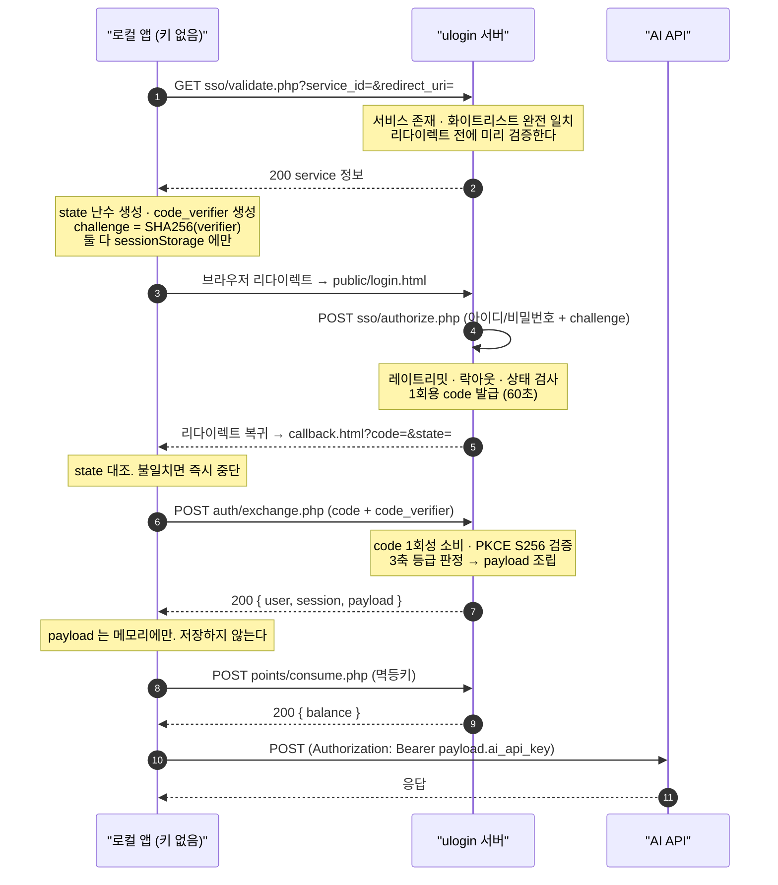

**각 단계에서 클라이언트가 지켜야 하는 것이 셋이다** — `state` 대조,
`code_verifier`를 메모리에만 두기, `payload`를 저장하지 않기.
셋 다 서버가 강제할 수 없으므로 연동 가이드가 이유와 함께 명시한다.

### 3-5. 유효 등급 계산 순서

```
1. 전역 값            users.account_level / role / billing_tier
2. 서비스 오버라이드   user_services.* (NULL 이면 전역 상속)   ← grant-only: 올려주기만 한다
3. 결제 만료 강등      billing_expires_at 이 지났으면 free
4. 차단               user_services.status='blocked' → payload 는 {} , 로그인은 FORBIDDEN
```

**2단계가 grant-only인 이유.** 서비스 기본등급(`default_account_level`)을 오버라이드로
그대로 기록하면, 전역 `verified` 사용자가 서비스 기본값 `basic` 때문에 **강등**된다.
그러면 `min_account_level='verified'` 시크릿이 `payload`에서 조용히 사라진다.
QA가 실제로 이 증상을 잡았고(`Q-3`), 그때 "서비스 기본값은 **최소 보장 등급**"으로
컬럼의 의미를 재정의했다(`D-35`). 같은 규칙이 자동 가입과 명시적 가입 **두 경로 모두**에
적용되어야 한다는 것은 그 다음 감사(`M-16`)가 잡았다 — 한 경로만 고쳐져 있었다.

**서비스 오버라이드 `role`은 서버의 관리 권한이 되지 않는다**(`D-50`).
관리자 API는 행위자·대상 모두 **전역 `users.role`만** 본다.
특정 서비스에서 `admin` 오버라이드를 받은 사용자가 로그인 서버 전체의 관리자가 되면
그 자체가 권한 상승이다.

---

## 4. 기능별 상세

**이 절은 화면 목록이 아니다.** "무엇이 보이는가"를 묶음별로 나열한 것은 저장소 루트
`README.md`의 기능별 갤러리(35장 전체)에 있다. 여기서는 **앞 절들의 설계 결정이 화면에서
어떤 모습으로 나타났는가**만 고른다 — 결정 하나에 그 결정이 눈에 보이는 장 하나씩이다.

촬영본은 `docs/screenshots/`에 있고, 각 장이 무엇을 증명하는지와 촬영 환경은
같은 폴더의 `INDEX.md`에 한/영으로 적혀 있다. **전부 실제로 설치·구동한 화면이며 합성이 아니다.**
데이터는 전부 가상이다(`demo_*` 계정 · 예약 도메인 `example.com` · 문서용 예약 IP 대역 · 가짜 AI 키).

### 4-1. 설치기 — "잘못 설정할 수 있는 자리"를 먼저 없앤다

설치기는 편의 기능이 아니라 **설정 오류의 방지 장치**다.
[2-5](#2-5-fail-closed--잘못된-설정을-왜-500으로-세우는가)가 잘못된 설정을 런타임에 500으로
세운다면, 설치기는 그 잘못된 설정이 **애초에 입력될 수 없게** 만든다.

| 화면 | 어떤 결정의 결과인가 |
|---|---|
| 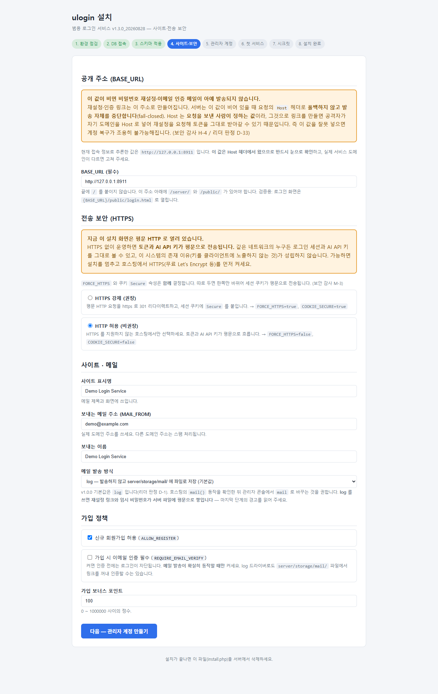 | **전송 보안을 라디오 하나로 받는다.** 라디오 두 개 중 어느 쪽을 고르든 `FORCE_HTTPS`와 `COOKIE_SECURE`가 **함께** 정해지고, 화면이 각 선택지 옆에 그 결과값을 그대로 인쇄한다. 따로 물었다면 한쪽만 바뀐 조합이 생긴다 — `FORCE_HTTPS=true` / `COOKIE_SECURE=false`면 세션 쿠키가 평문으로도 나가고, 반대 조합은 평문 요청에서 쿠키를 발급하려다 [2-5](#2-5-fail-closed--잘못된-설정을-왜-500으로-세우는가)의 fail-closed 500에 걸린다. **한 번만 물으면 그 조합이 존재할 수 없다** |
| 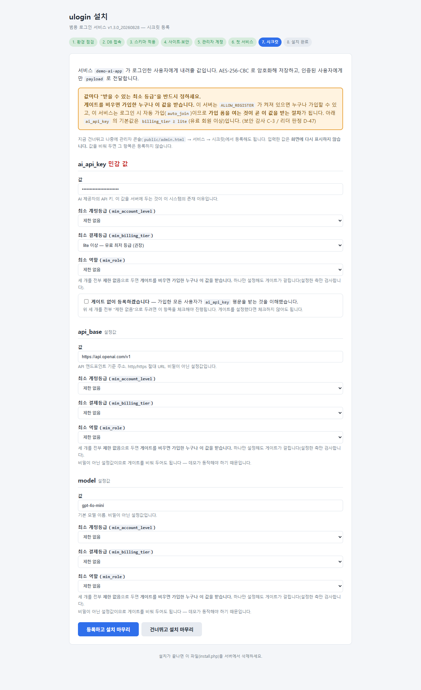 | **등급 게이트를 시크릿과 같은 화면에서 받는다.** [5-4](#5-4-c-3--기본-설치가-ai-키를-무조건-공개하고-있었다)의 Critical이 정확히 "게이트 없이 등록된 키"였다. 나중에 거는 옵션으로 두면 아무도 걸지 않는다. 화면의 `ai_api_key`는 `min_billing_tier = lite 이상`이고 `api_base`·`model`은 제한 없음 — **어떤 키가 비밀이고 어떤 것이 아닌지를 등록 시점에 구분하게 만든다** |
| 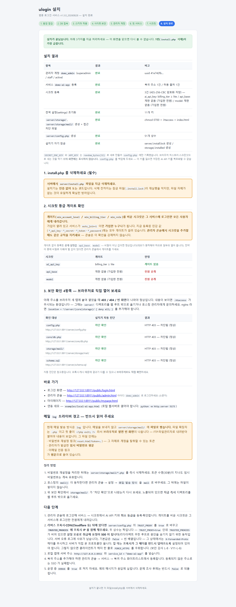 | **생성한 키를 화면에 인쇄하지 않는다.** 완료 화면은 `SECRET_ENC_KEY`·`APP_KEY`를 보여주는 대신 "브라우저 히스토리·스크린샷으로 새는 것을 막기 위해 표시하지 않는다"를 인쇄한다. 같은 화면이 보안 확인 4항목(전부 403)과 `install.php` 삭제 안내를 함께 낸다 — **설치의 마지막 단계가 자기 자신을 잠그는 것**이다 |

설치기 8단계 전체를 실 MariaDB + 실 HTTP로 완주해 확인한 기록은
[6-2](#6-2-실-mariadb--실-http로-설치기-8단계를-완주했다)에 있다.

### 4-2. 로그인 화면 — 밝히는 것과 밝히지 않는 것

같은 화면이 한쪽에서는 **더 말하고** 다른 쪽에서는 **덜 말한다.** 둘 다 의도된 것이다.

| 화면 | 어떤 결정의 결과인가 |
|---|---|
| 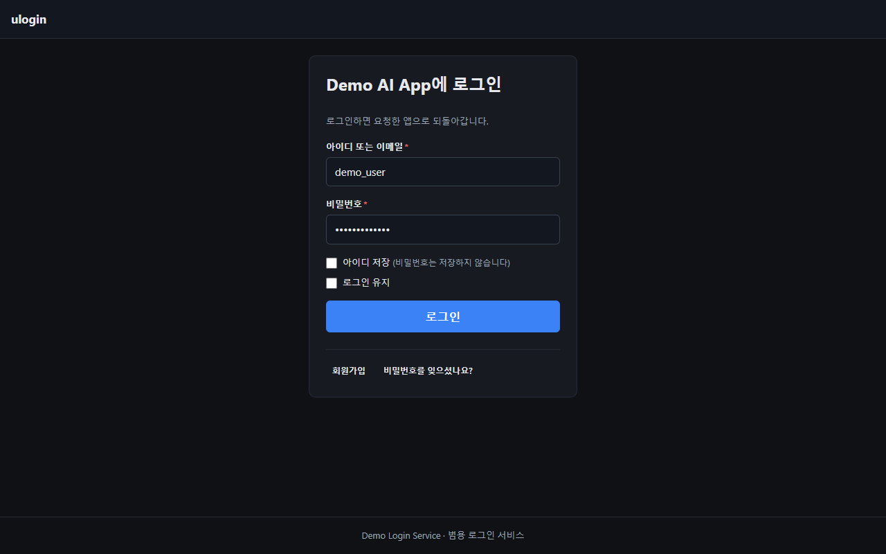 | **더 말한다.** SSO로 진입하면 헤더가 "Demo AI App에 로그인"으로 바뀐다. [2-2](#2-2-sso에-일회용-code-교환-단계를-왜-뒀는가)의 왕복에서 사용자는 **자기가 열지 않은 화면**에 도착한다. 어느 앱이 요청했는지를 밝히지 않으면 그 화면은 피싱과 구분되지 않는다. 이 문구는 `sso/validate.php`가 화이트리스트 **완전 일치**를 확인한 뒤에야 나오므로, 표시된 서비스명은 등록된 서비스의 것이다 |
| 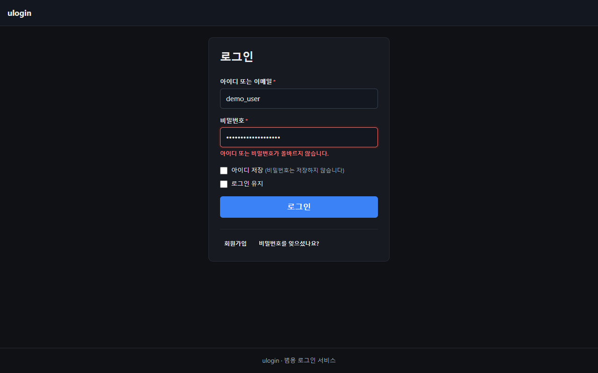 | **덜 말한다.** 아이디가 없는 경우와 비밀번호가 틀린 경우가 **같은 문구**로 돌아온다. 구분해 주면 로그인 폼이 곧 **계정 존재 여부 조회 API**가 된다. 다만 응답 시간 차이로 인한 열거 가능성은 남아 있고, 그것은 [5-8](#5-8-남긴-것--정직한-잔여-목록)에 잔여 항목으로 적었다 — 화면 문구가 닫은 것은 **명시적 누설**뿐이다 |

### 4-3. 마이페이지 — 3축이 항상 보이고, 그 축은 여기서 못 바꾼다

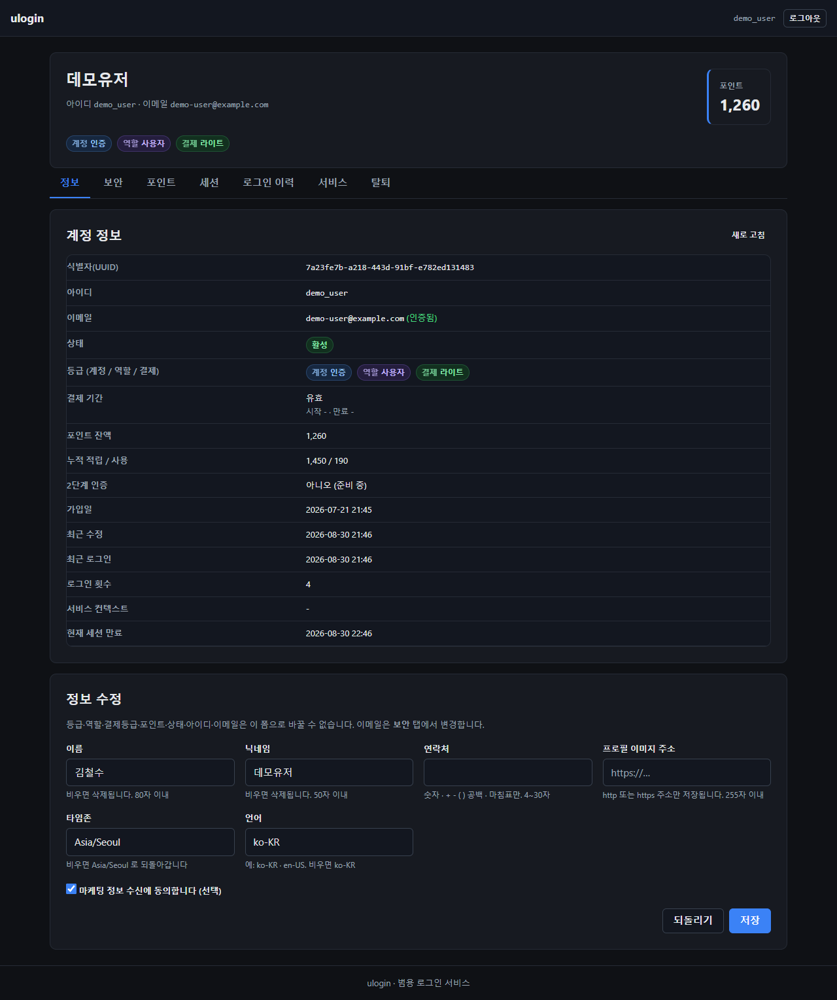

[2-1](#2-1-3축-권한-모델--왜-하나로-합치지-않았는가)에서 계정등급 · 역할 · 결제등급을 합치지 않기로
한 결정이 화면에서 확인되는 자리가 여기다. **7탭 전부가 상단에 세 배지를 함께 띄운다** — 하나로
합쳤다면 배지도 하나였을 것이고, 사용자는 "내가 무엇을 통과하지 못해 그 기능이 안 보이는지"를
알 수 없었을 것이다.

그리고 같은 화면이 **바꿀 수 없는 것**을 보여준다. 정보 수정 폼에 등급 · 역할 · 포인트 · 아이디 ·
이메일이 **없다.** 서버도 그 필드들을 화이트리스트에서 제외하지만, 화면에 두고 서버에서만 막으면
"보이는데 안 되는" 상태가 되고 그 상태는 반드시 시도된다. 이메일 변경이 왜 별도 경로(보안 탭)로
분리되어야 했는지는 [5-3](#5-3-c-2--h-3--이메일-변경을-통한-수평수직-권한-상승)의 Critical이 답한다.

### 4-4. 관리자 콘솔 — 권한 모델이 화면 구조에 그대로 나온다

| 화면 | 어떤 결정의 결과인가 |
|---|---|
| 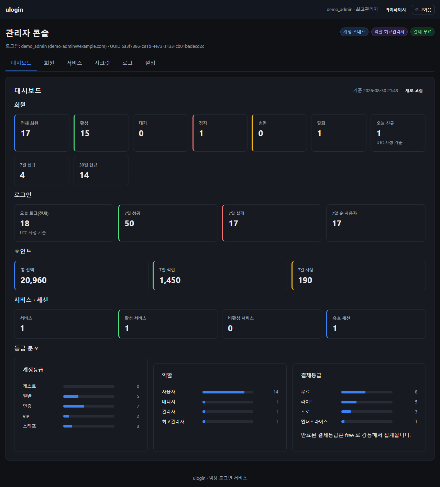 | 통계 화면의 등급 분포가 **막대 세 묶음**이다. 3축이 서로 독립이므로 하나의 분포로 합칠 수 없다 — 화면이 데이터 모델을 숨기지 않는다 |
| 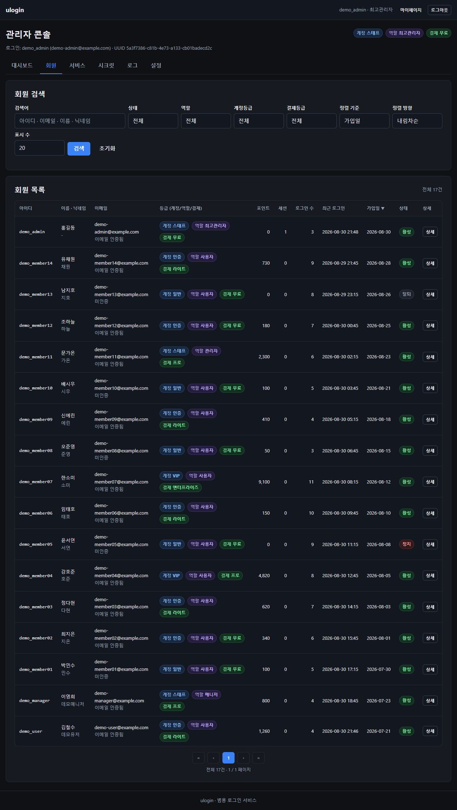 | 필터가 **상태 · 역할 · 계정등급 · 결제등급**을 각각 독립적으로 건다. "등급" 필터 하나였다면 운영자가 "결제는 유료인데 계정등급이 아직 basic인 사람"을 찾을 방법이 없다 |
| 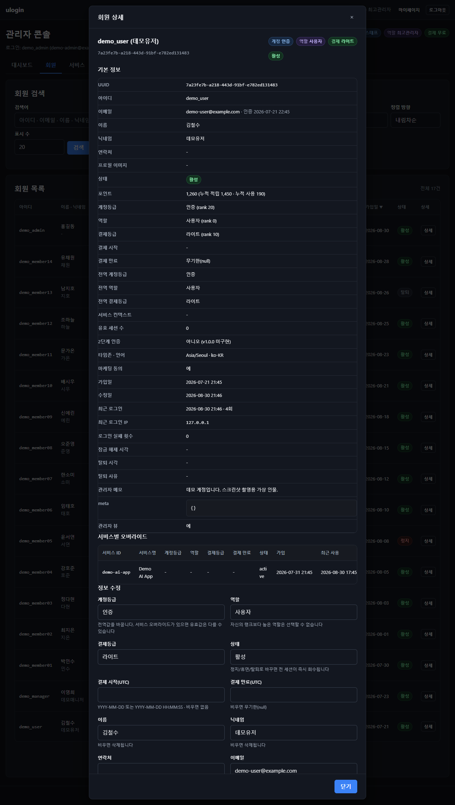 | 전역 값과 **서비스별 오버라이드 표**가 한 화면에 함께 있다. [3-5](#3-5-유효-등급-계산-순서)의 계산 순서(전역 → 오버라이드 → 결제 만료 강등 → 차단)는 **두 값을 나란히 보지 않으면 검증할 수 없다.** 오버라이드가 grant-only인 이유도 이 화면에서 눈으로 확인된다 |

**권한에 따라 탭 자체가 줄어든다.** 콘솔은 6탭(대시보드 · 회원 · 서비스 · 시크릿 · 로그 · 설정)이지만,
`manager`로 로그인하면 **대시보드 · 회원 · 로그** 3탭만 그려지고 관리자 조작 로그 서브탭도 사라진다.
기준값의 출처는 리포트가 아니라 `server/api/admin/*.php`의 서버측 역할 가드다. 다시 세려면:

```bash
# 저장소 루트에서
grep -n 'MIN_RANK = {' -A 12 public/admin.html                      # 탭별 최소 role_rank
grep -rn 'require_global_role($ctx' server/api/admin                # 그 값의 출처 (진입 가드)
grep -rn 'role_gte(ctx_global_role' server/api/admin                # 분기 안에서 더 좁히는 자리
```

두 번째 명령에서 `'manager'`로 열리는 파일(`stats.php` · `users.php` · `logs.php`)이 곧
`manager`에게 남는 세 탭이고, `'admin'`으로 잠긴 `services.php` · `secrets.php` · `settings.php`가
사라지는 세 탭이다. 세 번째 명령의 `role_gte(...)`는 **같은 파일 안에서 한 단계 더 좁히는** 자리다 —
`logs.php`는 진입을 `manager`로 열어 두고 관리자 조작 로그만 `admin` 이상으로 잠그고,
`secrets.php`는 진입이 `admin`이지만 평문 조회만 `superadmin`으로 잠근다.

**화면 차단은 편의일 뿐 실제 방어는 서버다.** 탭을 숨겨도 서버가 403을 돌려주지 않으면 아무것도
막지 못하므로, 두 층을 모두 두고 값의 출처를 한쪽(서버)으로 통일했다.
**다만 이 축소는 촬영본에 없다** — 공개된 35장은 전부 `superadmin` 세션이라 6탭이 모두 보인다.
`manager` 화면은 이 라운드에서 촬영하지 못했고, [9-1](#9-1-검증하지-못한-것--정직하게)의 성격과 같은
**미촬영**으로 남겨 둔다.

### 4-5. 시크릿 금고 — 마스킹이 기본값이고, 노출은 조건이다

**이 두 장은 반드시 함께 봐야 한다.** 오른쪽만 떼어 놓으면 "시크릿 평문을 화면에 뿌리는 콘솔"로
읽히는데, 실제 설계는 정확히 그 반대다.

| 기본 상태 | 예외 경로 |
|---|---|
| 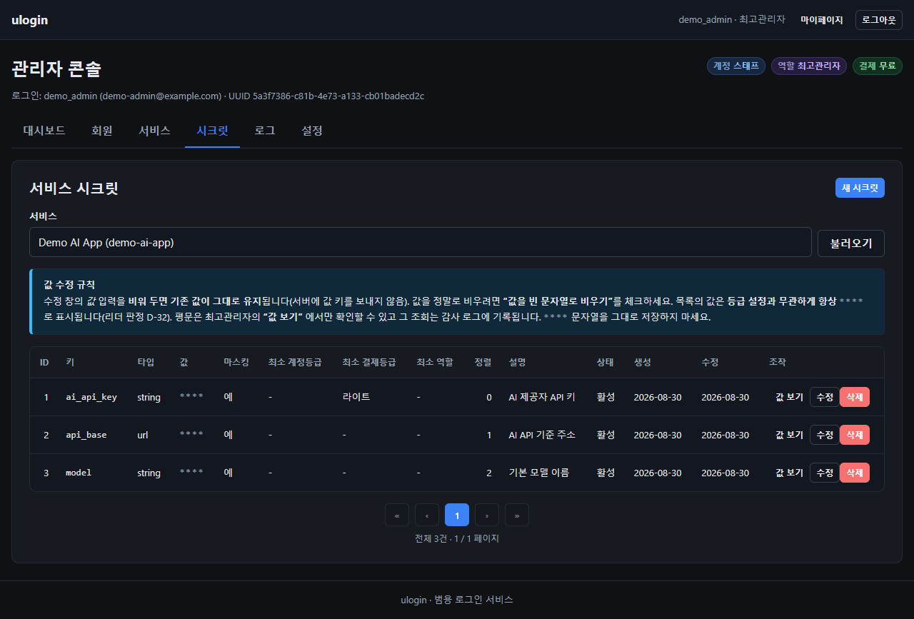 | 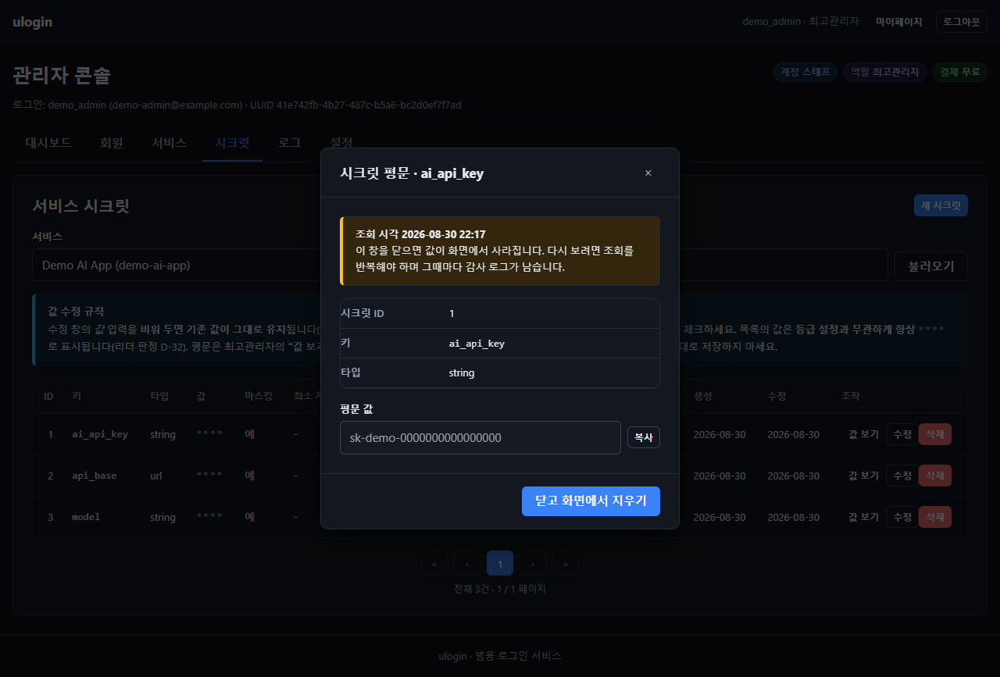 |
| **목록 · 상세 · 생성 · 수정 응답의 `secret_value`는 항상 `****`다.** 등급과 무관하고, 관리자 등급과도 무관하다. 마스킹은 화면의 표시 규칙이 아니라 **API 응답의 규칙**이다 | **`?action=reveal` 한 경로에서만 평문이 나간다. superadmin 전용**이고, 조회 사실이 `admin_logs`에 `secret.reveal`로 기록된다 — **값은 기록하지 않는다.** 모달 뒤의 목록은 여전히 `****`이고, 화면의 경고문 자체가 "그때마다 감사 로그가 남습니다"를 인쇄한다. 표시된 값 `sk-demo-…`는 데모용 가짜다 |

평문 경로를 **하나로 좁힌 것**이 핵심이다. 반환 경로가 여럿이면 그중 하나에 감사 로그를 붙이는 것을
잊는 순간 우회로가 생기고, 실제로 그 형태의 결함이
[5-5](#5-5-h-2--시크릿-마스킹-우회와-감사-로그-회피)에서 발견됐다. 값을 감사 로그에 남기지 않는 것도
같은 이유다 — 남기면 **로그가 두 번째 금고**가 되고, 그 금고에는 암호화가 없다.

### 4-6. 로컬 AI 앱 데모 — 요구사항 한 줄이 화면에서 닫힌다

이 프로젝트의 존재 이유는 한 문장이다 — **"인증된 사용자에게만, 그 사용자의 등급에 맞는 시크릿을
반환한다."** 세 장이 그 문장의 앞·가운데·뒤를 각각 보여준다.

| 화면 | 무엇이 닫히는가 |
|---|---|
| 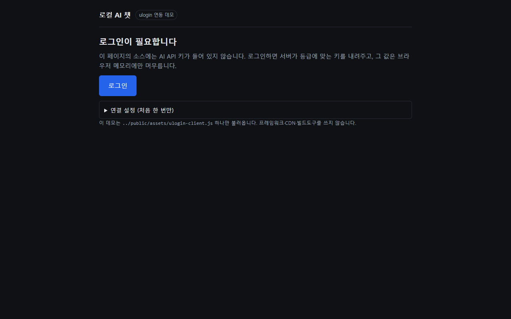 | **앞** — 로그인 전 화면은 "이 페이지의 소스에는 AI API 키가 들어 있지 않습니다"를 인쇄한다. [1-1](#1-1-출발점--배포하는-순간-키가-공개된다)이 지적한 문제가 이 지점에서 사라진다. 배포된 JS를 뜯어도 가져갈 것이 없다 |
| 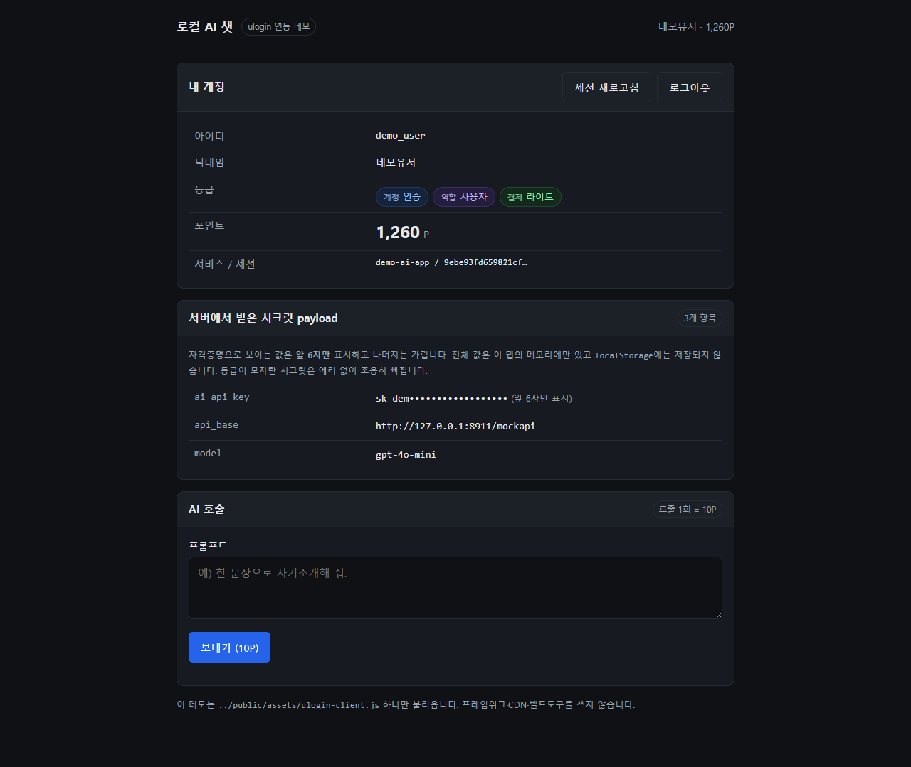 | **가운데** — 3축 배지와 포인트, 그리고 서버가 내려준 `payload`가 함께 보인다. 키는 **앞 6자만** 표시되고 `localStorage`에 들어가지 않는다. 등급이 모자란 키는 에러가 아니라 **응답에서 빠진 채로** 도착하므로, 화면에 보이는 항목이 곧 이 사용자가 통과한 게이트의 목록이다 |
| 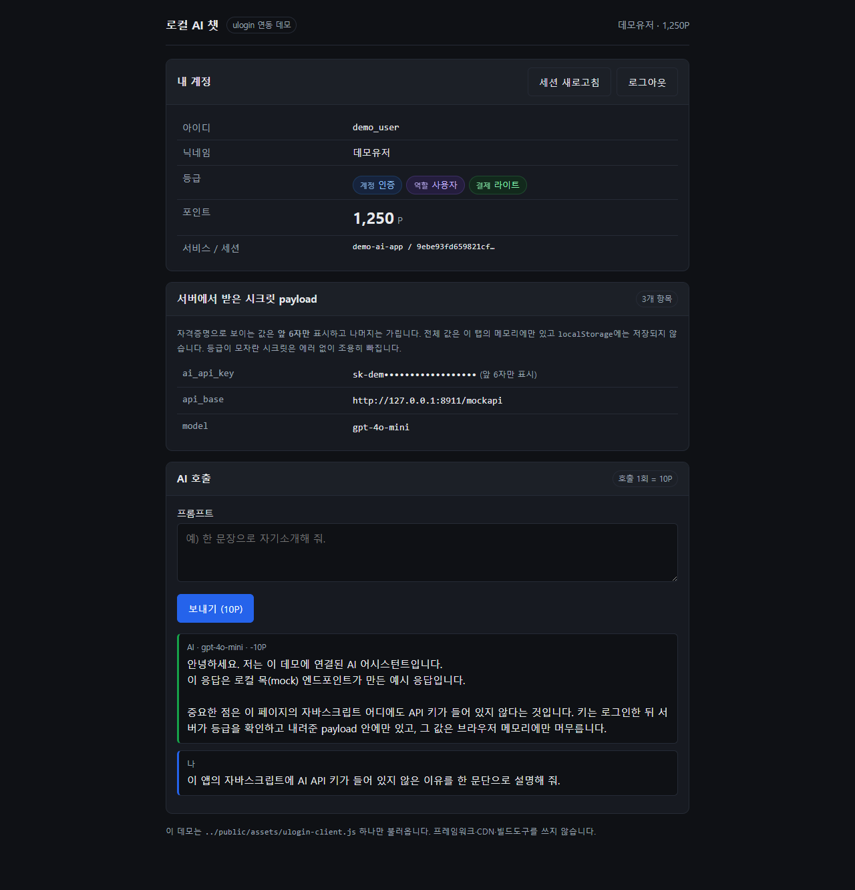 | **뒤** — 프롬프트 전송 시 포인트가 먼저 깎이고(1,260 → 1,250) 그 다음 AI가 호출된다. 순서가 반대였다면 잔액이 모자란 사용자도 호출을 한 번 성공시킨다. 이 장의 AI 응답은 **로컬 목(mock) 엔드포인트**가 만든 것이고(`api_base` 값이 화면에 보인다), ulogin 쪽 동작 — 등급 확인 · payload 전달 · 포인트 차감 — 은 전부 실제 서버가 처리했다 |

**이 3장은 실제 SSO 왕복을 거쳐 촬영됐다.** 앱의 로그인 버튼 → `public/login.html`(PKCE
`code_challenge` 포함) → 로그인 → `examples/callback.html` → 앱 복귀. 촬영 절차와 각 장의 단언 방식은
`docs/screenshots/INDEX.md`에 적혀 있다. **화면 자체가 증거를 담고 있다는 점이 중요하다** — 키가
가려진 상태(`sk-dem…`), 차감 전후 잔액, 그리고 목 엔드포인트의 `api_base` 값이 모두 같은 프레임에
찍혀 있어, 캡션이 화면 밖 사실을 혼자 주장하지 않는다.

---

## 5. 보안 설계와 실제로 막은 것

### 5-1. 집계

보안 감사를 **7회차** 돌렸다(v1.0.0 1·2회차, v1.1.0 3회차, v1.2.0 4회차, v1.4.0 5·6회차,
v1.6.0 7회차). v1.3.0(공개 패키징)과 v1.5.0(회귀 스위트)은 코드를 바꾸지 않았다.

| 회차 | 대상 | 신규 발견 | 배포 차단 |
|---|---|---|---|
| 1회차 | `v1.0.0` 전체 | 26건 (Critical 2 · High 5 · Medium 12 · Low 7) | **7건** |
| 2회차 | 수정 결과 재검증 + 신설 `install.php` | 6건 (**Critical 1** · Medium 4 · Low 1) | **1건** |
| 3회차 | v1.1.0 쿠키 전송 경로 | 7건 (Medium 1 · Low 6) | 0건 |
| 4회차 | v1.2.0 캐시·배포 반영 변경분 | 3건 (Medium 1 · Low 2) | 0건 |
| 5회차 | v1.4.0 변경분 + 신설 `migrate.php`·`health.php` | **High 3** 외 Medium·Low | **3건 → 배포 보류 판정** |
| 6회차 | 그 3건의 수정 재검증 | 보류 3건 **전부 수정확인**. 그러나 **신규 High 1** + Medium 4 + 문서 조건 1 | **다시 보류** — 남은 것이 「코드 2행 + 문서 1문장」이라는 판정과 함께 |
| 7회차 | v1.6.0 신설 `settings_bundle.php` + `core/` 3파일 | **High 3** + Medium 6 + Low 5. **High 3 중 2건이 이 라운드의 대표 방어를 무력화한다** | **3건 → 조건부 배포 가능.** 리더가 **H-1을 Critical로 상향**했고, 셋 다 같은 폴더에서 닫혔다([5-11](#5-11-v160--게이트를-건-척이-두-형태-더-있었다)) |

**5회차가 「배포 보류」를 냈다.** 미해결 Critical은 0이었지만 **그 라운드가 새로 연 표면**에
High 3건이 있었고, D-63에 따라 **같은 폴더에서** 닫았다. 그 셋의 내용과 재현은
[5-10](#5-10-v140--이-라운드가-만들고-이-라운드가-닫은-high-3건)에 있다.

**6회차가 그 셋을 전부 수정확인하고, 그 자리에서 High 1건을 새로 찾았다** —
시크릿 전달 감사 로그가 **갱신 요청과 1:1로 늘고 정리가 없다**(유효 계정 하나로 하루 43만 행).
그것과 함께 발견된 Medium 4건도 같은 폴더에서 닫혔다(위 5-8절의 두 행).
**보안이 배포 조건으로 걸었던 문서 1문장**(「`disabled`는 시크릿 차단 스위치이고 토큰 회수 도구가 아니다」)도
같은 라운드의 문서 수정에서 `INSTALL.md` 7-14절에 들어갔다.

**같은 라운드에 QA 통합 정합성 검증이 1회 돌았다.** 판정은 **배포 보류**였고
High 3 · Medium 6 · Low 1이었다. **기능 회귀는 0건**이고 막은 것은 대부분
**「서버가 만든 것을 화면이 쓰지 않는다」** 한 종류였다 — 그 라운드에서 백엔드가 만든 네 산출물이
관리자 콘솔에 한 곳도 연결되지 않았고, 그중 둘은 화면이 **「서버가 그것을 주지 않는다」는 문구를
그대로 띄우고** 있었다(프론트가 정직하게 적어 둔 당시의 사실이 백엔드 수정으로 거짓이 된 것이다).
그 셋과 필터·주석은 이 라운드의 프론트 수정에서 닫혔다. **리더는 이것을 개별 결함이 아니라
규약의 공백으로 판정했다** — 「생산자를 배정하면 그 산출물의 소비자도 같은 표에 배정한다」가 신설됐다.

> **정직하게 적는다 — 6회차 이후의 수정은 독립 재검증을 받지 않았다.**
> 신규 High 1건 + Medium 4건의 수정, 프론트 수정, 문서 수정의 근거는 **각 담당 자신의 실측**이다
> (수정을 도려낸 대조군을 함께 띄우고, v1.3.0 서버와 동시 기동해 응답 shape 26케이스 DIFF 0을 확인했다).
> **보안 7회차와 QA 2회차는 돌지 않았다.**
> **「현재 미해결 Critical 0 / High 0」을 v1.4.0에 대해 단언하지 않는다** —
> v1.3.0까지는 그것이 4회차 감사의 확정 판정이었고, v1.4.0은 아직 그 상태가 아니다.
> 라운드가 어떻게 끝났는지의 전수 기록은 [`../CHANGELOG.md`](../CHANGELOG.md)의 `v1.4.0` 절
> **「검증 라운드가 어떻게 끝났나」** 표에 있다.

**v1.3.0까지의 집계: 총 42건 발견, 배포 차단 8건 전부 수정 확인, 미해결 Critical 0 / High 0.**

발견 ID 전수(v1.3.0까지, 실측): `C-1 C-2 C-3` · `H-1 H-2 H-3 H-4 H-5` ·
`M-1`~`M-16` · `L-1`~`L-8` · `V11-M-1` · `V11-L-1`~`L-6` · v1.2.0 `V12-M-1` ·
`V12-L-1` · `V12-L-2`.
**v1.4.0 라운드의 ID:** `V14-H-1`~`H-3` · `V14-M-1`~`M-4` · `V14-L-1`~`L-4` ·
6회차 재검증의 `V14b-H-1` · `V14b-M-1`~`M-4` · QA의 `Q14-1`~`Q14-10`.
**이 목록은 라운드가 끝난 뒤에 적은 것이다.** 각 항목의 상태는 위 5-8절과
[`../CHANGELOG.md`](../CHANGELOG.md)의 `v1.4.0` 절에 있다.

**v1.6.0 라운드:** 보안 7회차가 High 3(`V16-H-1`~`H-3`) · Medium 6 · Low 5를 냈고,
같은 라운드에 QA 통합 검증이 1회 돌아 **배포 가능(조건부 1건)** 을 냈다.
QA의 과제는 이 라운드에 특별했다 — **「다른 AI가 이 가이드만 읽고 만든 JSON을 서버가
받아들이는가」**를 실 서버 + 실 DB로 재는 것이었다(리더 판정). 결과는 유효 예시 4/4 통과,
실패 예시의 오류 코드 19/19 일치, dry-run 강제 우회 17수법 17/17 차단이었고,
**막은 하나(`Q-1`)는 검증도 권한도 아니라 「가이드가 스스로 제시한 완전 예시를 두 번
적용하면 서버가 스스로 건 안전장치를 스스로 벗긴다」는 멱등성 결함**이었다.
그 셋과 High 3은 전부 이 폴더에서 닫혔다.

> **정직하게 적는다 — v1.6.0의 수정도 독립 재검증을 받지 않았다.**
> 보안·QA는 이 라운드에 **각 1회**만 돌았고, 그 뒤의 수정(High 3 · Q-1 · JS 패리티)의
> 근거는 **각 담당 자신의 실측**이다. 다만 v1.4.0과 다른 것이 하나 있다 —
> **그 실측이 회귀 스위트의 케이스로 남았다.** 백엔드가 변이 17종, 프론트가 변이 8종을
> 심어 전부 잡히는 것을 확인했고, 잡히지 않는 변이 1건을 **「잡았다」로 세지 않고
> 목록에서 뺐다.** 그래서 다음 라운드가 같은 결함을 되살리면 스위트가 빨개진다 —
> **v1.4.0에는 그 장치가 없었다.**

아래는 **재현 시나리오와 함께** 적는다. "무엇을 막았다"보다
**"어떻게 발견했는가"** 가 더 많은 것을 말한다.

**읽는 순서.** 5-2 ~ 5-7은 v1.0.0 ~ v1.2.0 라운드의 기록이고,
**v1.4.0 라운드에서 막은 것은 [5-9](#5-9-v140--이미-공개된-코드에-있던-critical-1건과-high-2건)와
[5-10](#5-10-v140--이-라운드가-만들고-이-라운드가-닫은-high-3건)에 있다.**
5-8의 잔여 목록은 v1.4.0 기준으로 갱신했다.
**절 번호를 다시 매기지 않은 이유는 다른 문서가 `5-6`·`5-8`을 이름으로 인용하기 때문이다** —
번호를 밀면 그 인용이 조용히 다른 절을 가리킨다.

### 5-2. C-1 — 세션 인증자가 관리자 응답에 평문으로 실려 있었다

**심각도 Critical. `manager`(최저 관리 권한)가 `superadmin`을 완전히 탈취할 수 있었다.**

#### 무엇이 문제였나

쿠키 세션의 인증 조회가 `WHERE session_id = ?` 였다. 즉 **`session_id`가 인증자**였다.
그런데 같은 `session_id`가 두 곳에 실려 나갔다 — `serialize_session()`의 응답 필드,
그리고 `GET /api/admin/user_detail.php`(**manager 권한**)의 타인 활성 세션 목록.

#### 재현

```
1. role=manager 로 로그인 (관리자 콘솔 최저 권한)
2. GET  /api/admin/users.php?role=superadmin        → 대상 uuid 획득
3. GET  /api/admin/user_detail.php?uuid={대상}
        → data.active_sessions[0].session_id = "a3f1…" (64 hex)
4. 브라우저 쿠키를 ULOGIN_SID=a3f1… 로 교체, Authorization 헤더 없이
   GET /api/auth/session.php
5. 200 OK. data.user.role = "superadmin"
   → 이후 하드 삭제, 시크릿 평문 조회(reveal)까지 전부 통과한다
```

부수 피해가 하나 더 있었다. **`session_id`는 DB에 평문으로 저장된다.**
다른 토큰은 SHA-256인데 실제로 인증에 쓰이는 값만 평문이었다 —
DB 덤프 유출이 곧 **살아 있는 세션 다발**이 된다.

#### 어떻게 발견했나

보안 감사가 **"시크릿 노출 경로 8단계"** 를 하나씩 판정하다가 잡았다.
그중 6번이 "클라이언트 저장"이었고, `ulogin-client.js`가 `session_id`를
`localStorage`에 저장하는 것을 확인한 뒤 **"이 값은 인증에 쓰이는가"** 를 역으로 물었다.
코드 주석은 "이 값으로 인증할 수 없다"고 단언하고 있었다. **그 단언이 거짓이었다.**

> **교훈:** 주석의 단언은 검증 대상이다. "안전하다"고 적힌 곳을 먼저 의심해야 한다.

#### 수정

쿠키에 담는 값을 `session_id` → `access_token` **원문**으로 바꾸고,
인증 조회를 `WHERE access_token_hash = ?` **한 문장으로 통일**했다(`D-29`).
분기가 둘이면 한쪽만 고쳐지는 사고가 난다 — Bearer 분기와 쿠키 분기를 합쳤다.

**역검증을 지시에 명시했다** — "예전처럼 `session_id`를 쿠키에 넣으면 401이 나야 한다".
수정 확인은 "새 경로가 동작한다"가 아니라 **"옛 공격이 실패한다"** 로 판정했다.
감사 2회차가 이 역검증을 재현했다: `token_hash(session_id)`가 어떤 `access_token_hash`와도
일치하지 않아 `AUTH_REQUIRED`(401).

#### 부수 결함 하나가 함께 드러났다

D-29로 쿠키 내용이 바뀌자, CSRF 토큰 조회 2곳이 여전히 `WHERE session_id = ?` 였다.
그러면 **0건 매치 → CSRF가 세션 바인딩에서 이중 제출 쿠키로 조용히 격하**된다.
검증 자체는 계속 통과하므로 **아무도 눈치채지 못한다.**
같은 라운드에서 함께 고쳤고(`D-42`), 변수명을 `$sid` → `$ck`로 바꿔
"이 값은 세션 ID가 아니다"를 코드에서 드러냈다.

> **이것이 이 프로젝트에서 가장 위험한 결함 유형이다** —
> **동작은 하는데 방어 층이 한 겹 벗겨진 상태.** 테스트는 통과한다.

### 5-3. C-2 / H-3 — 이메일 변경을 통한 수평·수직 권한 상승

**심각도 Critical. `admin`이 `superadmin`을, 그리고 다른 `admin`을 탈취할 수 있었다.**

#### 재현

```
1. role=admin 으로 로그인 (superadmin 아님)
2. PUT /api/admin/user_detail.php?uuid={superadmin-uuid}
   본문 {"email":"attacker@example.com"}
   → 200 OK, changed_fields:["email"]
3. POST /api/auth/password_forgot.php {"email":"attacker@example.com"}
   → 재설정 토큰이 공격자 주소로 발급된다
4. 그 링크로 POST /api/auth/password_reset.php
   → superadmin 의 비밀번호를 공격자가 설정한다
```

**진입부의 권한 검사(`require_global_role()`)는 10개 관리자 파일 전부에 있었다**(감사가 전수 확인).
없었던 것은 **대상 계정의 랭크 방어**다. `role` 변경과 파괴적 `status` 전이에만 가드가 있었고,
`email`·`account_level`·`billing_tier`·`memo` 경로에는 없었다.

> **함수 이름을 짧게 줄여 적으면 안 되는 자리다.** `server/core/perm.php`에는 이름이 비슷한
> `require_role()`도 있지만 **판정 기준이 다르다** — 그쪽은 effective role이라 **서비스 오버라이드를
> 반영한다.** 관리자 API가 그것을 쓰면 어떤 서비스에서 `admin` 오버라이드를 받은 사용자가
> **로그인 서버 전체의 관리자**가 된다. 그 자체가 이 절이 다루는 종류의 권한 상승이고,
> 그래서 관리자 API는 전역 `users.role`만 보는 함수로 통일돼 있다(`D-50` / 감사 `M-13`).
> 다시 확인하려면 — 저장소 루트에서:
>
> ```bash
> grep -rn 'require_global_role($ctx' server/api/admin   # 10개 파일에 12건
> grep -rn 'require_role(' server/api/admin              # 0건 (종료코드 1)
> ```

**공격자가 전제 조건을 스스로 만들 수 있다는 점이 심각도를 올렸다** —
3단계에서 메일이 실제로 도착해야 하는데, `mail_driver`를 `mail`로 바꾸는 것도 `admin` 권한이다.

#### 수정과, 내가 준 검증 케이스가 틀렸던 일

판정은 **"대상 계정을 변경하는 모든 관리자 경로의 진입부에 공통 가드"** 였다(`D-30`).

> 자신과 **같거나 높은** `role_rank`를 가진 **다른** 계정은 어떤 변경도 할 수 없다.

**필드마다 가드를 흩뿌리지 않은 이유:** 필드가 추가될 때마다 구멍이 생긴다.
이번 결함이 정확히 그렇게 생겼다.

그런데 이 판정에는 **자기모순이 있었다.** 함께 준 검증 케이스가
"`admin` → 다른 `admin`에 무변경 저장 → **200**"이었다. 담당 에이전트가 그 모순을
정확히 지적하고 **D-30을 우선해 403으로 구현했다.** 그 선택이 옳았다(`D-41`).

이유: 동급 `admin`끼리 서로의 `email`을 바꿀 수 있으면,
C-2에서 막은 **수직 탈취(admin → superadmin)와 동일한 공격이 수평(admin ↔ admin)으로
그대로 남는다.** 이메일 변경 → 비밀번호 찾기 경로는 **대상의 랭크와 무관하게 성립**한다.

**가드 사본의 동일성을 검증했다.** 진입부 가드는 4개 파일에 사본으로 들어간다
(`install.php`가 `core/`를 로드하지 않는 구조적 제약 때문에 공용 파일로 뺄 수 없었다).
**하나만 옛 로직이면 그 경로로 뚫린다.** 그래서 사본의 본문을 문자 단위로 대조하고,
QA가 함수 10종 · 사본 35개의 **본문 SHA-256 불일치 0건**을 확인했다.

### 5-4. C-3 — 기본 설치가 AI 키를 무조건 공개하고 있었다

**심각도 Critical. 이 프로젝트의 존재 이유를 정면으로 무너뜨리는 결함이었다.**

#### 재현 — 추가 조건이 없다

```
1. 관리자가 설치기 7단계에서 실제 AI 키를 입력한다
   ← 그 화면이 "이 값을 서버에 두는 것이 이 시스템의 존재 이유"라고 안내한다.
     즉 정상 사용 흐름이다
2. 공격자가 그냥 가입한다
   POST /api/auth/register.php  → 200, status=active, account_level=basic
3. POST /api/auth/login.php {"username":…,"service_id":"local-ai-app"}
4. 응답 payload.ai_api_key = "sk-…"   ← 평문
```

세 가지가 겹쳐 성립했다.

- 설치기가 시크릿을 `min_account_level` · `min_role` · `min_billing_tier` **전부 NULL**로 INSERT
- `min_*`가 비어 있으면 `build_payload()`가 **등급 검사를 건너뛴다**(그 자체는 정상 동작)
- `allow_register` 기본값이 켜져 있고 첫 서비스가 `auto_join=1`

**즉 가입 폼을 채우는 것이 곧 AI 키를 받는 절차였다.** 감사 로그에는 정상 로그인으로만 남는다.

#### 왜 1회차에 안 나왔나

1회차 시점에 **`install.php`가 존재하지 않았다**(그것 자체가 1회차의 Medium `M-12`였다).
시크릿 노출 경로 8단계 중 7번(등급 판정)은 "코드가 `min_*`를 검사하는가"만 봤고 통과했다.
**"배포되는 기본 데이터가 `min_*`를 비워 둔다"** 는 것은 설치기가 생긴 뒤에야 확인 가능했다.

> **교훈:** 코드가 통제를 구현하는 것과, **기본값이 그 통제를 켜는 것**은 다른 문제다.
> 감사 범위에 "설치기가 심는 초기 데이터"가 들어가야 한다.

#### 수정 — 한 곳만 고치면 되살아난다

세 층에 나눠 넣었다(`D-47` / `D-54`).

| 층 | 조치 |
|---|---|
| **설치기** | 7단계가 시크릿마다 등급 게이트를 받는다. 민감 키(`*_api_key` · `*_secret` · `*_token` · `*_password`)는 기본 `min_billing_tier='lite'`. 게이트를 비우려면 **명시적 확인** |
| **관리자 API** | 같은 검사를 `POST /api/admin/secrets.php`에도 넣었다. 설치기만 막으면 API로 그냥 우회된다. **PUT으로 기존 게이트를 전부 지우는 요청도 같은 검사를 받는다** — 생성만 막고 수정을 열어두면 의미가 없다 |
| **문서** | "게이트 없는 시크릿 = 가입한 모든 사용자에게 공개"를 문서 4종에 명시 |

**랭크 0 게이트를 게이트로 인정하지 않는다.** `free` / `guest` / `user`는 랭크 0이라
전원 통과다. 그것을 게이트 칸에 적는 것은 **"게이트를 건 척"** 하는 우회이므로
설치기와 API가 이 값을 게이트로 세지 않는다.

> **이 기준은 v1.6.0에서 두 번 좁아졌다. 위 문단은 v1.4.0 시점의 기록이다.**
> 「랭크 0 초과」는 **`basic`(랭크 10)을 빠뜨렸고**, `basic` 은 계정등급의 스키마
> 기본값이자 회원가입 코드가 신규 가입자에게 박는 값이다 — 즉 **랭크가 0이 아니면서
> 전원 통과인 값**이 하나 있었다. 현재 기준은 **「각 축의 모집단 기본값 초과」**이고,
> 여기에 **「같은 서비스의 `default_account_level` 이 그 축을 자동 부여하지 않을 때」**가
> 붙는다. 경위는 [5-11](#5-11-v160--게이트를-건-척이-두-형태-더-있었다)에 있다.

담당 에이전트가 지시 밖에서 추가로 막은 것도 있다 — **비민감 키를 민감한 이름으로 개명하는
PUT 우회**(`api_base` → `stolen_token`). `secret_key` 변경도 게이트 검사 대상에 포함된다.

#### 고치지 않은 것과 그 이유

`build_payload()`를 **"게이트 없으면 거부"로 바꾸지 않았다.**
그러면 `api_base` · `model` 같은 공개 설정값을 내려줄 방법이 없어지고,
사용자가 우회하려고 모든 등급을 낮춰 **결국 더 위험해진다.**
게이트는 **등록 시점에** 올바르게 정하게 만드는 것이 맞다.

### 5-5. H-2 — 시크릿 마스킹 우회와 감사 로그 회피

**심각도 High.**

시크릿 목록·상세 응답이 `is_masked=0`인 시크릿의 **평문을 그대로 실었다.**
그러면 `admin` 권한이 **감사 로그 없이** 목록 화면에서 키를 통째로 볼 수 있다.
게다가 `admin`이 스스로 `is_masked=false`로 PUT한 뒤 목록을 조회하면,
`superadmin` 전용 `reveal` 경로와 `secret.reveal` 감사 로그를 **양쪽 다 우회**한다.

**판정:** `is_masked` 값과 무관하게 목록·상세·생성·수정 응답의 `secret_value`는
**항상 `****`** (`D-24` / `D-32`). 평문은 `?action=reveal`(superadmin + 감사 로그 기록)
**한 경로**에서만 나간다.

`is_masked` 컬럼은 지우지 않고 **UI 힌트**("값 보기 버튼을 띄울지")로만 남겼다.
그것은 애초에 화면 표시 편의 플래그였고 **보안 경계로 쓸 수 없다.**

이 판정 뒤에 QA가 후속 결함 하나를 잡았다 — 콘솔의 안내 문구가 여전히
**"`****`로 보이는 것은 마스킹 설정 때문"** 이라고 적고 있었다.
동작은 옳은데 **문구가 관리자에게 "설정을 끄면 값이 보인다"고 오해를 유도**한다.
값 노출은 일어나지 않으므로 동작 결함은 아니지만, 잘못된 정신 모델을 심는 문구는 결함이다.

### 5-6. PHP 7.2에서 쿠키 보호 속성이 조용히 사라지던 문제

**실제 결함. 그리고 정적 grep으로는 판정할 수 없었던 항목.**

#### 무엇이 문제였나

호스팅의 실제 PHP가 **7.2.34**로 확인되어 최소 요구 버전을 내리는 작업을 했다.
그 과정에서 블로커 하나가 나왔다.

```php
setcookie($name, $value, ['expires'=>…, 'path'=>…, 'secure'=>…, 'httponly'=>…, 'samesite'=>…]);
//                        ↑ 이 옵션 배열 형식은 PHP 7.3 부터만 동작한다
```

**7.2에서는 이 배열이 세 번째 인자 `$expires`로 넘어가 정수로 캐스팅된다.**
결과:

- **`SameSite`가 통째로 사라진다** → CSRF 심층 방어가 한 겹 벗겨진다
- **`HttpOnly`가 빠진다** → XSS가 세션 쿠키를 읽을 수 있게 된다
- **`Secure`가 빠진다** → 평문 연결에 세션 쿠키가 실린다
- `path`도 기본값으로 떨어진다

**오류가 하나도 나지 않는다.** 로그인은 성공하고 화면도 정상이다.
`Set-Cookie` 헤더를 눈으로 보지 않으면 알 방법이 없다.

#### 수정 — path 해킹을 쓰지 않았다

널리 쓰이는 우회는 `$path . '; SameSite=Lax'` 로 속성을 밀어 넣는 것이다.
**쓰지 않았다** — 일부 SAPI·프록시가 path를 정규화하면서 조용히 깨진다.
**쿠키는 조용히 깨지면 원인을 찾기 어렵다.**

대신 **양방향 호환 래퍼 하나**를 만들어 한 곳에서 분기했다(`D-59`).

```
send_cookie()  ─ PHP_VERSION_ID >= 70300 ─→ setcookie($name, $value, $optionsArray)
               ─ PHP_VERSION_ID <  70300 ─→ header('Set-Cookie: …', false) 로 직접 조립
```

옵션 배열을 **만드는 책임**(`cookie_options()`)과 **전송하는 책임**(`send_cookie()`)을 분리했다.
세션 쿠키·CSRF 쿠키의 발급과 삭제가 모두 이 한 함수를 지난다.

#### 그리고 "동등성"을 관측에서 불변식으로 바꿨다

여기가 이 항목에서 가장 중요한 부분이다.

구현 담당이 두 분기가 같은 헤더를 내는지 16케이스로 대조하고 **전부 일치**를 보고했다.
그런데 보안 감사가 그 대조를 **독립적으로 재현하고 50케이스로 확장**하자
**7건이 갈라졌다.** 갈라진 입력은 전부 "이 시스템이 만들어낼 수 없는 값"이었지만,
그 사실 자체가 **"동등성은 관측일 뿐 보장이 아니다"** 를 뜻했다.

| 갈라진 입력 | 7.3+ 분기 (PHP 본체) | 7.2 분기 |
|---|---|---|
| `path = '/; HttpOnly'` | `ValueError`로 **거부** | **`path=/; HttpOnly` 주입** — `httponly=false`인데 `HttpOnly`가 붙는다 |
| 이름 `ulogin[sid]` | `ulogin[sid]=v` | `ulogin%5Bsid%5D=v` — **7.2에서만 다른 이름으로 쿠키가 나가 로그인이 조용히 깨진다** |
| `$opt = []` | 두 분기 모두 `Secure`·`HttpOnly`·`SameSite` 전무 | 같음 (하한선이 없었다) |

그래서 네 건을 **묶어서** 고쳤다(`D-65` / `D-66`).
핵심은 **검증을 버전 분기보다 앞에 두는 것**이다.

```
[ 속성 하한선 채움 ] → [ SameSite 화이트리스트 ] → [ path/domain 구분자 검증 ]
                             ↓
                     ┌───────┴────────┐
                   7.3+ 분기        7.2 분기
```

**목표는 "7.2 분기가 7.3+ 분기와 같은 입력에서 같은 결과·같은 실패"** 다.
검증도 그 기준으로 했다 — 잘못된 입력에서 **양쪽이 똑같이, 같은 지점에서 실패**하는지.
이로써 동등성이 **불변식**이 되었다.

`SameSite`에 `'None'`을 적으면 `Secure`를 자동 강제하는 것도 같은 라운드에서 넣었다.
브라우저 요구사항이고, 강제하지 않으면 **브라우저가 쿠키를 통째로 거부**해
"로그인이 안 되는데 원인이 안 보이는" 상태가 된다.

#### 함께 나온 것 — 비밀번호의 NUL 바이트

같은 감사가 하나 더 잡았다. `password_hash()`는 bcrypt = C 문자열이라
**첫 NUL에서 절단**된다.

> **감사 실측:** "8자 이상 · 2종 이상" 정책을 통과한 10자 비밀번호가
> 실제로는 **앞 3자 해시로 저장되고, 그 3자만으로 로그인이 됐다.**

이전의 유일한 방어는 `v_string()`의 `trim()`이 PHP 기본 문자셋에 NUL을 포함해
선행 NUL을 지워 주는 **우연**이었다. 우연에 의존하지 않도록
`validate_password()`가 NUL을 포함한 비밀번호를 `VALIDATION_FAILED`로 **명시 거부**한다.
가입 · 비밀번호 재설정 · 비밀번호 변경 **세 저장 경로 전부**가 이 함수를 지난다.

### 5-7. 그 밖에 막은 것

| 위협 | 어떻게 막았는가 |
|---|---|
| **차단된 회원이 키를 계속 수령** (H-1) | `user_services.status='blocked'`면 `payload`가 빈 객체, 로그인은 `FORBIDDEN`(403). `blocked` 전환 시 **그 서비스의 세션을 회수**한다 |
| **미가입자가 키를 수령** (M-14) | 활성 `user_services` 행이 있을 때만 시크릿을 담는다. `auto_join=0` 서비스는 로그인은 되지만 `payload`가 `{}`다 |
| **비밀번호 재설정 링크 탈취** (H-4) | `base_url()`이 `Host` 헤더로 폴백하지 않는다. `BASE_URL`이 비면 **메일 발송 자체를 중단**한다(fail-closed) |
| **메일 로그 평문 노출** (H-5) | 다층 방어 — 디렉토리 차단 + 빈 `index.html` + 메일 파일 확장자 `.php` + 첫 줄 `<?php exit; ?>` + 파일명 8바이트 난수 + `chmod 0700`/`0600` |
| **`core/*.php` 직접 실행** | `bootstrap.php` **1개**가 상수를 정의하고 나머지 **16개**가 그 상수 없으면 404로 종료(정의 1 + 검사 16 = 17). **웹서버 설정 없이도 막힌다** |
| **오픈 리다이렉트 (SSO)** | `redirect_whitelist` **완전 일치**. 접두사 매칭이 아니다 |
| **SQL 인젝션** | 전 경로 PDO prepared statement + `ATTR_EMULATE_PREPARES=false`. 테이블명은 상수, prefix는 정규식 검증 후 치환 |
| **XSS** | 프론트에 `innerHTML` 계열 **실사용 0건**. 렌더 헬퍼에 금지 가드. CSP `connect-src 'self'`로 **XSS가 성립해도 데이터를 밖으로 보낼 통로를 막는다** |
| **무차별 대입** | 레이트리밋 + 계정 락아웃(기본 5회/15분). `login:ip`/`login:user` 버킷을 **SSO와 공유**해 우회 경로로 시도 횟수가 2배가 되지 않게 했다 |
| **CSRF** | 쿠키 세션 경로에 `access_token_hash` 기반 **세션 바인딩** 토큰 |
| **설치기 선점** | 1단계 최상단 경고 + 완료 화면 1번 항목 = 파일 삭제. 자기 잠금 3종. **잠금 해제 파라미터는 구현하지 않았다** |
| **설치기 자체 보안** | POST + 1회용 CSRF, DB 정보는 서버 세션에만, 오류 메시지에서 절대경로 제거, 키는 `random_bytes(32)`로 생성해 **화면에 표시하지 않음**, `config.php` `0600` |

### 5-8. 남긴 것 — 정직한 잔여 목록

Medium·Low로 분류해 **처리하지 않은 항목이 있다.** 배포를 막지는 않지만 알고 운영해야 한다.
대표적인 것들이다(전체 목록은 `README.md`의 `## 알려진 제한 · 미검증 항목` 절).

| # | 항목 | 남긴 이유 |
|---|---|---|
| `M-4` | `.htaccess`가 무시되는 환경(nginx · `AllowOverride None`)에서 `public/`의 보안 헤더가 통째로 사라진다 | 대체 수단이 웹서버 설정뿐이다. `frame-ancestors`는 meta로 지정해도 무시되므로 **클릭재킹 방어는 어떤 경우에도 서버 설정이 필요하다.** nginx·Apache 대체 스니펫을 문서에 실었으나 **문서가 설정을 적용해 주지는 않는다** |
| `M-7` | PKCE가 강제되지 않고 `file://`에서는 클라이언트가 생략한다. 난수 폴백이 `Math.random()` | 보안 컨텍스트가 없는 환경을 지원하려는 선택의 대가. 로컬 웹서버 사용을 권고하는 쪽으로 문서화했다 |
| `M-8` | 레이트리밋이 저장소 장애 시 fail-open 한다 | DB 장애 시 로그인을 통째로 막을지(fail-closed) 레이트리밋만 열지(fail-open)의 선택. 후자를 남기고 기록했다. **v1.4.0이 이것을 닫아야 하는 근거를 하나 더 만들었다** — `V14-M-4`: 헬스체크의 익명 503이 "지금 DB가 죽었다"를 익명에게 확인해 주므로, 저장소 장애를 유도하려는 공격자에게 **성공 여부를 알려주는 채널**이 된다. **헬스체크를 없앨 것이 아니라 fail-open 쪽을 닫아야 한다** |
| `M-10` | `services.payload_fields`가 저장·반환만 되고 실제 필터링에 쓰이지 않는다 | **동작하지 않는 보안 통제이므로 "이것에 기대지 마라"를 문서에 명시**했다. 접근 통제는 시크릿 등급 게이트가 전부다 |
| `L-5` | 암복호에 무결성 검증(MAC)이 없다 | 암호문 변조를 탐지하지 못한다. AES-256-CBC + HMAC으로 가는 것이 다음 단계다 |
| — | **게이트 강제는 생성·수정 시점만 막는다** | 그 이전에 만들어진 게이트 없는 시크릿은 그대로 동작한다. **v1.4.0이 판정 규칙을 넓혔지만(`openai_key` · `claude_key` · `private_key` · `sk_live` · 맨 `key`가 빠져나가고 있었다) 기존 행은 건드리지 않는다** — 대신 관리자 콘솔에 「게이트 점검」 화면을 만들어 **목록으로만** 보여 준다. 운영 중인 서비스의 등급을 코드가 임의로 올리면 정상 연동 앱이 갑자기 막힌다. 이름 기반 판정이라 `openai_org` · `api_base` 같은 이름은 여전히 비민감이다 |
| ~~`V14b-M-1`~~ | 레이트리밋 로그 기록 판정이 **경쟁 조건에 취약한 등호 비교**에 의존했다 | **이 라운드에서 닫혔다.** 6회차 재검증의 새 발견이었다 — `V14-H-1` 수정(429마다 1행 → 윈도우당 1행)이 「카운트가 정확히 한도와 같을 때만 기록」으로 판정해서, 동시 요청이 그 값을 뛰어넘으면 그 윈도우의 기록이 **한 행도 남지 않았다**(동시 4요청 20시행에서 소실 10회 재현). **세지 않고 주장하는 방식으로 바꿨다** — `UNIQUE` 키에 마커 행을 INSERT하고 성공한 하나가 기록한다. 수정 후 20시행 전부 **소실 0 · 중복 0** |
| **`secret_access_logs`가 갱신 요청과 1:1** | 시크릿 전달 감사 로그가 요청 수만큼 늘고 정리가 없었다 (High) | **이 라운드에서 「상한 없음」만 닫혔다.** 시간 버킷 설계였는데 **갱신마다 새 세션 식별자가 생겨 버킷 키가 매번 갈렸다** — 원인이 UPSERT가 아니라 키의 한 축이었다. 갱신 경로에 전용 레이트리밋을 걸어 계정당 하루 **1,440행**으로 묶었다(수정 전 432,000). **비율 자체는 남아 있다** — 회전에 걸쳐 살아남는 계보 키가 필요하고 그것은 마이그레이션 대상이다(v1.5.0). 보존 GC는 v1.9.0 |
| **`verify`의 맹점이 8개** | 두 설치 경로의 스키마 대조가 비교하지 않는 항목이 문서보다 넓었다 (Medium) | QA가 실증했다 — **`UNIQUE`를 평범한 `KEY`로 바꿔도, 기본값과 `UNSIGNED`를 바꿔도 「동일합니다」로 통과한다**(대조군으로 `VARCHAR` 길이 변경은 잡는다). 문서가 3개라고 적었던 것을 **8개로 고치고** 운영자가 따로 확인할 SQL을 넣었다. **검사 강화 자체는 v1.5.0** — `UNIQUE` 여부는 `STATISTICS.NON_UNIQUE` 한 컬럼으로 넣을 수 있다 |
| — | **`SECRET_ENC_KEY` 회전 경로 없음 (Critical)** | 지금 그 키를 바꾸면 저장된 시크릿을 복호화할 수 없고 **`payload`가 조용히 `{}`가 된다.** v1.4.0이 마이그레이션 기반을 놓았으므로 이제 저장 포맷을 바꿀 수단이 있다 — v1.9.0(키 수명주기)에 배정됐다 |
| — | **서비스·전역 단위 일괄 세션 회수 없음 (High)** | **서비스를 껐다 켜면 탈취 토큰도 되살아난다.** v1.4.0은 「끈 동안 `payload`가 `{}`」까지만 한다. 상세는 [5-9](#5-9-v140--이미-공개된-코드에-있던-critical-1건과-high-2건)의 마지막 항목 |

**미완성 기능을 완성된 것처럼 쓰지 않는 것**이 이 프로젝트의 문서 규칙이었다.
2FA는 컬럼과 응답 필드만 있고 기능이 없으며, 마이페이지에 "준비 중" 비활성 항목으로 표시된다.
`TIER_INSUFFICIENT` 에러 코드는 정의되어 있지만 **기본 구성에서 발생하지 않는다** —
그 판정 함수를 아무 데서도 쓰지 않기 때문이다. 서비스 연동 측이 등급 게이팅을 붙일 때
쓰라고 남긴 API 표면이고, 그 사실을 그대로 적었다.

### 5-9. v1.4.0 — 이미 공개된 코드에 있던 Critical 1건과 High 2건

**이 셋은 v1.0.0부터 있었고, 저장소가 공개된 뒤에도 넉 달 가까이 남아 있었다.**
어떻게 발견됐는가가 세 건 모두에서 같은 형태다 — **"막혔다는 신호가 실제로 여러 개 있었다."**

#### C-4 — 서비스를 껐는데 시크릿이 계속 나갔다. 그리고 셋은 정말로 막혔다

`require_auth()`가 세션 행의 `service_id`를 그대로 `build_payload()`에 넘기면서
**서비스 자체의 상태를 한 번도 읽지 않았다.** 검사하던 것은 회원별 가입 상태였고,
서비스 상태를 보는 함수는 이 경로에서 불리지 않았다.

**이 결함의 핵심은 「나갔다」가 아니라 「안 보였다」다.**
침해를 의심한 관리자가 서비스를 비활성으로 바꾼다. 그리고 **네 반환 경로 중 셋이 실제로 막힌다.**

| 반환 경로 | v1.3.0에서 서비스를 `disabled`로 바꾼 뒤 | v1.4.0 |
|---|---|---|
| `POST /api/auth/login` | 400 `SSO_INVALID_SERVICE` — **막힌다** | 변화 없음 |
| `POST /api/auth/exchange` | 400 `SSO_INVALID_SERVICE` — **막힌다** | 변화 없음 |
| `POST /api/auth/refresh` | 200 · `payload={}` — **막힌다** | 변화 없음 |
| `GET /api/auth/session` (탈취 토큰) | **200 + `payload.ai_api_key` 평문** | **200 · `payload={}`** |

**운영자는 셋이 막히는 것을 보고 막혔다고 결론짓는다.**
그 오판을 굳히는 대조군이 하나 더 있다 — **회원 단위 `blocked`는 즉시 `{}`로 반영된다.**
그래서 "이 시스템은 차단이 즉시 반영되는 시스템"이라는 인상이 먼저 만들어지고,
남은 한 경로를 의심할 이유가 사라진다. 탈취된 Bearer 토큰은 최대 `services.session_ttl`
(상한 7일)만큼 살아 키를 계속 받는다.

**넷 중 셋이 옳게 동작하는 결함은 「부분적으로 고쳐진 것」이 아니라 「신호가 위장된 것」이다.**
이 프로젝트에서 발견 방법으로 삼은 규칙이 여기서 나왔다 —
**"막혔다"를 경로 하나로 판정하지 않고 반환 경로를 전수 열거한다.**

**수정은 호출부가 아니라 함수 안에 넣었다.** `build_payload()`가 서비스 상태를 직접 보고,
그 판정은 **이미 있던 유일한 `status='active'` 필터를 재사용**한다 — 조건식을 새로 쓰지 않았다.
두 곳에 두면 한쪽만 고쳐지는 사고가 나고, 그 사고가 바로 이 결함의 원인이었다.

**수정 후 판정 — "새 경로가 동작한다"가 아니라 "우회 경로가 없다".**

```bash
# 저장소 전체에서 payload 를 응답에 싣는 자리를 전수 열거한다
grep -rn "'payload'" --include=*.php server/ | grep -v "server/core/payload.php"   # 4줄
grep -n "payload_service_active" server/core/payload.php                          # 정의 1 + 호출 1
```

**4줄 전부가 `build_payload()`를 지난다.** 그러므로 이 게이트를 우회하는 반환 경로가 없다.

#### 남는 것을 정직하게 — 이 수정은 「껐다 켜면 탈취 토큰도 죽는다」를 만들지 않는다

**같은 라운드의 보안 검증이 이 수정의 반대 방향 결함을 찾았다.**
`payload`만 비우고 세션은 살리는 선택 때문에, 회전 경로에서 `service_id`가 `NULL`로 굳었다.

| | 비활성 동안 | 운영자가 다시 켠 뒤 |
|---|---|---|
| 공격자 (회전하지 않은 탈취 토큰) | `payload={}` | **키를 되찾는다** |
| 정상 사용자 (그 사이 `refresh` 함) | `payload={}` | **영구히 `{}`. 회전을 반복해도 복구 경로가 없다** |

**의도와 정확히 반대였다.** 「연동 앱을 안 깨뜨린다」를 위해 고른 선택이
**정상 사용자만 영구히 깨뜨리고 공격자는 복구시켰다.**
세션 생성에 "서비스 행이 없을 때만 옛 `service_id`를 이어받는" 폴백을 더해 그 비대칭을 지웠다.

**그러나 위 표 첫 줄, 공격자의 복구는 이 수정으로 닫히지 않는다.**
「껐다 켜면 탈취 토큰도 죽는다」는 **서비스 단위 일괄 세션 회수**가 있어야 성립하고,
그것은 사고 대응 도구 묶음(v1.9.0)에 배정됐다.
**지금은 두 토큰이 대칭이다 — 껐다 켜면 둘 다 돌아온다.** 종전은 비대칭이었고 방향이 반대였다.

#### H-6 — 401과 400 두 응답이 `service_secret`의 정오답을 알려줬다

`exchange`가 클라이언트 인증을 **`code` 형식 검사보다 먼저** 했다.
그래서 익명이 쓰레기 `code`를 들고 `service_secret`만 바꿔 가며
**401(틀림) / 400(맞음)** 으로 정답을 가를 수 있었고, **실패가 어느 로그에도 남지 않았다.**

**순서를 바꾸는 것만으로는 닫히지 않는다.** 이 판단이 이 항목의 핵심이다.
공격자는 자기 계정으로 정상 `authorize`를 돌려 **유효한 `code`를 얻을 수 있고**,
종전 코드는 클라이언트 인증에 실패해도 **`code`를 소모하지 않아** 같은 `code`로 반복 추측이 가능했다.
**순서만 고쳤다면 「유효한 code 한 개 + 무한 추측」으로 그대로 성립했다.**

그래서 넷을 함께 걸었다.

| # | 조치 | 효과 |
|---|---|---|
| (a) | `code` 형식 검사를 클라이언트 인증 **앞**으로 | 유효한 `code` 없이는 401 분기에 도달하지 못한다 |
| (b) | 클라이언트 인증을 **`code` 소모 뒤**로 옮기고, 실패해도 소모를 커밋 | 추측 1회당 `authorize` 왕복 1회의 비용이 붙는다 |
| (c) | 실패를 `login_logs`에 기록 + `service_id` 단위 전용 버킷 10회/900초 | 진행 중인 무차별 대입이 관리자 콘솔에 보인다 |
| (d) | secret 미전송·미저장일 때도 더미 해시 검증을 1회 수행 | 응답 시간으로 `is_confidential`이 새는 것을 막는다 |

**여기서 수치 정정이 하나 있었다 — 기록해 둘 값이 있다.**
백엔드가 "정답/오답 사이 타이밍 차이 8ms vs 48~76ms"를 보고했고,
보안이 **n=25로 다시 재서 「정답과 오답 사이에는 차이가 없다」(47.2 vs 47.3 ms)** 로 정정했다.
둘 다 `password_verify`를 돌기 때문이다. 8ms로 갈린 것은 **secret 미전송** 케이스뿐이고,
그것이 흘리는 것은 정오답이 아니라 `is_confidential`이다.

**즉 오라클은 두 개였고 성질이 달랐다** — 응답 코드(정오답)와 타이밍(`is_confidential`).
리더의 1차 요약이 그 둘을 하나로 합쳤고, 재측정이 갈랐다. **수정은 둘 다 유효하다.**
**측정을 한 번 더 한 것이 서술을 정정했다 — 수정을 되돌린 것이 아니다.**

#### H-7 — 왕관 보석의 접근 로그가 없었고, 감사 대상이 뒤집혀 있었다

`payload` 반환은 **무기록**이었다. 탈취 토큰으로 분당 200회 키를 받아가도 남는 것은
세션의 `last_seen_at`뿐이었다. 반대로 **드문 관리자 조회(`?action=reveal`)는 기록됐다.**

**이 비대칭이 이 항목의 발견 근거다.** 감사 로그가 있는 쪽과 없는 쪽을 나열해 보면,
**기록되는 것은 사람이 하는 드문 조작이고 기록되지 않는 것은 기계가 하는 잦은 조작**이었다.
탈취 사고는 후자에서 일어난다.

**새 표를 만들되 요청마다 INSERT하지 않았다.** 근거는 [3-2](#3-2-데이터-모델--17-테이블)에 적었다 —
하루 28만 행이 신호를 묻는다. `(세션, 출처, 1시간)` UNIQUE + `hits`로 묶었다.

**그리고 읽는 경로를 같은 라운드에 만들었다.** 관리자 API의 새 `type` 값과
관리자 콘솔 `로그` 탭의 세 번째 서브탭이다.
**기록만 하고 볼 곳이 없으면 같은 라운드가 고치려던 문제를 다른 형태로 다시 만든다** —
바로 아래 항목이 그 사례다.

#### 같은 자리에서 — `fail_ratelimit`이 4곳에서 참조되고 0곳에서 기록됐다

관리자 콘솔의 「실패 · 레이트리밋」 필터가 **항상 0건**을 돌려주었다.
**그리고 그것이 「공격이 없었다」로 읽혔다.**

**이 유형이 이 프로젝트에서 반복해 나온다 — 「있는 것처럼 보이는 없음」.**
필터도 있고 열거값도 있고 화면도 있는데 기록하는 코드가 없다.
**아무 화면도 없는 것보다 나쁘다** — 없으면 확인하러 가고, 0건이면 확인을 마쳤다고 생각한다.

**전역 버킷에는 붙이지 않았다.** 거기까지 남기면 로그인과 무관한 429가
로그인 이력을 채워 신호가 다시 묻힌다. 자격증명·SSO 경로에만 붙였다.

> **v1.3.0까지 이 필터가 0건이었던 것은 「공격이 없었다」는 뜻이 아니다.**
> 기록하는 코드가 없었다는 뜻이다. **과거 데이터를 소급해 채울 방법은 없다.**

### 5-10. v1.4.0 — 이 라운드가 만들고 이 라운드가 닫은 High 3건

**보안 검증이 「배포 보류」를 냈다.** 미해결 Critical은 0이었지만
**이 라운드가 새로 연 표면**에 High 3건이 있었다.

**셋 중 둘이 `migrate.php`에 있었고, 그것이 이 라운드의 교훈이다.**
스키마를 바꾸는 웹 화면은 **`install.php`와 같은 수준의 보호**를 받아야 한다.
새 파일을 「기능」으로만 보고 「표면」으로 보지 않으면 그 파일이 이미 있던 방어를 상속하지 않는다.

| ID | 무엇이 문제였나 | 어떻게 닫았나 |
|---|---|---|
| `V14-H-1` | 레이트리밋 기록이 **429마다** 1행을 남겼다. 미인증 150요청 → **150행**(v1.3.0은 5행). **정리하지 않는 로그 표 4개**는 GC 대상이 아니라 영구 누적이다 | 윈도우당 **한도를 처음 넘은 그 한 번만** 남긴다. 150행 → **7행**, HTTP 응답은 한 건도 바뀌지 않았다(401×5 / 429×145 동일) |
| `V14-H-2` | `migrate.php`의 시도 제한이 **경쟁 조건**에 무력했다. 배타 잠금이 쓰기 순간만 걸리고, 읽기와 쓰기 사이에 bcrypt 수십 ms가 통째로 들어갔다 → superadmin에 대한 **무제한·무기록 비밀번호 오라클** | **한 핸들 안에서 읽고 판정하고 쓴다.** 카운트를 **검증 전에** 올린다(성공하면 되돌린다). 계정 락아웃 존중 + 실패의 DB 기록을 함께 걸었다 |
| `V14-H-3` | `migrate.php`가 `FORCE_HTTPS`를 무시했다. 같은 설정에서 API는 301, `install.php`는 403인데 **이 화면만 평문 200 + 비밀번호 입력란**이었다 | 평문 요청을 **403으로 거부한다. 리다이렉트가 아니다** |

> **셋 중 둘의 수정이 재검증에서 한 번 더 바뀌었다 — 그것도 이 절의 기록이다.**
>
> - **`V14-H-1`의 판정 방식이 교체됐다.** 「카운트가 정확히 한도와 같을 때만 기록」은
>   동시 요청이 그 값을 뛰어넘으면 **그 윈도우의 기록을 통째로 잃는다**(6회차가 실증, `V14b-M-1`).
>   지금은 세지 않고 **`UNIQUE` 키에 마커 행을 넣어 성공한 요청 하나가 기록을 주장한다.**
>   위 「150행 → 7행」과 HTTP 응답 불변은 교체 후에도 같은 값으로 재현된다.
> - **`V14-H-3`의 403이 프록시 뒤에서는 과잉이었다.** 전송 판정을 이 화면에 복제하지 않으려고
>   프록시 헤더를 아예 보지 않았는데, 그러면 **정상 프록시 배포에서 이 화면만 영구 403**이 된다.
>   판정 함수를 `core/transport.php`로 **추출**해 `/api/*`와 조건식을 공유하게 했다 —
>   복제하지 않으면서 판정을 일치시킨 것이고, 위조 헤더 우회는 재도입되지 않았다(설정 4종 대조).
>
> **두 수정 모두 「처방은 옳았고 구현이 한 번 더 필요했다」는 형태다.**

**`V14-H-1`을 `H-7`처럼 시간 버킷으로 묶지 않은 이유가 대칭적이다.**
마이페이지의 로그인 이력에는 **1행 = 1회**라는 전제가 있다(응답에 횟수 필드가 없고
화면 표의 첫 열이 「시각」이다). 버킷 UPSERT로 바꾸면 **성공 행까지 포함해 모든 행의 뜻**이 바뀌고
사용자 화면은 그것을 표시할 자리가 없다. **같은 기법이 한 표에서는 옳고 다른 표에서는 틀린다** —
판단 기준은 "누가 읽는가"였다.

**`V14-H-3`에서 리다이렉트를 고르지 않은 근거 두 개.**

1. **301로 `POST`를 되던지면 브라우저가 비밀번호를 다시 보낸다.** 평문 전송이 이미 한 번
   일어난 사실을 가리면서 두 번째 전송을 만든다. **자격증명은 재전송이 아니라 폐기가 맞다.**
   화면에 "평문으로 이미 보냈다면 그 비밀번호는 노출된 것으로 보고 바꾸십시오"를 적었다
2. **리다이렉트 목적지를 만들려면 호스트가 필요하다.** 클라이언트가 정하는 `Host` 헤더를
   쓰면 호스트 헤더 주입이 되고, 설정값을 쓰면 그 값이 비었거나 깨진 배포에서 또 갈라진다.
   **거부는 어느 쪽도 필요로 하지 않는다.** 올바른 주소는 헤더가 아니라 **본문에 글자로만** 적는다

**여기서 발주문의 사실관계가 하나 정정됐다.** 리더 지시는 "`install.php`와 같게 403"이었는데,
확인해 보니 **`install.php`의 403은 `FORCE_HTTPS` 때문이 아니라 설치 자기 잠금**이었다 —
그 파일에는 전송 보안 판정이 아예 없다. **근거 서술은 틀렸고 처방은 옳았다.**
보안 검증이 그 정정을 승인했다. **지시를 따르면서 그 지시의 근거를 다시 확인한 것이
결과를 바꾸지는 않았지만, 다음 라운드가 잘못된 전제를 상속하는 것을 막았다.**

### 5-11. v1.6.0 — 「게이트를 건 척」이 두 형태 더 있었다

설정 번들 기능은 **새 도달 경로**를 만들었고, 그 경로가 v1.4.0에 고친 것과 **같은 계열의
결함 두 개를 심각도 위로 밀어 올렸다.** 결함 자체는 이월된 것이었고, **새로운 것은
도달 가능성**이었다.

| # | 무엇 | 심각도 | 어떻게 닫았나 |
|---|---|---|---|
| `V16-C-1` | **`min_account_level: "basic"` 이 게이트로 인정됐다.** `basic` 은 랭크 10이라 v1.4.0의 「랭크 0 초과」를 통과했는데, 계정등급의 **스키마 기본값이자 회원가입 코드가 신규 가입자에게 박는 값**이다. 실측: 그 게이트를 건 `ai_api_key` 가 **신규 일반 회원의 로그인 payload 에 평문으로** 실렸고, 그 행의 `allow_public` 이 `0` 이라 **게이트 점검 화면에도 뜨지 않았다** | 보안 감사는 High. **리더가 Critical로 상향** | 판정 기준을 「랭크 0 초과」에서 **「각 축의 기본값 초과」**로. 기본값 3개(`basic`/`free`/`user`)를 상수 한 곳에 두고 그 출처(스키마 DEFAULT · 회원가입 리터럴 · 폴백)를 주석에 적었다 |
| `V16-H-2` | **게이트 값이 기본값을 넘어도 무력화될 수 있었다.** `min_account_level: "vip"` + 같은 서비스 `default_account_level: "vip"` + 가입 경로가 열려 있으면 **가입하는 순간 전원이 `vip`** 가 되어 게이트가 자동으로 열린다. **두 필드가 서로 다른 자리에 있어 사람도 못 알아챈다** | High | **경고가 아니라 거절**로 만들었다(리더 판정). 첫 수정이 `auto_join` 만 보았는데, **`allow_register`(스키마 기본값 1)가 여는 두 번째 가입 경로**로 같은 유출이 성립하는 것을 담당이 실측 재현해 조건을 넓혔다 |
| `V16-H-3` | 검증 오류 응답의 `got` 에 **`service_secret` 원문**이 실렸다. `secret_value` 는 이미 마스킹했는데 그 한 자리만 빠져 있었다 | High | 같은 마스킹을 적용. **유출 채널이 이 기능이 AI에게 시키는 루프 그 자체였다** — `?action=validate` 의 실패 응답을 대화창에 붙여넣게 되어 있다 |

**왜 「도달 가능성이 심각도를 바꾼다」인가.** 이 기능의 전제가 **「AI가 번들을 만들고
사람이 한 번에 적용한다」**이고, **사람이 각 필드를 깊이 검토하지 않는 것이 설계 목표**다.
그리고 `min_account_level: "basic"` 은 **이름이 게이트로 읽힌다** — AI가 낼 가능성이 높다.
탐지 화면이 그것을 잡지 못하고, 결과가 「AI API 키가 전 회원에게 나가는 것」이다.
**같은 코드가 v1.5.0에도 있었지만 그것을 부르는 문서가 없었다.**

**닫은 방식에서 두 가지가 이 프로젝트의 규율을 보여 준다.**

1. **거절을 새 오류 코드로 만들지 않았다.** 두 경로가 뜻하는 사실이 같고 해법도 같으므로
   기존 `gate_required` 를 재사용하고 원인은 `expected`·`message` 로 갈랐다. **오류 코드
   표가 늘지 않았고**(18 그대로), 개발 중간에 태어난 경고 코드 하나는 **도달 불가가 되어
   지웠다**(경고 7 그대로). 지운 근거를 「왜 8이 아니고 7인지」로 코드 주석에 남겼다.
2. **같은 판정을 콘솔 쓰기 경로에도 넣었다.** 처음에는 번들 import 만 막았고, 프론트 담당이
   전수 조사로 **`api/admin/secrets.php` 가 같은 조합을 받아 준다**는 것을 찾아 보고했다.
   그 상태는 「같은 제품의 두 부분이 같은 DB 상태를 두고 서로 다른 말을 하고, **엄격한 쪽이
   AI를 향하고 느슨한 쪽이 사람을 향한다**」였다.

**그리고 「규칙이 두 곳에 있다」가 이 프로젝트에서 세 번째로 나왔다.** 게이트 판정 사본이
**PHP(`core/`) · PHP(`install.php`) · JS(`admin.html`)** 세 곳에 있어서, C-1 수정이
화면 사본을 **위험한 쪽으로** 뒤처지게 만들었다(화면이 `basic` 행을 과소 보고).
사본을 맞추는 것으로 끝내지 않고 **회귀 스위트에 PHP↔PHP↔JS 패리티 케이스를 넣었다** —
정규식·랭크·기본값을 테스트 파일에 다시 적지 않고 세 곳에서 **뽑아서** 각자의 엔진
(PCRE ↔ ECMAScript)으로 돌려 대조한다. 그 검사가 **정규식이 아니라 그 앞의 정규화**가
갈라진 것을 찾아냈다 — `"api_key\0"` 이 PHP에서는 민감, JS에서는 비민감이었다
(`trim()` 의 charlist 가 다르다). **v1.4.0의 48키 손 대조로는 보이지 않던 종류다.**

**남긴 문 하나를 정직하게.** `api/admin/services.php` 로 `default_account_level` 을
**나중에** 올리면 어느 단일 요청도 그 조합을 보지 못한다. 막지 않은 이유는 **과잉 차단**이다 —
시크릿 하나 때문에 그 서비스 등급 정책 변경 전체가 막히고, 그러면 운영자는 게이트를 통째로
푸는 쪽으로 간다(v1.4.0에서 배운 것). **근본 해법은 서버가 판정을 계산해 응답에 실어 주는
것**이고 다음 버전 과제다. 그때까지 화면이 그 공백을 글자로 고지하고, 회귀 스위트가
매 실행 그 사실을 `KNOWN GAP` 으로 출력한다 — **그 NOTE 문구는 산문 단언이 아니라
코드를 읽어서 만든다.** 누군가 화면에 판정을 넣으면 문구가 스스로 바뀐다.

---

## 6. 검증 방법론

**이 절이 이 프로젝트의 차별점이다.**
검증은 세 단계로 구성했다 — 정적 검사, 실 환경 왕복, 그리고 **검사기 자체의 검증**.

### 6-1. 정적 검사로는 잡히지 않는 것들

먼저 무엇을 잡을 수 없는지 정리했다. 이 목록이 나머지 검증 설계의 근거다.

| 잡을 수 없는 것 | 왜 | 그래서 무엇으로 잡았나 |
|---|---|---|
| PHP 7.2에서 옵션 배열이 만료 인자로 캐스팅되는 것 | 문법 오류가 아니다. `php -l`이 통과한다 | **두 분기 강제 실행 + 헤더 바이트 대조** ([6-3](#6-3-두-분기의-set-cookie-헤더를-바이트로-대조했다)) |
| 8.1에서 `php -l`이 7.3~8.x 전용 문법을 통과시키는 것 | 린터는 실행 중인 버전의 문법만 본다 | **`token_get_all()` 기반 자체 스캐너** ([6-5](#6-5-토크나이저-스캐너를-만들고-스캐너를-먼저-검증했다)) |
| 브라우저가 자산을 실제로 다시 받는지 | `curl`은 캐시를 쓰지 않는다 | **실 Apache + 실 브라우저 + 액세스 로그** ([6-6](#6-6-실-apache로-브라우저-캐시를-실측했다)) |
| DDL이 실제 MySQL에서 적용되는지 | SQLite 하네스로는 인덱스 길이·`ROW_FORMAT` 문제가 안 드러난다 | **임시 MariaDB에 무수정 적용** ([6-2](#6-2-실-mariadb--실-http로-설치기-8단계를-완주했다)) |
| 수정이 실제로 그 공격을 막는지 | "새 코드가 동작한다"는 다른 명제다 | **수정 전 공격의 재현 실패를 확인** ([6-4](#6-4-취약점을-재현한-뒤-수정-후-차단을-확인했다)) |

### 6-2. 실 MariaDB + 실 HTTP로 설치기 8단계를 완주했다

웹 설치기는 **한 번밖에 실행되지 않는 코드**다(자기 잠금). 그래서 검증이 어렵고,
검증하지 않으면 배포자가 첫 실행에서 막힌다.

QA가 **별도 datadir · 별도 포트의 임시 MariaDB 10.4.32**와 산출물의 스크래치 사본으로
1~8단계를 완주했다. 검증 범위:

| 단계 | 확인한 것 |
|---|---|
| 1. 환경 점검 | 필수 7항목 전부 통과. **"PHP 버전 7.2 이상 / 통과"** 문구 실측 |
| 3. 스키마 적용 | DDL **15/15 테이블**. 재실행 멱등(`CREATE TABLE IF NOT EXISTS`) |
| 5. 관리자 생성 | `role='superadmin'` · `account_level='staff'` · `status='active'` |
| 6. 첫 서비스 | `service_id` · `redirect_whitelist` 등록 |
| 7. 시크릿 | 등급 게이트 입력 · 스킵 경로 |
| 8. 완료 화면 | 브레드크럼 · 결과 표 · 백업 경고 · 복귀 주소 안내 렌더 정상 |
| 자기 잠금 | 락 파일 2종 생성 → **재POST 403 "이미 설치됨"** |
| 생성물 검증 | `config.php` **상수 51개** · `php -l` OK · 7.2 스캔 0/0 |
| **결과물로 실제 로그인** | `POST /api/auth/login` **200** + 정상 `Set-Cookie` |

> **이 표의 두 숫자는 측정 시점의 값이다 — v1.4.0 이전 라운드의 실측이고 v1.4.0에서 바뀌었다.**
> 테이블은 **17개**(`schema_migrations` · `secret_access_logs` 추가), `config.php` 상수는 **54개**
> (`SECRET_ACCESS_LOG` · `T_MIGRATIONS` · `T_SECRET_ACCESS` 추가)다.
> **완주 기록 자체는 고치지 않았다** — 그 라운드가 실제로 본 화면이 15줄이었기 때문이다.
> v1.4.0 기준의 재측정은 아래 6절 말미의 검증 요약표(`DDL 실적용 17/17`)에 있다.

**이 검증이 문서의 주장 하나를 실증했다.** 문서는 "정상 설치 경로에서는
`FORCE_HTTPS`/`COOKIE_SECURE` 모순이 만들어지지 않는다"고 적었다.
생성된 `config.php`가 **두 값을 함께 `false`로** 내리는 것을 확인해 그 주장이 참임을 실측했다.

**프로젝트의 실제 DB는 건드리지 않았다.** 다른 서버 · 다른 포트를 썼고,
검증 후 임시 DB DROP + datadir 삭제 + 프로세스 종료를 확인했다.

DDL 검증에서 추가로 확인한 것들:

- **prefix 치환 내구성** — `app_ulogin_` → 훨씬 긴 prefix로 치환 후에도 15/15 성공, 잔존 0
- **`ROW_FORMAT=DYNAMIC`** — 15/15 테이블. utf8mb4 + VARCHAR(190) 복합 UNIQUE가
  767바이트 인덱스 한계에 걸리지 않는다
- **SQL 문장 분해기의 안전성** — 설치기의 문장 분할 함수를 **산출물에서 추출해** 현재
  `schema.sql`에 실행 → `CREATE TABLE` **15문장 / 그 외 0문장**.
  `DELETE`·`DROP`·`INSERT`·`ALTER`·`TRUNCATE` **전부 0건**.
  주석과 COMMENT 문자열이 토크나이저를 흔들지 않는다

### 6-3. 두 분기의 `Set-Cookie` 헤더를 바이트로 대조했다

PHP 7.2 호환 작업의 핵심 검증이다. 개발 환경에는 **PHP 8.1만 있었다.**
그래서 7.2 분기를 실행할 방법을 만들어야 했다.

```
send_cookie_real()    원본 그대로.  PHP 8.1 이므로 PHP_VERSION_ID >= 70300 이 참
                      → 본체 setcookie() 를 실제로 호출한다

send_cookie_legacy()  조건만 >= 99999999 로 뒤집은 사본
                      → 7.2 분기(header() 직접 조립)를 강제 실행한다
```

`headers_list()`로 헤더를 캡처하고, 케이스마다 `header_remove('Set-Cookie')`로 격리했다.
전체 출력을 버퍼링해야 했다 — **먼저 출력하면 `headers_sent()`가 참이 되어 두 분기가 모두
무력화된다.** 이런 하네스 함정을 먼저 처리하지 않으면 "둘 다 헤더 0줄, 완벽히 일치"라는
무의미한 통과가 나온다.

| 라운드 | 케이스 | 결과 |
|---|---|---|
| 구현 담당 | 16 | 전부 일치 |
| **보안 감사(독립 재현 + 확장)** | **50** | **운영 경로 25/25 바이트 동일. DIFF 7건** |
| QA(제3 재현, 실 HTTP) | 8 | 정규화 후 diff 0. **삭제 쿠키는 원문 바이트 동일** |

**DIFF 7건이 이 검증의 산출물이다.** 전부 "이 시스템이 만들어낼 수 없는 입력"이었지만,
그 격차를 남기지 않고 [5-6](#5-6-php-72에서-쿠키-보호-속성이-조용히-사라지던-문제)의 불변식화로 닫았다.

**구현 중에 실제 결함 1건도 이 대조에서 나왔다.** `Expires` 날짜 형식이 PHP 본체와 달랐다 —
본체는 구 Netscape 형식(`D, d-M-Y`, **하이픈**)을 쓰는데 직접 조립 쪽은 RFC 7231
형식(`D, d M Y`, **공백**)을 냈다. QA가 **PHP 본체가 하이픈을 낸다는 것을 실측**해
확정했다. 이후 주석 2곳이 공백 형식으로 적혀 있는 것을 발견해 정정했다 —
**다음 작업자가 주석에 맞추려고 코드를 고치면 그 결함이 그대로 되살아난다.**

### 6-4. 취약점을 재현한 뒤, 수정 후 차단을 확인했다

수정 확인의 판정 기준을 **"새 경로가 동작한다"가 아니라 "옛 공격이 실패한다"** 로 뒤집었다.

| 결함 | 수정 전 재현 | 수정 후 판정 |
|---|---|---|
| **C-1** | manager가 얻은 `session_id`를 쿠키에 넣어 superadmin으로 인증 성공 | 같은 값을 넣으면 `token_hash(session_id)`가 어떤 `access_token_hash`와도 일치하지 않아 **401**. 인증 경로의 `WHERE session_id = ?` 는 **전체 grep 0건** |
| **C-2** | `admin`이 `superadmin`의 `email`을 변경 → 200 | 같은 요청이 **필드 처리에 도달하지 못한다**(가드가 본문 파싱보다 앞). 가드 사본 4개의 본문 문자 단위 동일 |
| **V11-M-1** | `COOKIE_PATH='/; HttpOnly'` → `httponly=false`인데 `HttpOnly`가 붙는 헤더 실측 | 같은 입력에서 **두 분기가 같은 지점에서 같은 이유로 거부**(500 + 로그) |
| **V11-L-5** | 정책을 통과한 10자 비밀번호가 3자 해시로 저장되고 **`"Abc"`로 로그인 성공** | NUL 포함 비밀번호를 `VALIDATION_FAILED`로 거부. 저장 경로 3곳 전부 이 함수를 지난다 |

**보안 감사 2회차는 수정 리포트의 서술을 근거로 상태를 바꾸지 않았다.**
항목마다 해당 코드를 다시 읽고, 1회차 재현 시나리오를 코드 경로에 다시 태우고,
**수정이 다른 경로를 열었는지**까지 확인했다. 해결된 항목도 리포트에서 삭제하지 않았다 —
회귀 추적을 위해서다.

그 회귀 점검이 실제로 하나를 잡았다. D-29(쿠키 인증자 교체) 수정이
CSRF 세션 바인딩을 조용히 격하시킨 것([5-2](#5-2-c-1--세션-인증자가-관리자-응답에-평문으로-실려-있었다) 마지막 항목)이 그것이다.

XSS는 정적 grep으로 끝내지 않았다. **라이브 데이터 주입**으로 확인했다 —
`nickname` · `memo` · `username` · `user_agent`에 ``와 `<script>`를
넣고 실제 브라우저로 관리자 콘솔을 렌더한 뒤, **주입된 `` 0개 / `alert` 0회 /
페이로드가 텍스트로 표시**되는 것을 확인했다.

### 6-5. 토크나이저 스캐너를 만들고, 스캐너를 먼저 검증했다

**문제:** PHP 8.1의 `php -l`은 7.3·7.4·8.x 전용 문법을 **전부 통과시킨다.**
7.2 호환을 린터로 검증할 수 없다.

그리고 `grep`으로도 안 된다. 대표적인 예가 **함수 호출의 trailing comma**다 —
PHP 7.3+ 문법인데 **배열 리터럴의 trailing comma는 예전부터 합법**이므로
정규식으로 둘을 구분할 수 없다. **토크나이저로만 판정 가능하다.**

그래서 `token_get_all()` 기반 스캐너를 만들었다. **규칙 50종.**

| 요구 버전 | 규칙 예 |
|---|---|
| 7.3 | 호출의 trailing comma, 구조분해 참조 할당, 유연한 heredoc, **`setcookie` 3번째 인자 배열**, 7.2에 없는 함수·상수·클래스 |
| 7.4 | 화살표 함수, 타입 프로퍼티, `??=`, 배열 스프레드, 숫자 구분자 |
| 8.0 | `match`, 널세이프 `?->`, 유니온 타입, 명명 인자, 어트리뷰트, 파라미터 trailing comma |
| 8.1+ | enum, `readonly`, `never`, 교차 타입, 일급 콜러블 |

함수 존재 검사는 별도다 — 호출하는 전역 함수 이름을 전부 추출해
**7.2 이후 추가된 함수·상수·클래스 deny-list**와 대조한다.

#### 스캐너 자기검증 — 이것이 없으면 "검출 0건"은 증거가 아니다

| 픽스처 | 결과 |
|---|---|
| **양성** — 50개 위반을 모두 담은 파일 | **ERROR 50건. 규칙 50/50 전부 발화** |
| **음성(통제군)** — 7.2에서 합법인 코드만(배열 리터럴 trailing comma, `list()`, `?nullable`, 스프레드 언팩, `?:`, `??`, heredoc, by-ref 파라미터, 비트연산 `\|`) | **ERROR 0건. 오탐 0** |

이 과정에서 **스캐너 자체의 버그 2건**을 잡았다.

1. PHP 8.1은 `&`를 두 개의 세분화된 토큰으로 쪼갠다. 단일 문자 토큰으로 정규화하지 않으면
   **구조분해 참조 할당과 교차 타입 규칙이 영구히 침묵한다** — 즉 그 규칙이 아무것도
   잡지 못하는 상태로 "검출 0건"을 보고했을 것이다
2. `&` 분기의 `continue`가 파라미터 목록 검사를 가로막아 교차 타입 규칙이 미발화

> **스캐너를 검증하지 않으면 "검출 0건"이 스캐너가 침묵하고 있다는 뜻일 수 있다.**
> 양성 픽스처는 그 침묵을 드러내기 위한 것이다.

**스캐너는 이 저장소에 `tools/php72_scan.php`로 함께 들어 있다.** 위 자기검증을 독자가 직접
재현할 수 있어야 이 절이 주장이 아니라 증거가 되기 때문이다. 사용법 · 종료코드 · 두 가지 함정은
`tools/README.md`에 있다.

```bash
php tools/php72_scan.php server tools     # ERROR 0 이 이 프로젝트의 기준선
```

**다만 배포물은 아니다 — 저장소에는 들어 있지만 서버에 둘 물건이 아니다.** 호스팅에 올리는 것은
`server/` · `public/` · `examples/` 뿐이고, `tools/`는 릴리스를 내보내는 사람이 **자기 PC에서 CLI로**
돌리는 폴더다. 설치·동작에는 전혀 쓰이지 않는다.

### 6-6. 실 Apache로 브라우저 캐시를 실측했다

사용자 보고가 출발점이었다 — **"새 버전 올리고 새로고침해도 반영이 안 돼."**

**`curl`로는 이 검증을 할 수 없다.** `curl`은 캐시를 쓰지 않으므로 항상 새 파일을 받는다.
그래서 실 Apache + 실 브라우저 + **액세스 로그**로 설계했다.

```
1. 버전 폴더를 스크래치로 복사해 문서 루트로 삼고 Apache 를 띄운다
2. 자산에 판별 마커를 넣는다 — style.css 에 --qa-build:"BUILD-A",
   api.js·ui.js 에 window.__QA_BUILD_*="BUILD-A"
3. 브라우저로 화면을 열어 자산을 실제로 캐시시킨다
4. 대조군 — 자산 내용만 BUILD-B 로 바꾸고 ?v= 는 그대로 둔 채 일반 새로고침
5. 처치군 — ?v= 를 올리고 일반 새로고침만 한다 (Ctrl+Shift+R 금지)
6. 판정 — DOM 에서 마커를 읽고, Apache 액세스 로그로 실제 요청 여부까지 본다
```

| 조작 | 브라우저가 실행한 자산 | 서버 요청 | 판정 |
|---|---|---|---|
| **대조군** — 자산 교체, `?v=` 유지, 새로고침 | **옛것** | HTML만. **자산 요청 0건** | **사용자 증상 재현** |
| **처치군** — `?v=` bump, 새로고침만 | **새것** | 자산 3건 전부 200 | **해결** |

**대조군에서 "자산 요청 0건"이 확인된 것이 핵심이다.** 브라우저는 URL이 같으면
서버에 묻지도 않는다. 그러니 서버에서 아무리 헤더를 붙여도 도달하지 않는다.
**URL을 바꾸는 것만이 확실하다** — 그것이 `?v={버전}`을 주 수단으로 고른 이유다.

그리고 `mod_headers`가 **없는** 인스턴스를 별도로 만들어 같은 실험을 반복했다.
그 환경에서 나온 결과가 문서를 정정했다.

> **일반 새로고침은 `mod_headers`가 없어도 반영된다.**
> 브라우저가 최상위 문서를 항상 재검증하기 때문이다.
> **무력해지는 경로는 새로고침이 아니라 "링크·주소창 재진입"에 한정된다.**

설계 판정은 `.htaccess`가 무시되면 `?v=` 방식이 통째로 무력해진다고 우려했다.
실측 결과 그 범위는 **좁았다.** 그래서 문서에 **"새로고침해도 안 되는가,
링크로 들어갔을 때만 안 되는가"** 를 진단 분기로 넣었다 — 원인이 갈린다.

같은 라운드에서 실 Apache로 확인한 것이 더 있다.

- `public/.htaccess`를 실제 Apache 2.4.58 + `mod_headers`로 파싱시켜
  **보안 헤더 5종 + 캐시 정책 3종이 함께** 응답에 나가는 것
- `AllowOverride None` 환경용 대체 스니펫을 **실제로 적용해** `httpd -t` Syntax OK와
  기대값 표 충족을 확인
- 데모 폴더가 `?v=` 전제 밖에 있다는 것 — **`?v=`를 두 번 올린 뒤에도 브라우저가
  서버에 요청조차 하지 않고 옛 HTML을 냈다**(액세스 로그 0건). 그 결과 전용 `.htaccess`를
  신설했다

**nginx는 여전히 미검증이다.** 이 환경에 nginx가 없어 `nginx -t`조차 돌리지 못했다.
확인한 것은 **헤더 값이 정본과 문자 단위로 같다는 것**뿐이고, 그 사실을 그대로 적었다.
**Apache가 됐다는 것이 nginx가 된다는 뜻이 아니다.**

### 6-7. 검사기를 먼저 믿지 않았다

문서 검증용 검사기(표 파이프 계수 · 내부 앵커 · 코드펜스 짝)를 만들었다.
**그 검사기가 처음 19건의 거짓 깨짐을 냈다.**

원인은 GitHub 슬러그 규칙 3개의 잘못된 구현이었다.

1. 연속 공백을 하이픈 1개로 병합 (GitHub은 **공백 1개당 하이픈 1개**)
2. 밑줄을 제거 (GitHub은 **남긴다**)
3. 강조 마커 제거 단계에서 `_`까지 함께 제거

세 곳을 고친 뒤 **19 → 0.**

> **검사기를 검증하지 않으면 "깨짐 0"이 검사기의 버그일 수 있다.**

그래서 다음 라운드부터 **검사기 픽스처**를 함께 뒀다 —
거짓 깨짐 19건의 원인 3개를 한 행으로 덮는 제목(밑줄 + 연속 공백 + 강조 + 코드스팬),
없는 앵커, 중복 제목, 코드펜스 안의 표 행. **검출해야 하는 것과 통과시켜야 하는 것을
모두 넣었다.**

파이프 계수기에도 같은 함정이 있었다. GFM은 **인라인 코드 안의 `|`도 셀 구분자로 취급**하므로
표 셀의 `` `type=login|admin` `` 은 그 행을 쪼갠다. 그런데 **`\|`로 올바르게 이스케이프한 것을
계수에서 빼지 않으면** 정상인 곳이 결함으로 오검출된다 — 실제로 그 오탐이 났다.

**그리고 이 검사기들이 실제로 결함을 잡았다.** 표 셀 안에 넣은 검산 명령의
`\| head -1` 때문에 5칸 표에 파이프 6개가 들어가 그 행이 쪼개진 것을 검출했다.
이스케이프가 아니라 **구조 변경**(명령을 표 밖 펜스 블록으로 이동)으로 해소했다 —
독자가 raw 소스에서 복사해도 이스케이프 문자가 섞이지 않게.

#### 그 결함이 v1.4.0 라운드에 되살아나 있었다 — 픽스처가 없었기 때문이다

**같은 밑줄 결함이 다시 나왔다.** v1.4.0 문서 라운드가 검사기를 돌렸을 때
**거짓 깨짐 6건**이 나왔고, 전부 같은 제목 하나를 가리켰다 —
`TRUST_PROXY` + `TRUSTED_PROXIES`가 들어간 절 제목이다.
원인은 위 목록의 2번, **밑줄 제거**가 검사기 스크립트에 그대로 남아 있던 것이었다.

**여기서 배운 것은 "고쳤다"가 아니라 "고친 것을 어디에 두었나"다.**
그 세 곳을 고친 라운드는 **문서 안에 기록만 남기고 스크립트에는 픽스처를 넣지 않았다.**
그래서 다음 라운드가 같은 스크립트를 그대로 물려받았고, **같은 거짓 양성이 재발했다.**

이번 라운드는 두 가지를 함께 했다.

1. 슬러그 함수를 고쳤다 (밑줄 유지)
2. **그 결함을 잡는 픽스처를 셀프테스트에 넣었다** — 제목에 밑줄이 있는 파일이
   「깨짐 0」으로 나와야 통과다

그리고 **음성 대조로 픽스처가 실제로 결함을 잡는지 확인했다.**

| 검사기 | 픽스처 — 제목 `# A_B c` 와 그 제목을 가리키는 앵커 링크 한 줄 | 판정 |
|---|---|---|
| 결함이 있는 판 | `broken: 1` | 픽스처가 결함을 **검출한다** |
| 고친 판 | `broken: 0` | 통과 |

**두 값이 같으면 픽스처는 아무것도 증명하지 않는다.** 그것을 확인하는 것이
이 절 제목이 말하는 "먼저 믿지 않았다"의 실제 내용이다.

> **문서가 「고쳤다」고 적혀 있는 것과 도구가 고쳐져 있는 것은 다른 사실이다.**
> 전자는 라운드가 끝나면 남고, 후자는 스크립트에 테스트가 없으면 다음 편집에 사라진다.

### 6-8. 인용과 재현을 구분한다

이 프로젝트에서 **반복해 사고를 낸 유형**이 하나 있다. **상류 리포트의 수치를
검증 없이 전파하는 것.** 실제로 벌어진 일:

> 한 항목의 폭발 반경 측정값("32파일 × 2메서드 = 64요청 중 5xx 1건")을
> **한 리포트가 측정하고 여섯 리포트가 인용**했다.
> 여섯 곳에 같은 숫자가 있으면 검증된 것처럼 보이지만 **측정은 한 번뿐이다.**

그래서 규약을 넣었다.

- 상류 리포트의 수치를 문서에 실을 때는 **재현하고 쓴다.**
  재현되지 않으면 그 문구를 쓰지 말고 **자기가 확인한 것만** 단언한다
- 결론이 같아도 **근거는 좁힌다.** 실제로 "정규식 14종 전부 앵커"라는 상류 주장이
  재현되지 않아 근거를 좁힌 사례가 있다
- 리포트에 **줄 번호를 적지 않는다.** 문서가 편집되면 즉시 낡는다.
  절 이름·함수명으로 가리킨다 — 실제로 어떤 항목이 적어 둔 줄 번호 4개가
  한 라운드 뒤에 낡았다
- **문서가 자기 파일의 상태를 단언하지 않는다.** 줄 수·크기·"다른 버전과 동일" 같은
  단언은 다음 편집이 스스로를 거짓으로 만든다. 실제로 세 번 발생했다 —
  한 번은 **그 단언을 넣은 편집 자체가 그 단언을 깨뜨렸다.**
  단언 대신 **검증 방법**을 적는다

같은 규약이 이 문서에도 적용됐다. [8절](#8-정량-지표)의 수치에는 측정 명령을 함께 실었고,
재현하지 않고 인용한 것은 **인용임을 표시**했다.

### 6-9. 동시성은 순차 시도로 증명되지 않는다 — v1.4.0 라운드의 새 기법

**v1.4.0에서 이 프로젝트가 처음으로 「순차로는 정상인데 동시에는 깨지는」 결함을 만났다.**
`migrate.php`의 시도 제한(`V14-H-2`)이 그것이고, 발견과 검증의 순서 자체가 방법론이 됐다.

#### 순서가 세 단계다. 첫 단계를 빼면 나머지가 아무것도 증명하지 못한다

| 단계 | 무엇을 하는가 | 왜 이 순서인가 |
|---|---|---|
| **① 순차로 제한이 있음을 먼저 증명한다** | 같은 워커로 **순차 7회** → `200×5` 다음 **`429×2`**, 카운터 `{"count":5}` | **이것을 먼저 하지 않으면 ②의 「429가 0건」을 「제한이 아예 없다」와 구분할 수 없다.** 코드를 읽고 "제한이 있다"고 말하는 것과, 그 제한이 실제로 발화하는 것을 본 것은 다른 사실이다 |
| **② 동시에 보내 깨뜨린다** | **4워커 동시 16건** → `200×16` · **`429×0`**, 카운터 `{"count":4}` | 16건이 전부 인증 처리되고 카운터는 4다. **읽기와 쓰기 사이에 bcrypt 수십 ms가 들어가 모든 워커가 같은 값을 읽고 각자 「읽은 값+1」을 썼다** |
| **③ 수정 후 같은 하네스로 다시, 그리고 더 세게** | 순차 7회 → **변화 없음**(`200×5` → `429×2`). 동시 **16건 → `200×5` / `429×11`**. 동시 **40건 → `200×5` / `429×35`** | **①이 변하지 않은 것을 함께 보이는 것이 판정의 절반이다** — 동시성을 고치면서 순차 동작을 바꿨다면 그것은 다른 결함이다. 그리고 부하를 **16 → 40으로 올려** 상한이 요청 수에 따라 늘지 않는 것을 확인했다 |

**③에서 인증 처리는 동시 40건에서도 정확히 5건이다.** 그리고 그 5건이
DB 기록 `5행`과 **일치**한다 — 두 계수기가 독립적으로 같은 값을 낸다.
**그 상태에서 올바른 비밀번호를 보내도 429다** — 잠금이 정답에도 적용된다.

#### 이 기법이 필요했던 이유 — 순차 결과만 보면 「방어가 있다」로 끝난다

종전 구조는 배타 잠금을 **쓰기 순간에만** 걸었다.
순차 시도에서는 읽기·판정·쓰기가 시간상 겹치지 않으므로 **정확히 5회에서 막힌다.**
코드를 읽어도 잠금이 있고, 시험해도 막힌다. **그런데 동시에는 무제한이다.**

**공용 호스팅은 다중 프로세스다** — 이 조건은 예외가 아니라 기본이다.
그래서 재검증 환경도 그것을 흉내 냈다: **하나의 복사본을 4개 포트가 공유**하도록 띄우고,
DB는 프로젝트 폴더 밖의 별도 datadir·별도 포트로 올렸다.

#### 대조군을 「수정 코드를 도려낸 사본」으로 만들었다

②를 다시 재현할 때 **v1.3.0 폴더를 쓰지 않았다.** 그 폴더에는 이 화면이 아예 없다.
대신 **같은 파일에서 이번에 넣은 판정 블록만 도려낸 사본**을 스크래치패드에 만들었다.

**그리고 자르기 전후로 단언을 걸었다** — 도려낼 구간에 그 판정문이 **있음**을,
도려낸 뒤에 **없음**을 확인했다. **자르다 만 파일로 재현했다는 착각을 막는 절차다.**
같은 기법을 `V14-H-1`(레이트리밋 로그)과 `V14-H-3`(평문 403)의 대조군에도 썼다.

| 항목 | 대조군(수정 도려냄) | 배포본 |
|---|---|---|
| `V14-H-1` — 미인증 150요청의 `login_logs` 행 수 | **150행** | **7행** (HTTP 응답은 동일: `401×5` / `429×145`) |
| `V14-H-2` — 4워커 동시 16건의 인증 처리 | **16건 / 429 0건** | **5건 / 429 11건** |
| `V14-H-3` — 평문 HTTP로 `migrate.php` | **200 + 비밀번호 입력란** | **403, 입력란 없음** |

**세 행 모두 「배포본이 옳다」가 아니라 「대조군이 틀린다」를 보인다.**
검사기가 결함을 볼 수 있음을 먼저 증명하지 않으면 「0건」이 검사기의 무능일 수 있다 —
[6-5](#6-5-토크나이저-스캐너를-만들고-스캐너를-먼저-검증했다)·[6-7](#6-7-검사기를-먼저-믿지-않았다)과 같은 규약이다.

#### 그리고 이 라운드에서 그 기법이 자기 하네스의 결함을 잡았다

`C-4`(비활성 서비스의 시크릿 반환)를 재현하던 중, 같은 세션으로 `refresh`를 먼저 돌렸더니
그다음 요청이 401이 났다. **그대로였다면 「이미 막혀 있다」고 잘못 결론냈을 것이다.**
원인은 결함이 아니라 **회전이 옛 토큰을 폐기한 것**이었다 — 하네스가 자기 앞 단계에서
쓰던 토큰을 무효화하고 있었다.

**"막혔다"는 결과는 두 원인에서 나온다** — 방어가 동작했거나, 시험이 잘못됐거나.
전자로 읽으면 결함이 그대로 남는다. **이 라운드에서 실제로 그 갈림길에 두 번 섰다.**

### 6-10. 검증을 버리지 않고 자산으로 만들었다 — v1.5.0

**앞의 6-1 ~ 6-9는 전부 일회용이었다.** 각 라운드가 하네스를 만들고, 숫자를 리포트에 적고,
**코드를 버렸다.** 리포트 90여 건 중 20건 이상이 그런 하네스를 언급하는데
**저장소에는 그 코드가 하나도 없었다.** 쿠키 헤더 71케이스, 폭발반경 64요청,
`schema.sql` 무수정 적용 — 전부 "그때 확인했다"로만 남았다.

**그 대가를 v1.4.0 한 라운드가 치렀다.** 그 라운드에서 나온 결함 넷이 전부
**테스트로 잡히는 종류**였다. v1.5.0은 그래서 기능을 하나도 추가하지 않고
**검증 자체를 저장소에 넣는 데만 쓴 라운드**다.

#### 만든 것 — 3티어 99케이스, 의존성 0

| 티어 | 케이스 | 필요한 것 | 이 문서의 어느 절을 코드로 만든 것인가 |
|---|---|---|---|
| 1 정적 | 22 | 없음 | QA가 매 라운드 손으로 하던 경계면 교차 대조 · [6-5](#6-5-토크나이저-스캐너를-만들고-스캐너를-먼저-검증했다)의 스캐너 위임 |
| 2 순수 단위 | 53 | 없음 | [6-3](#6-3-두-분기의-set-cookie-헤더를-바이트로-대조했다)의 쿠키 불변식 · 3축 등급 · fail-closed |
| 3 실측 | 24 | 실 MySQL/MariaDB | [6-2](#6-2-실-mariadb--실-http로-설치기-8단계를-완주했다)의 스키마 적용 · 폭발반경 · [6-9](#6-9-동시성은-순차-시도로-증명되지-않는다--v140-라운드의-새-기법)의 동시성 |

**PHP CLI 하나면 돈다.** Composer도 PHPUnit도 빌드도 네트워크도 쓰지 않는다 —
이 프로젝트의 「의존성 0」 제약을 검증 계층에도 그대로 적용했다.
`tools/`와 같은 층이라 **서버에 올라가지 않는다.**

#### ① 러너가 자기 검사기를 먼저 검증한다 — 양성 23 / 음성 16

[6-7](#6-7-검사기를-먼저-믿지-않았다)의 규약을 **매 실행의 0단계로 굳혔다.**

| 픽스처 | 무엇 | 실패하면 |
|---|---|---|
| **양성 23** | 일부러 깨뜨린 미니 설치 루트 · 쿠키 변이 7종 · 어긋난 스키마 5종 | 검사기가 **못 잡으면** 종료코드 4 |
| **음성 16** | 결함이 하나도 없는 통제군 | 검사기가 **잡으면** 실패 (= 과검출) |

**음성 대조군을 함께 둔 것이 이 설계의 절반이다.** 과검출하는 게이트는 며칠 안에 사람이
무시하게 되고, **무시되는 게이트는 없는 게이트다.** 통제군에는 검사기를 속이기 쉬운
**합법** 패턴을 모았다 — 배열 리터럴의 trailing comma(함수 호출의 7.3+ 것과 `grep`으로 구분 불가),
과거 릴리스를 가리키는 정당한 주석, 문자열 안의 `//`, 주석 안의 `href=`.

**첫 실행에서 검사기 6종의 결함이 잡혔고 그중 3건은 「없는 결함을 지어내는」 방향이었다.**
상대 링크를 스크립트 폴더 기준으로 풀어 404를 지어낸 것, 와일드카드 표기와 메서드를
팬텀 함수로 신고한 것, 자기 픽스처를 실제 코드로 훑어 결함으로 보고한 것.
**음성 대조군이 없었으면 셋 다 결함 리포트에 실렸을 것이다.**

#### ② 종료코드 `3`과 `4` — "0건"이 증거가 아닐 때를 위한 자리

| 코드 | 의미 | 조치 대상 |
|---|---|---|
| `0` | 전부 통과. **그리고 1건 이상 실제로 실행됐다** | — |
| `1` | 실패 있음 | 산출물 |
| `2` | 사용법 오류 | 명령 |
| **`3`** | **한 건도 실행되지 않았다** | **환경** |
| **`4`** | **러너 자신이 고장이다** | **러너** |

**왜 이 둘을 `0`·`1`에 합치지 않았는가.** 이 저장소에서 「0건」이 「결함 없음」이 아니라
「검사기가 눈멀었음」이었던 적이 **누적 27번**이다(이전 라운드들의 집계 21건 + 이 라운드의
자기검증이 잡은 6건). "통과"와 "아무것도 안 돌았다"가 같은 종료코드를 쓰면
**회귀 게이트는 조용히 항상 통과한다** — 그리고 그 사실은 아무도 눈치채지 못한다.

`4`는 성질이 다르다. **본 실행을 하기 전에** 난다. 러너가 자기 검사기를 믿을 수 없는
상태에서 낸 "0건"은 증거가 아니므로 **아예 판정을 내지 않는다.** `1`로 뭉개면
운영자가 "고칠 코드"를 찾으러 가는데, 고쳐야 하는 것은 러너다.

#### ③ 복원한 하네스를 **그대로 믿지 않았다** — 이 라운드에서 가장 값이 나간 판단

원래 계획은 v1.1.0의 쿠키 71케이스를 그대로 옮기는 것이었다.
옮긴 뒤 **변이를 심어 봤더니 오라클이 못 잡았다.**

심은 변이는 지어낸 것이 아니라 **감사 `V11-L-1`의 실제 사고**다 — 쿠키 **이름**이 URL
인코딩되어 `ulogin[sid]`가 7.2에서만 `ulogin%5Bsid%5D`로 나가고 로그인이 조용히 깨진 것.
못 잡은 이유는 허무할 만큼 단순했다: **71케이스의 이름이 전부 `ULOGIN_SID` 류라
`rawurlencode`가 항등이었다.** 오라클은 이름을 검사하고 있었지만 **검사가 발화할 입력이 없었다.**

이름이 항등이 아닌 케이스를 넣어 86으로 늘렸고, 지금 그중 **10건**이 그 자리다.

```bash
php -r "require 'tests/lib/cookie_oracle.php'; \$c=cookie_cases(); echo count(\$c);"   # 86
```

**71을 그대로 저장했다면 "v1.1.0의 하네스를 복원했다"고 적으면서, 실제로는 그 하네스가
잡았어야 할 사고를 못 잡는 코드를 남겼을 것이다.** 그리고 아무도 그것을 몰랐을 것이다 —
71케이스가 전부 초록이었을 테니까.

**복원은 옮기는 작업이 아니라 검증하는 작업이다.** 6-7의 「검사기를 먼저 믿지 않는다」가
자기 자신에게 적용된 자리다.

#### ④ 스위트가 첫날 잡은 것 — 6건, 그리고 잡은 뒤에 한 일

| # | 무엇 | 유형 |
|---|---|---|
| N-1 | `install.php` 머리 주석이 **존재하지 않는 함수**를 가리켰다 | 팬텀 식별자 — 이 저장소에서 두 번째다 |
| N-2 | 주석의 **줄 번호 인용 6건이 전부 낡았다** (최대 156행) | 위치 안내 부패 |
| N-3 | 업그레이드 경로의 컬럼 COMMENT가 **11값 중 7값**에서 멈춰 있었다 | 두 설치 경로 드리프트 |
| N-4 | 컬럼 순서가 두 경로에서 다르다 | 같은 종류, **고치지 않기로 판정** |
| N-5 | 독스트링의 **사실 오류** — 같은 파일 안에서 두 서술이 모순 | 문서 부패 |
| N-6 | 응답 필드 17개에 소비자가 없다 | 배선 |

**N-3이 D-175의 실증이다.** `migrate.php verify`는 이 차이를 **통과시킨다** —
대조 전에 인용 문자열을 선삭제하는데 COMMENT는 통째로 문자열이라 양쪽에서 사라진다.
**`verify`가 초록인 것과 두 경로가 같은 것은 다른 명제다.** 그 사실을 문서에 적는 것으로
끝내지 않고 스위트가 `information_schema`를 직접 읽게 만들었기 때문에 드러났다.

**N-1이 드러낸 것은 함수명 오류보다 나빴다.** 그 주석은 설치기의 잠금 파일을 둘로 적고
있었는데 **실제 차단 조건은 셋이다**(`config.php` 포함 — 락 파일만 지우고 재실행하는
우회를 막는다). 표제만 읽은 운영자는 두 파일을 지우고 "왜 아직 안 열리지"를 겪는다.

**그리고 테스트가 대상 코드를 고치지 않았다.** 발견은 전부 보고로 넘겼고 수정은 그 파일의
소유자가 했다. 반대 방향도 지켜졌다 — 티어 3의 테이블 계수기가 `schema.sql` **주석 안의**
`CREATE TABLE` 문자열까지 세어 실패를 냈을 때, 백엔드 담당은 **테스트를 고치는 대신 자기
주석의 표현을 바꿨다.** 대상을 고치려고 테스트를 고치기 시작하면 안전망이 무너진다.

#### ⑤ 커버리지를 과장하지 않는 것이 이 라운드의 산출물이다

`tests/README.md`는 **각 티어가 무엇을 못 잡는지**를 잡는 것과 같은 분량으로 적고,
안전망 **바깥**을 `C-1` ~ `C-14`로 따로 열거한다. 그중 가장 나쁜 자리는 **`C-11`** 이다 —
**SSO 3단 종주(`authorize` → `code` → `exchange`)와 PKCE 왕복이 미검증**이다.
SSO가 이 시스템의 존재 이유인데 스위트가 그것을 종주하지 못한다.

**「테스트가 생겼으니 안전하다」는 이 스위트가 뒷받침하지 않는 문장이고,
그 문장을 쓰지 않는 것이 여기서의 정직함이다.**

---

## 7. 개발 과정

### 7-1. 라운드 구성

```
v1.0.0  설계 → 구현 → [보안 감사 1회차 + QA 1회차] → 수정 라운드 1
                     → [보안 감사 2회차 + QA 2회차] → 수정 라운드 2 → 문서
v1.1.0  PHP 7.2 호환 → [보안 감사 3회차] → 후속 수정 → [QA] → 문서 정정 6라운드
v1.2.0  배포 반영·캐시 무효화 → [보안 감사 4회차 + QA] → 후속 수정
v1.3.0  공개 준비 — 개인정보 정리 · 스크린샷 · 문서
v1.4.0  격차 조사 3건 → 구현 → [보안 감사 5회차: 배포 보류]
                     → 같은 폴더에서 수정(D-63) → [보안 재검증 6회차] → 문서
v1.5.0  회귀 안전망 — 테스트 스위트 신설 → [스위트가 결함 6건 발견] → 수정 → 문서
```

**v1.5.0은 검증자가 앞에 선 첫 라운드다.** 구현이 먼저 있고 검증이 뒤따르던 순서가
뒤집혔다 — 만든 것이 **검증 자체**이고, 그 검증이 첫 실행에서 대상 코드의 결함 6건을 냈다.
**그리고 테스트 담당은 그 6건을 하나도 고치지 않았다.** 전부 보고로 넘겼고
수정은 그 파일의 소유자가 했다. 자기가 감시하는 코드를 자기가 고치는 검사기는 검사기가 아니다.

**v1.4.0에서 라운드 구조가 한 단계 늘었다 — 「격차 조사」가 앞에 붙었다.**
아키텍처·보안·운영 세 방향으로 무엇이 없는지를 먼저 훑고(리포트 3개),
그 결과로 **열 버전 로드맵**을 확정한 뒤 첫 버전을 구현했다.
그전까지는 사용자 요청이 라운드의 입력이었다. **「무엇을 만들까」를 조사로 답한 첫 라운드다.**

그리고 이 라운드에서 **D-63이 실제로 값어치를 했다.** 보안 감사 5회차가 「배포 보류」를 냈고
그 High 3건은 **이 라운드가 만든 것**이었으므로 새 버전을 열지 않고 같은 폴더에서 닫았다.
그 셋마다 새 버전 폴더를 만들었다면 v1.4.0 ~ v1.4.3이 생기고
**어느 폴더가 배포 대상인지가 흐려진다.**

**규칙은 하나였다** — 새 작업은 직전 버전을 복사해 **새 버전 폴더**에서 하고,
**이전 버전 폴더는 수정하지 않는다.** 그래서 어느 시점의 상태든 그대로 남아 있다.

이 규칙에 예외를 하나 만들었다. **같은 라운드의 검증(QA·보안·문서)이 찾아낸 항목은
그 라운드 폴더에서 고친다**(`D-63`). 판정 기준은 **"누가 발견했는가"** 다 —
라운드 내부 검증이면 같은 폴더, 사용자 요청이면 새 폴더.
그렇지 않으면 자기 라운드의 감사 결과 하나마다 새 버전이 생긴다.

### 7-2. 판정 문서로 결정을 추적한다

모든 설계 판단을 **번호가 붙은 판정**으로 남겼다.

| 실측 | v1.3.0 시점 | **v1.5.0 시점** |
|---|---|---|
| 판정 문서 파일 | 14개 | **22개** |
| 판정 번호 | D-0 ~ D-109 | **D-0 ~ D-182** (전 번호가 판정 문서에 최소 1회 등장 — 실측) |
| 에이전트 리포트 | 53개 | **82개** |

> **이 세 값의 정본은 [8절 「관리 기록」](#8-정량-지표)이다.** v1.3.0 판에는 이 자리에 한 열만
> 있었고 그 값이 그대로 굳어 있었다 — 같은 사실을 두 곳에 적으면 한쪽이 반드시 낡는다.
> 두 열로 만든 이유가 그것이다: 왼쪽은 **그 시점의 기록**이고, 오른쪽만 갱신 대상이다.

판정 문서의 구속력을 명시했다 — **API 계약서보다 우선한다.**
그리고 **계약서와 코드가 다르면 코드가 정답**이라는 규칙을 함께 뒀다.
이 두 규칙이 없으면 "계약서에 그렇게 적혀 있다"가 결함을 정당화한다.

판정에는 결론만 적지 않고 **왜**를 적었다. 그리고 **고치지 않기로 한 것에도 이유를 적었다** —
[5-4](#5-4-c-3--기본-설치가-ai-키를-무조건-공개하고-있었다)에서 `build_payload()`를 바꾸지 않은 이유가 그 예다.
이유가 없으면 다음 작업자가 "왜 이건 안 고쳤지"에서 멈추거나, 나쁘게는 고쳐 버린다.

### 7-3. 그 규약이 실제로 잡아낸 것

규약이 장식이 아니었다는 증거를 적는다.

| 규약 | 실제로 잡은 것 |
|---|---|
| **판정 문서를 계약보다 우선** | 담당 에이전트가 **내가 준 검증 케이스의 자기모순**을 지적하고 판정 원문을 따랐다. 그 선택이 옳았고, 판정이 확정으로 승격됐다([5-3](#5-3-c-2--h-3--이메일-변경을-통한-수평수직-권한-상승)) |
| **계약서보다 코드가 정답** | 상류 리포트가 적은 잠금 파일 경로가 실제와 달랐다. 문서 담당이 코드를 따라 정정했다. **경로가 틀리면 갱신 절차에서 재설치가 트리거되거나 반대로 영구 차단된다** |
| **문서 산출 직후 루틴 검사** | 도입 직후 두 담당이 자기 리포트에서 같은 결함(표 파이프)을 각각 1건 잡았다. 한 담당은 [6-7](#6-7-검사기를-먼저-믿지-않았다)의 거짓 깨짐 19건을 먼저 고쳐 **"깨짐 0"이 검사기 버그가 아님을 확인**했다 |
| **미완성 기능을 완성된 것처럼 쓰지 않는다** | `payload_fields`가 저장·반환만 되고 필터링에 쓰이지 않는다는 것을 **"동작하지 않는 보안 통제이므로 이것에 기대지 마라"** 로 명시했다 |
| **수치는 재현하고 쓴다** | 리포트 계보에서 검증 오류 2건을 찾았다(파일 크기 오기, 인용 절 이름 오기). **어느 것도 산출물에 실리지 않았으므로 배포 영향은 0**이었다 |

**규약 자체도 실패에서 나왔다.** 리더가 라운드 중 12건쯤 코드를 직접 편집한 적이 있다.
근거는 "소유자 없는 파일의 동시 편집 충돌 회피"였는데, 사용자 지시는
"모든 작업을 팀에 위임한다"였다. 지적을 받고 규약을 바꿨다(`D-64`) —
**1행 수정도 담당을 배정한다. 동시 편집 충돌은 파일 소유권을 판정 문서에 명시해 해결한다.**
예외를 허용하면 그 경계가 매번 판단에 맡겨지고, 그것이 이탈의 원인이었다.

그리고 검증이 **규약의 구멍 하나를 찾아냈다.** 한 문장을 4개 문서에 정렬하는 데
라운드 4개가 들었고 그 끝에도 두 파일이 남았다. 원인은 개별 실수가 아니라
**"릴리스 서술 문장"이라는 단위에 소유자가 없었다**는 것이다.
개별 수정 요청이 아니라 **규약 문제로 에스컬레이션**됐다.

### 7-4. 파일 소유권

라운드마다 **파일 소유권 표**를 판정 문서에 넣었다.

```
| 담당 | 소유 파일 | 처리 항목 |
```

각 담당은 **자기 목록의 파일만** 쓰고 나머지는 읽기 전용이다.
겹치는 파일이 생기면 그것은 소유권 설계의 실패이고, 판정으로 해소한다.
이 표가 있어서 여러 담당을 **동시에** 돌릴 수 있었다.

---

## 8. 정량 지표

**전부 실측이다.** 아래 명령은 저장소 루트에서 실행한다.
측정 시점은 **v1.5.0 라운드의 코드·문서 편집을 모두 마친 뒤**(2026-09-01)다.
**v1.4.0 값을 옮겨 적지 않았다** — 같은 명령을 두 폴더에 나란히 돌려 얻은 값이다.

> **v1.4.0 판의 값 6개가 틀려서 이 라운드에서 정정했다.** 같은 명령을 v1.4.0 폴더에
> 다시 돌려 확인한 것이다. `core/` 모듈을 **13**으로 적어 `core/transport.php`를
> 빠뜨렸고(그 라운드의 `CHANGELOG.md`는 14로 맞게 적고 있었다), 그 하나가
> 「PHP 파일」과 「배포물 파일」로 각각 전파됐다. 레이트리밋 버킷은 **14**로 적혀 있으나
> 그 라운드가 이미 16으로 늘렸고, `login_logs.result`도 **10**이 아니라 11이었다.
> 「코드 라인」·「문서 라인」이 어긋난 것은 다른 이유다 — 그 값을 잰 뒤에
> 마감 라운드가 `AI_INTEGRATION_GUIDE.md`와 `schema.sql`을 더 편집했다.
> **아래 「v1.4.0」 열은 그 폴더에 지금 명령을 다시 돌려 얻은 값이지, 그 문서에 적혀 있던 값이 아니다.**

**계수에서 세 폴더를 뺀다.** `docs/`(포트폴리오·스크린샷)와 `tools/`(릴리스 도구),
그리고 **`tests/`(회귀 스위트, v1.5.0 신설)** 는 **서버에 올리는 물건이 아니다.**
이 표의 "배포물"은 호스팅에 업로드하는 것 — `server/` · `public/` · `examples/`와 루트 문서 —
을 가리킨다. `tools/`와 `tests/`는 별도 행으로 뺐다.

### 코드와 파일

**아래 명령의 제외 목록에 `./tests/*` 가 새로 들어갔다.** v1.4.0 열의 값도 **같은(새) 명령**으로
그 폴더에 다시 재서 얻은 것이다 — v1.4.0에는 `tests/`가 없으므로 결과가 달라지지 않는다.

| 항목 | v1.5.0 | **v1.6.0** | 측정 명령 |
|---|---|---|---|
| 배포물 파일 | 87 | **92** | `find . -type f -not -path "./.git/*" -not -path "./docs/*" -not -path "./tools/*" -not -path "./tests/*" \| wc -l` |
| PHP 파일 (배포물) | 51 | **55** | `find . -name "*.php" -type f -not -path "./tools/*" -not -path "./tests/*" \| wc -l` |
| API 엔드포인트 파일 | 33 | **34** | `find server/api -name "*.php" \| wc -l` |
| `core/` 내부 모듈 | 14 | **17** | `find server/core -name "*.php" \| wc -l` |
| 마이그레이션 SQL | 3 | **3** | `ls -1 server/migrations/*.sql \| wc -l` |
| 화면 (HTML) | 8 | **8** | `ls public/*.html \| wc -l` |
| 프론트 자산 (CSS·JS) | 4 | **4** | `ls public/assets \| wc -l` |
| `.htaccess` (배포물) | 7 | **7** | `find . -name ".htaccess" -not -path "./.git/*" -not -path "./tools/*" -not -path "./tests/*" \| wc -l` |
| 릴리스 도구 (`tools/`) | PHP 2 + `README.md` + `.htaccess` | **변화 없음** | `ls -a tools` — **서버에 올리지 않는다** |
| **회귀 테스트 (`tests/`)** | 0 | **58 파일** | `find tests -type f \| wc -l` — **서버에 올리지 않는다** |
| 코드 라인 (php·js·css·html·sql, 배포물) | 25,557 | **25,670** | `find . -type f -not -path "./.git/*" -not -path "./tools/*" -not -path "./tests/*" \( -name "*.php" -o -name "*.js" -o -name "*.css" -o -name "*.html" -o -name "*.sql" \) -exec cat {} + \| wc -l` |
| 테스트 PHP 라인 (픽스처 제외) | 0 | **6,273** (27파일) | `find tests -name "*.php" -not -path "*fixtures*" -exec cat {} + \| wc -l` |
| 픽스처 | 0 | **29파일 / 449줄** | `find tests/fixtures -type f \| wc -l` |

> **배포물 파일 +1의 내역:** `server/migrations/0003_login_logs_result_comment.sql` 하나다.
> 화면·자산·API 파일은 늘지 않았다.

> **코드 라인 +113의 내역이 전부 설명된다** — `0003` SQL 49행 + `schema.sql` 주석 24행 +
> 편집한 PHP 4파일의 주석 30행 + `install.php` 주석 10행. **실행 코드는 0행이다**
> (주석·공백을 뺀 토큰 열의 SHA-256이 5파일 전부 v1.4.0과 같다).

문서 라인은 이 라운드에서 세는 대상이 하나 늘었다 — `tests/README.md`.

| 항목 | v1.5.0 | **v1.6.0** | 측정 명령 |
|---|---|---|---|
| 문서 라인 (`.md` 7종) | 12,920 (6종) | **13,818** (7종) | `wc -l README.md INSTALL.md AI_INTEGRATION_GUIDE.md CHANGELOG.md examples/README.md tools/README.md tests/README.md` |

> **문서 라인에서 이 파일(`docs/PORTFOLIO.md`)은 뺐다.** 자기 줄 수를 자기 안에 적으면 다음 편집이
> 그 숫자를 스스로 거짓으로 만든다. `tools/README.md`와 **`tests/README.md`** 는 저장소 문서이고
> `README.md`·`INSTALL.md`가 독자를 그리로 보내므로 **세는 대상에 포함했다** —
> 그래서 이 행의 라벨이 v1.5.0에서 `6종`이 아니라 `7종`이다.
> v1.4.0 열은 그 폴더의 6종 합계이므로 **두 열은 세는 파일 수가 다르다.**

### API와 데이터

| 항목 | 값 | 측정 명령 |
|---|---|---|
| DB 테이블 | **17** (v1.5.0과 같다 — v1.6.0은 신규 테이블·컬럼 0건) | `grep -c "CREATE TABLE IF NOT EXISTS" server/schema.sql` |
| 엔드포인트 — 메서드 × 경로 조합 (`HEAD` 포함) | **47** (v1.5.0: 45) | `grep -rho "only_method([^)]*)" server/api \| grep -o "'" \| wc -l` (÷2) |
| 엔드포인트 — 논리 (계약서 기준) | **53** (v1.5.0: 49) | 계약서 계수 `11+2+10+1+28+1` — **인용** |
| 에러 코드 | **31** (v1.5.0과 같다 — v1.6.0의 검증 오류 18종은 `data.errors[].code` 이고 이 표에 속하지 않는다) | `grep -o "'[A-Z_]\{4,\}' *=>" server/core/response.php \| wc -l` |
| 설정 상수 (`config.sample.php`) | **54** (v1.5.0과 같다) | `grep -c "^define(" server/config.sample.php`. **`grep -c` 는 줄 수를 센다** — 이 파일은 한 줄에 `define()` 이 하나뿐이라 우연히 맞는다. 매치를 세려면 `grep -o` 뒤에 `wc -l` |
| 관리자 전역 설정 키 | **13** (v1.3.0: 12 — `secret_access_log`이 **맨 뒤**에) | `server/api/admin/settings.php` 의 정의 목록 |
| 로그인 로그 `result` 열거 | **11** (v1.3.0: 7) | v1.3.0의 7종 + `fail_client_auth` · `fail_migrate_auth` · `fail_refresh_reuse` · `fail_refresh_revoked`. **v1.4.0 판이 10으로 적어 네 번째를 빠뜨렸다** — `schema.sql` 의 COMMENT 와 `admin/logs.php` 의 `$results` 가 둘 다 11값이다 |
| 레이트리밋 버킷 (고유 이름) | **18** (v1.5.0: 16 — `bundle:apply:user` · `bundle:check:user` 추가) | 아래 펜스 블록의 명령. **v1.4.0 판이 14로 적어 `refresh:` 두 버킷을 빠뜨렸다** |
| 관리자 콘솔 탭 | **7** (v1.5.0: 6 — `설정 번들` 탭 추가. **최고관리자에게만 보인다**) | 대시보드 · 회원 · 서비스 · 시크릿 · 로그 · 설정 · 설정 번들 |
| 마이페이지 탭 | **7** | 정보 · 보안 · 포인트 · 세션 · 로그인 이력 · 서비스 · 탈퇴 |
| 웹 설치기 단계 | **8** (변화 없음) | |
| 스키마 마이그레이션 러너 명령 | **3** | `status` · `apply` · `verify` |
| **회귀 테스트 케이스** | **128** (티어 1 `22` + 티어 2 `63` + 티어 3 `43`). v1.5.0은 **99**(`22` + `53` + `24`) — 이 라운드가 티어 2에 PHP↔JS 게이트 패리티 `10`, 티어 3에 설정 번들 `19` 를 더했다 | `php tests/run.php` 요약 줄의 `executed`. **DB를 붙여서** 돌려야 한다 — 없으면 티어 3 이 SKIP 되고 `executed` 가 85로 나온다. 자기검증 39는 별도 |
| **회귀 테스트 종료코드** | **5** | `0` `1` `2` `3`(한 건도 안 돌았다) `4`(러너가 고장) |
| 마이그레이션 상태값 | **7** | `baseline` `applied` `pending` `partial` `failed` `checksum-mismatch` `orphan` |

레이트리밋 버킷을 다시 세는 명령은 표에 넣지 않았다 — **파이프가 섞이면 그 행이 쪼개진다**([6-7](#6-7-검사기를-먼저-믿지-않았다)).

```bash
grep -rhoE "rate_limit(_logged)?\(\s*'[^']*'" server/ \
  | sed "s/.*('//" | sed "s/'$//" | sort -u | wc -l    # → 18
# 같은 명령을 v1.5.0 폴더에 돌리면 16 이다. 두 값을 나란히 재서 얻었다.
```

### 검증

| 항목 | 값 | 근거 |
|---|---|---|
| 보안 감사 회차 | **6** | v1.0.0 1·2회차 / v1.1.0 3회차 / v1.2.0 4회차 / **v1.4.0 5·6회차** |
| QA 회차 | **3** | v1.0.0(2회차 통합) / v1.1.0 / v1.2.0. **v1.3.0·v1.4.0 라운드의 독립 QA 리포트는 없다** — 이 문서를 쓴 시점의 사실이다 |
| **보안 발견 총계 (v1.3.0까지)** | **42** | 항목 헤딩 실측 — `32`(v1.0.0 1·2회차 합) + `7`(v1.1.0) + `3`(v1.2.0) |
| ├ Critical | **3** | `C-1` `C-2` `C-3` — **전부 수정 확인** |
| ├ High | **5** | `H-1`~`H-5` — **전부 수정 확인** |
| ├ Medium | **18** | `M-1`~`M-16` + `V11-M-1` + `V12-M-1` |
| └ Low | **16** | `L-1`~`L-8` + `V11-L-1`~`L-6` + `V12-L-1`·`L-2` |
| 배포 차단 항목 (v1.3.0까지) | **8건 발견 / 8건 수정 확인** | 1회차 7건 + 2회차 1건 |
| **v1.3.0까지의 미해결 Critical / High** | **0 / 0** | 4회차 감사 판정 |
| **v1.4.0 라운드가 닫은 것** | Critical **1** (`C-4`) · High **2** (`H-6` `H-7`) — 이미 공개된 코드에 있던 것 | [5-9](#5-9-v140--이미-공개된-코드에-있던-critical-1건과-high-2건) |
| **v1.4.0 라운드가 만들고 닫은 것** | High **3** (`V14-H-1`~`H-3`) — 5회차가 **배포 보류** 판정 | [5-10](#5-10-v140--이-라운드가-만들고-이-라운드가-닫은-high-3건) |
| **v1.4.0의 미해결 Critical / High** | **라운드 신규 발견은 전부 닫혔다** — 5회차 High 3 · 6회차 신규 High 1 + Medium 4 · QA High 3 · Low/문서. **그러나 6회차 이후의 수정은 독립 재검증을 받지 않았다**(보안 7회차 · QA 2회차 미실행)이므로 **「미해결 High 0」을 확정 판정으로 단언하지 않는다.** 이월 격차는 별개다 — Critical 1(`SECRET_ENC_KEY` 회전) · High 5(세션 절대 수명 · HSTS · 2FA · `secret.reveal` 제한 · 일괄 회수) | 전수는 [`../CHANGELOG.md`](../CHANGELOG.md)의 `v1.4.0` 절 「검증 라운드가 어떻게 끝났나」 |
| QA 통과 항목 | v1.0.0 **61** · v1.1.0 **88** · v1.2.0 **47** | 각 리포트의 집계표 — **인용**(항목 표는 각 절에 있다) |
| 런타임 단위 어서션 (v1.0.0 2회차) | **208 PASS** | QA 리포트 — **인용** |
| PHP 문법 검사 | **80/80** | `php -l` — `server/` **51** + `tools/` **2** + `tests/` **27**(픽스처 제외). 실패 0. 고의로 깨뜨린 파일을 먹여 검사기가 실제로 잡는 것을 먼저 확인했다. **픽스처를 뺀 이유:** `tests/fixtures/positive/` 에 **일부러 파싱이 깨지는 파일**이 들어 있고, 그것을 잡아내는 것이 자기검증의 역할이다 |
| 7.2 호환 스캐너 | **ERROR 0**, 규칙 50종 | `php tools/php72_scan.php server tools tests --exclude=fixtures` → **ERROR 0 / NOTE 6**, 종료코드 0. NOTE 6건은 전부 기지 항목(`extends Exception` 3 · `setcookie` 3번째 인자 비리터럴 1 · `proc_open` 배열 2). 양성 픽스처 50/50 발화 · 음성 픽스처 오탐 0. **이제 티어 1이 매 실행 이 명령을 위임 실행한다** |
| 쿠키 두 분기 헤더 대조 | **50케이스 / 운영 경로 25/25 바이트 동일** | 보안 감사 3회차 독립 재현 |
| DDL 실적용 | **17/17 테이블** | 임시 MariaDB 10.4.32, 무수정 적용 |
| **두 설치 경로가 같은 스키마에 도달하는가** | **두 담당이 각자** `information_schema` 직접 비교 — **291항목**과 **321항목**(세는 집합이 다르다: 후자는 인덱스를 `SEQ_IN_INDEX` 단위로 펼치고 `TABLES` 메타를 포함한다). 동작에 영향을 주는 축은 양쪽 다 차이 0 | 신규(`schema.sql`) vs 기존(`migrations/`). **러너의 `verify`를 쓰지 않는 독립 하네스** — 러너가 자기 자신을 채점하면 대조가 아니다. 넓게 센 쪽이 찾은 차이 2건은 컬럼 주석과 컬럼 순서이고 **둘 다 `verify`가 비교하지 않는 항목**이다(위 5-8절) — 코드가 컬럼을 이름으로만 읽으므로 동작 영향 0. **인용** |
| 마이그레이션 멱등성 | 재실행 → `건너뜀(applied)`, `verify` 동일 | 같은 `apply`를 두 번 — **인용** |
| **동시성 재현** (`V14-H-2`) | 순차 7회 `429×2` → 4워커 동시 16건 **`429×0`(결함)** → 수정 후 16건 `429×11` · 40건 `429×35` | [6-9](#6-9-동시성은-순차-시도로-증명되지-않는다--v140-라운드의-새-기법). 4포트 공유 + 별도 datadir — **인용** |
| `X-Powered-By` 부재 | **9경로 전부 0** (200·403·404). 대조군은 전부 1 | 실 Apache 2.4.58에 서버 수준 주입을 걸고, **그 두 줄만 뺀 사본**을 대조군으로 — **인용** |
| 응답 shape 대조 (v1.3.0 동시 기동) | **26케이스 SAME / DIFF 0** | 알려진 DIFF 1건(`exchange` 401→400)은 별도 확인 — **인용** |

| DOM id 참조 정합 | **258 참조 / 미존재 0** | `$('#id')` ↔ 실제 `id` 전수 — **인용** |
| `innerHTML` 계열 실사용 | **0건** | 매치는 전부 "쓰지 않는다" 주석 + 금지 가드 — **인용** |
| 관리자 헬퍼 사본 본문 동일성 | 함수 10종 · 사본 35개 · **SHA-256 불일치 0건** | 가드 사본이 갈라지면 그 경로로 뚫린다 — **인용** |
| **회귀 스위트 전체** (v1.5.0 신설) | **pass 89 / fail 0 / skip 0 / exit 0** | `php tests/run.php` — 실 MariaDB 10.4.32(포트 3307). 시작 상태는 `fail 1`(N-1)이었다 — **인용** |
| 회귀 스위트 (DB 없이) | **pass 65 / fail 0 / exit 0** · 약 6초 | `php tests/run.php --tier=1,2` — **직접 재현** |
| 러너 자기검증 | **양성 23 전건 검출 / 음성 16 전건 침묵** | DB 없으면 양성 18 / 32 — **직접 재현** |
| 종료코드 분기 | `--bogus` → **2** · `--tier=9` → **2** · DB 없이 `--tier=3` → **3**(`skip 24`) | 세 가지 전부 — **직접 재현** |
| 쿠키 불변식 케이스 (저장소에 남은 것) | **86** — 그중 **10건**이 이름 인코딩 변이를 잡는 자리 | `php -r "require 'tests/lib/cookie_oracle.php'; echo count(cookie_cases());"` — **직접 재현** |
| 실행 토큰 diff (v1.5.0이 편집한 PHP 5파일) | **전건 0** | 주석·공백을 뺀 토큰 열의 SHA-256을 v1.4.0 파일과 비교. **검사기 민감도(함수명 1개 변경 → DIFF)·둔감도(주석만 추가 → SAME)를 먼저 확인했다** — **직접 재현** |

> **「인용」 표시가 있는 행은 이 문서를 쓴 담당이 다시 재지 않았다.** 실 Apache·다중 워커·
> 두 서버 동시 기동·실 MySQL이 필요한 측정이고, 그 환경은 코드 담당과 검증 담당이 만들었다.
> **명령 하나로 재현되는 값은 전부 다시 쟀다** — 위 「코드와 파일」·「API와 데이터」 표의 모든 행,
> `php -l` 80/80, `php72_scan` ERROR 0 / NOTE 6, 자산 `?v=` 24참조, 레이트리밋 버킷 16,
> 그리고 이 표의 **「직접 재현」 여섯 행**이다. [6-8](#6-8-인용과-재현을-구분한다)의 규약이다.
>
> **v1.4.0 판에서는 이 안내문이 표 중간을 가르고 있었다** — 뒤의 세 행이 머리열 없는 별도
> 표로 떨어져 렌더됐다. 이 라운드에서 묶어 고쳤다.

### 관리 기록

| 항목 | 값 | 근거 |
|---|---|---|
| 판정 문서 | **22개** (v1.4.0과 같다) | 릴리스별 5 · 5 · 3 · 8 · **1**. v1.5.0은 v1.4.0과 같은 로드맵 파일을 쓴다 — **내부 기록 실측** |
| 판정 번호 | **D-0 ~ D-182** | v1.4.0·v1.5.0의 D-150~D-182가 한 파일에 다섯 블록으로 이어 붙었다. 본문과 `CHANGELOG.md`가 인용하는 `D-nn`이 이 범위 안에 있다 |
| 에이전트 리포트 | **82개** | v1.5.0 마감 시점. 세는 규칙은 「내부 기록의 `.md` 전체(106) − 판정 문서(22) − 계약·스펙(2)」이다 — **내부 기록 실측** |
| 릴리스 | **6** | `v1.0.0` · `v1.1.0` · `v1.2.0` · `v1.3.0` · `v1.4.0` · `v1.5.0` — 저장소에서 확인 가능한 유일한 행이다 |

> **앞 세 행은 재계수 명령을 실을 수 없다.** 판정 문서와 에이전트 리포트는 **저장소에 포함되지 않는
> 내부 작업 기록**이기 때문이다. 그래서 다른 표와 달리 측정 명령 대신 **인용**임을 밝혀 둔다 —
> 클론한 저장소에서 이 두 숫자를 검증할 방법은 없다. 저장소가 직접 증명하는 것은 **릴리스 번호**와,
> 본문·`CHANGELOG.md`가 실제로 인용하는 **판정 번호들**뿐이다.

---

## 9. 알려진 제한과 다음 단계

### 9-1. 검증하지 못한 것 — 정직하게

| # | 항목 | 왜 못 했나 | 배포 시 무엇을 하면 되나 |
|---|---|---|---|
| 1 | **실 호스팅 PHP 7.2.34 인터프리터** | **개발 환경에 PHP 8.1만 있었다.** 토크나이저 스캐너(ERROR 0)와 7.2 분기 강제 실행(헤더 바이트 동일 + 실 HTTP 왕복)으로 대체했다. 그래도 **인터프리터 자체의 동작 차이**는 정적 스캔으로만 커버된다 | 설치기 1단계를 열어 "PHP 버전 7.2 이상 / 통과"가 뜨는지, 8단계까지 가는지 확인한다 |
| 2 | **nginx · LiteSpeed** | 이 환경에 nginx가 없어 **`nginx -t`조차 돌리지 못했다.** 확인한 것은 헤더 값이 정본과 문자 단위로 같다는 것뿐이다. `add_header` 비상속은 문서상의 동작이며 실측이 아니다 | 설정 후 `nginx -t` → 문서의 `curl` 3줄로 확인. **`Cache-Control`은 보이는데 CSP가 사라졌다면 헤더 재삽입 줄이 빠진 것이다** |
| 3 | **실 공용 호스팅의 `.htaccess`** | Apache 2.4.58 + `mod_headers`로는 검증했다. 그 서버의 Apache 버전 · `AllowOverride` 값 · `mod_headers` 유무 · 제공자 단 프록시는 확인할 수 없다 | 브라우저 Network에서 화면 응답에 CSP가 있는지 본다. 없으면 대체 스니펫을 적용한다 |
| 4 | **배포 호스팅 MySQL의 전 엔드포인트 e2e** | 실 MariaDB로 DDL **17/17**과 주요 플로우는 왕복했고, v1.4.0에서는 **두 설치 경로가 같은 스키마에 도달하는지**까지 `information_schema` 비교로 확인했다. 그래도 호스팅의 MySQL 버전·`sql_mode`는 다를 수 있다 | 설치 후 로그인 → `payload` 수신 → 포인트 차감까지 1회 종주. **기존 설치본을 갱신했다면 `php server/migrate.php verify`도** |
| 8 | **v1.4.0 라운드의 독립 QA** | **리포트가 없다.** 이 라운드는 조사 → 구현 → 보안 검증 → 수정 → 보안 재검증 → 문서로 돌았고, **QA 담당의 산출물이 만들어지지 않았다.** 경계면 정합(API 응답 shape ↔ 프론트 사용 필드, DB 컬럼 ↔ API 필드명)은 보안 재검증과 아키텍트 계약 동기화가 부분적으로 덮었을 뿐이다 | 새 화면 3개(시크릿 전달 로그 · 게이트 점검 · 마이그레이션 상태)를 실제로 열어 값이 나오는지 눈으로 확인한다 |
| 9 | **`migrate.php`의 프록시 뒤 동작** | `X-Forwarded-Proto`를 보지 않는다(조건식을 두 곳에 복제하지 않기 위한 선택). **TLS를 프록시가 종료하는 구성에서 이 화면이 403이 되는 것을 실제 프록시로 확인하지 못했다** | 프록시 뒤라면 **CLI로 마이그레이션한다**(`php server/migrate.php apply`) |
| 5 | **`mail()` 실제 발송** | SMTP 환경이 없다. 기본 드라이버가 `log`다 | 콘솔에서 `mail`로 바꾼 뒤 비밀번호 찾기를 1회 실행 |
| 6 | **브라우저 CORS 프리플라이트 · 쿠키 실전송** | 서버가 감지해 멈추는 것까지만 측정했다 | 로컬 앱에서 로그인해 개발자도구 Network로 확인 |
| 7 | **2FA** | **미구현이라 감사 대상 코드가 없다** | — |

### 9-2. 배포 직후 반드시 할 30초 확인

정적 검증으로 메울 수 없는 유일한 공백이다. **속성이 하나라도 없으면 즉시 배포 중단.**

```
1. install.php 1단계에서 "PHP 버전 7.2 이상 / 통과" 확인
2. 로그인 1회 → 개발자도구 Network → login.php 응답의 Set-Cookie 에
   HttpOnly · SameSite=Lax (HTTPS 면 secure) 가 붙었는지
3. 로그아웃 응답이 Set-Cookie 2줄인지, 이후 /api/me 가 401 인지
```

**v1.4.0에서 두 항목이 늘었다.** 앞 셋과 성격이 다르다 — 앞 셋은 **정적 검증으로 메울 수 없는 것**이고,
아래 둘은 **이 라운드가 새로 만든 상태를 확인하는 것**이다.

```
4. 기존 설치본을 갱신했다면: server/migrate.php 로 적용 → verify 가 "동일" 인지
   (신규 설치는 해당 없다 — 설치기가 baseline 으로 기록한다)
5. 관리자 토큰으로 GET /server/api/health.php → checks 9 항목이 전부 ok:true 인지
   특히 schema · installer_removed · secret_enc_key · debug_off
```

**5번이 4번을 겸한다** — `checks.schema`가 미적용 마이그레이션을 알려주므로,
헬스체크 하나로 4번을 빠뜨렸는지까지 확인된다.

이것을 확인 절차로 못박은 이유는 [5-6](#5-6-php-72에서-쿠키-보호-속성이-조용히-사라지던-문제)이다.
**조용히 깨질 수 있었던 유일한 지점**이고 확인 비용이 30초다.

### 9-3. 다음 단계

우선순위 순이다. 각 항목이 **왜 이번에 안 들어갔는지**도 함께 적는다.

**v1.6.0에서 움직인 항목 — 그리고 로드맵이 순서를 바꾼 자리다.**

| # | 항목 | v1.6.0의 처리 |
|---|---|---|
| 6 | 중복 코드 정리 (민감 키 정규식 복제) | **절반 닫혔다.** 판정 규칙 3종을 `core/` 로 승격시켜 **`api/admin/secrets.php` 의 사본을 지웠다** — `function_exists` 가드로 남겨 두면 그것이 곧 사본이기 때문이다. **`server/install.php` 의 사본은 그대로다.** 구조적 이유가 그대로이기 때문이다(설치기는 `config.php` 가 없는 시점에 돌아서 `core/bootstrap.php` 를 로드할 수 없다). 그 사실과 「함께 고쳐라」를 새 파일의 머리주석에 적었다 |
| 10 | 2FA + 백업코드 | **v1.6.0에 배정돼 있었으나 들어가지 않았다.** 사용자 요청(설정 JSON export/import)이 이 자리를 가져갔다. **재배정 대기 상태다.** 이 문서는 로드맵의 정본이 아니다 — 정본은 `_workspace/41_leader_roadmap_v14_v23.md` 이고, 그 파일의 v1.6.0 슬롯은 아직 2FA로 적혀 있다. **두 문서가 갈리는 자리이므로 여기 명시한다:** 실제 v1.6.0은 설정 번들이고, 2FA의 새 배정은 리더 판정 사안이다. 함께 묶여 있던 **SSO 3단 종주 테스트(항목 13)도 같이 밀렸다** — 로드맵이 그것을 「v1.6.0이 로그인 흐름을 어차피 건드리므로 그때 함께」로 배정했고, 이 라운드는 로그인 흐름을 건드리지 않았다 |
| 12 | 동의 이력이 실제로 쌓이게 | **v1.8.0 배정 유지.** v1.6.0의 설정 번들이 약관 표의 **첫 쓰기 경로**가 될 수 있었지만 **일부러 넣지 않았다** — 관리 CRUD가 없어 만든 행을 그 뒤 아무도 수정·발행할 수 없기 때문이다. **「import만이 편집기인 법률 문서」는 없는 것보다 나쁘다**: 없는 것은 없다고 알지만, 있는데 관리 불가능한 것은 **관리되고 있다고 오해된다** |
| — | **새로 잡힌 것: 실패한 번들 적용의 감사 기록** | 실패한 적용은 관리자 감사 로그에 남지 않는다(PHP 오류 로그에만). 대안 둘이 각각 더 나빴다 — 트랜잭션 안에 쓰면 롤백과 함께 사라지고, 밖에 쓰면 「적용된 것처럼 보이는 행」이 남는다. **성공은 반드시 남고 시간당 10회 제한이 무제한 시도를 막는다**는 것이 현재의 답이다 |

**v1.5.0에서 닫힌 항목 — 아래 표의 8번이다.**

| # | 항목 | v1.5.0의 처리 |
|---|---|---|
| 8 | 회귀 테스트 러너 (의존성 0) | **닫혔다.** `tests/` — v1.5.0 시점 3티어 **99케이스**, PHP CLI 하나로 돈다. **첫 실행에서 대상 코드의 결함 6건을 냈다.** 다만 **커버리지를 과장하지 않는 것**을 함께 산출물로 삼았다 — 덮지 못하는 자리를 `C-1` ~ `C-14`로 열거했고, 그중 **`C-11`(SSO 3단 종주 미검증)이 남은 가장 큰 구멍**이다. 상세는 [6-10](#6-10-검증을-버리지-않고-자산으로-만들었다--v150) |

**v1.4.0에서 닫힌 항목 — 이 표가 실제로 소진되는지 보이는 것이 요점이다.**

| # | 항목 | v1.4.0의 처리 |
|---|---|---|
| 3 | `X-Powered-By` 응답 헤더 제거 | **닫혔다.** PHP 응답은 부트스트랩 한 곳에서, **정적 파일은 `.htaccess` 3곳**에서 지운다. 정적 파일이 PHP를 아예 거치지 않는다는 것이 두 층으로 나뉜 이유다 |
| 1 | 관리자 콘솔이 실행 중인 PHP 버전과 EOL 상태를 표시 | **절반 닫혔다.** 콘솔 화면은 아직이지만 **헬스체크가 `php.version`·`php.supported`를 관리자에게 낸다.** 원래 근거였던 「`install.php`를 지우면 경고가 사라진다」는 그 자리에서 해소됐다 |
| 6 | 중복 코드 정리 (민감 키 정규식 복제) | **닫히지 않았다. 오히려 하나 늘었다** — v1.4.0이 규칙을 넓히면서 `install.php` · 관리자 API · **관리자 콘솔 JS** 세 곳을 같은 값으로 맞췄다. 근본 원인(`install.php`가 `core/`를 로드하지 않는 구조)은 그대로다 |
| 7 | 암복호에 MAC 추가 | **전제가 생겼다.** 「저장 포맷 변경이므로 마이그레이션 경로가 필요하다」가 이 항목을 막고 있었고, **v1.4.0이 그 경로를 만들었다.** v1.9.0(키 수명주기)에서 키 회전과 함께 다룬다 — 저장 포맷을 두 번 바꾸지 않기 위해서다 |

**아래 원래 표는 그대로 둔다** — 위 표가 그 위에 덧씌우는 기록이다.

| # | 항목 | 왜 필요한가 | 왜 이번이 아닌가 |
|---|---|---|---|
| 1 | **관리자 콘솔이 실행 중인 PHP 버전과 EOL 상태를 표시한다** | **설치기의 7.2 경고는 `install.php`를 삭제하면 사라진다.** 나중에 인수하는 운영자는 자기가 보안 지원이 끝난 인터프리터 위에서 AI 키를 다루고 있다는 것을 모른 채 운영한다. 문서는 배포 폴더와 함께 유실되기 쉽고 콘솔은 매일 열린다 | 콘솔·API 양쪽 변경이 필요하다 |
| 2 | **인라인 `<script>`를 외부 파일로 빼서 CSP의 `'unsafe-inline'`을 지운다** | 화면 8개 중 7개가 인라인 스크립트를 갖고 있다. **빌드 도구가 없어 sha256도 nonce도 쓸 수 없다** — sha256은 HTML을 한 글자 고치면 전 화면이 조용히 죽고, 정적 파일에 nonce는 매 요청 갱신이 불가능하다 | 8개를 한 커밋에서 함께 고쳐야 한다. 일부만 하면 화면마다 방어 수준이 갈라진다 |
| 3 | **`X-Powered-By` 응답 헤더 제거** | 공용 호스팅의 PHP 기본값이 `expose_php=On`이면 **모든 응답에 PHP 마이너 버전이 익명에게 나간다.** 앱 버전보다 공격에 직접 쓰인다 | 모든 요청이 지나는 관문의 출력 경로가 4갈래여서 별도 회귀 확인이 필요하다. **비용이 사실상 0이므로 그 파일을 여는 어떤 작업과도 함께 처리할 수 있다** |
| 4 | **감사 로그 1행 누락 제거** | 설정 모순으로 500이 나면 **DB 상태 변경(세션 회수·탈퇴)은 완료되지만 로그아웃 감사 로그 1행이 누락된다.** 운영자가 로그인 로그로 추적하면 "로그아웃 기록이 없는 로그인"이 남는다 | 코드 변경은 두 줄의 순서 교체지만 **정상 경로(200)의 기록 시점까지 함께 바뀐다.** 3파일 동시 변경 + 회귀 확인이 필요하다 |
| 5 | **데모 폴더 전용 CSP 설계** | 데모에는 보안 헤더가 없다. 화면용 CSP를 그대로 걸면 **실측으로** 깨진다 — `style-src 'self'`를 걸면 데모의 스타일시트가 0개가 되고, `connect-src 'self'`는 사용자가 입력한 AI 제공자 주소로의 교차 출처 호출(**데모의 본체**)을 막는다 | 데모에 맞는 값을 만드는 것은 **새 정책을 설계하는 일**이고 별도 보안 감사가 필요하다 |
| 6 | **중복 코드 정리** | 관리자 헬퍼 10개가 10개 파일에 사본으로 있고(현재 본문 SHA 동일 검증), 민감 키 판정 정규식이 두 곳에 복제되어 있다 | `install.php`가 `core/`를 로드하지 않는 구조 때문에 공용 파일로 뺄 수 없었다. **`core/` 없이도 로드되는 공용 파일**이 먼저 필요하다 |
| 7 | **암복호에 MAC 추가** | 현재 AES-256-CBC에 무결성 검증이 없어 **암호문 변조를 탐지하지 못한다** | 저장 포맷 변경이므로 마이그레이션 경로가 필요하다 |

**v1.4.0 이후로 새로 잡힌 것** — 열 버전 로드맵(D-150)의 앞자리들이다.

| # | 항목 | 왜 필요한가 | 배정 |
|---|---|---|---|
| 8 | **회귀 테스트 러너 (의존성 0)** | **여덟 버전을 더 쌓기 전에 필요하다.** 없으면 v1.5~v2.3이 서로를 조용히 깨뜨린다. v1.4.0에서 그 위험이 실물로 나타났다 — 이 라운드가 만든 High 3건은 전부 **회귀가 아니라 신규 표면**이었지만, 그것을 잡은 것은 사람이었고 사람은 다음에 놓친다 | **v1.5.0** |
| 9 | **`SECRET_ENC_KEY` 회전 + 서비스 단위 일괄 세션 회수 + config MAC** | 셋이 한 묶음인 이유는 **전부 저장 포맷이나 사고 대응 도구**라서다. 회전 없이 회수만 있으면 침해 대응이 반쪽이고, 회수 없이 회전만 있으면 [5-9](#5-9-v140--이미-공개된-코드에-있던-critical-1건과-high-2건)의 「공격자가 키를 되찾는다」가 남는다 | **v1.9.0** |
| 10 | **2FA + 백업코드** | 컬럼만 있고 기능이 없다. **둘을 쪼갤 수 없다** — 백업코드 없는 2FA는 기기 분실이 영구 잠김이 된다 | **재배정 대기** — 원래 v1.6.0. 위 9-3 첫 표 참조 |
| 11 | **`CAN_MAP` 17개를 실제 호출부에 배선** | 정의만 되고 호출이 0건이다. 그래서 커스텀 역할이 불가능하다 | **v1.7.0** |
| 12 | **동의 이력이 실제로 쌓이게** | 기본 설치본의 동의 이력이 **항상 0행**인데 화면은 동의를 받은 것처럼 보인다 | **v1.8.0** |

**v1.5.0이 새로 잡은 것** — 스위트를 만들면서 드러난 자리다.

| # | 항목 | 왜 필요한가 | 배정 |
|---|---|---|---|
| 13 | **SSO 3단 종주(`authorize` → `code` → `exchange`)와 PKCE 왕복을 티어 3에 넣는다** | **SSO가 이 시스템의 존재 이유인데 회귀 스위트가 그것을 종주하지 못한다**(`C-11`). 막고 있는 것은 어려움이 아니라 시드다 — 서비스 1 + 시크릿 1 + `redirect_uri` 허용목록만 만들면 되고, `t_50_regression_walk.php`의 패턴을 늘리면 된다. **그때까지 SSO 경로를 건드리는 변경은 스위트가 초록이어도 검증된 것이 아니다** | **다음 라운드 1순위** |
| 14 | **`tests/`에 `.htaccess`가 없다** | `tools/`에는 있고 `tests/`에는 없다. 실수로 업로드되면 **두 번째 방어선이 없다.** 그 폴더에는 일부러 깨뜨린 설치 루트 사본(`fixtures/positive/root/`)이 들어 있어 노출의 성격도 `tools/`보다 나쁘다 | 미배정 |
| 15 | **`mig_table_ddl_from_schema()`의 정규식에 줄머리 고정이 없다** | 주석 안에 `CREATE TABLE IF NOT EXISTS`와 백틱 테이블명을 함께 적으면 **마이그레이션이 그 주석을 DB에 넣는다.** 같은 파일의 `mig_parse_guard()`는 정확히 이 이유로 이미 줄머리를 고정했고 그 이유까지 주석에 적어 두었는데, **옆 함수에 그 교훈이 적용되지 않았다** | 미배정 |

---

## English Summary

> The body of this document is in Korean. This section carries the same substance —
> the problem, the design decisions, what was actually prevented, how it was verified,
> and the numbers.

### The problem

Ship a local AI app as static HTML and **your API key ships with it.** Anyone who opens
DevTools takes it, and the bill lands on you. Obfuscation is not a defense: the browser
needs the plaintext to run, and the `Authorization` header shows up in the Network tab.

Standing up a full backend solves it but drags in everything you did not set out to build —
signup, login, password reset, sessions, metering, an admin console.

**ulogin moves only the login to the server.** The app stays a single static HTML file with
**zero keys in its JavaScript**. After login, the server decides which secrets that specific
user is allowed to receive, based on their tier, and returns only those. Secrets the user
does not qualify for are **silently omitted** — not an error. The app calls the AI provider
directly with what it received, and spends points per call.

### Why not Firebase / Auth0 / Keycloak

| Option | Blocker |
|---|---|
| Firebase Auth | Returning tier-gated secrets requires Cloud Functions — that means standing up a second backend, which defeats "one shared host, nothing else" |
| Auth0 | Paid past the free MAU tier. Custom claims are possible, but **putting an AI key in a JWT just relocates the hardcoded key into client storage** |
| Keycloak | Needs a resident JVM process. Shared hosting grants no Docker, no systemd, no port binding |
| Composer libraries | Shared hosting has **no SSH.** Nowhere to run `composer install` |

**And one blocker applies to all three.** A standard IdP proves *who someone is*.
This project needs to decide *which secret value that person may receive*.
That is outside the IdP's role — and an `id_token` is the wrong container for a secret,
because the secret then travels everywhere the token travels.

So secret delivery had to be a **separate one-time exchange step**, with tier evaluation
attached to it. Bolting that onto a hosted IdP puts the evaluation logic back on my own
server anyway.

### Environment constraints that shaped the architecture

**One database. No Composer. No build tools. `mod_rewrite` not guaranteed. PHP 7.2.34.**

- **Table prefix** (`app_ulogin_`) so the system shares a single database with other apps
- **Zero external dependencies** — PDO, OpenSSL, mbstring; PHP built-ins only
- **File path = URL path.** A single front router was rejected: if rewrite dies,
  a router takes the **entire API to 404**, while file-per-endpoint keeps working by
  appending `.php`. **Chosen on the size of the failure mode.** Dynamic path segments
  became query parameters as a consequence
- **PHP 7.2 through 8.x, both directions** — not backward compatibility, bidirectional

### Key design decisions

- **Three independent permission axes** — `account_level`, `role`, `billing_tier`,
  each with an **integer rank**. String comparison is genuinely wrong here:
  `'enterprise' >= 'lite'` evaluates to **false**, so your top-paying customer silently
  fails the gate. That failure throws no exception. Ranks are spaced by 10 so new tiers
  slot in without renumbering, and **rank 0 means "everyone passes"** — a property the
  security model later relies on
- **One-time `code`, then exchange.** Secrets cannot ride in a URL: URLs land in browser
  history, `Referer`, and **web server access logs** that application code cannot erase.
  So `authorize` returns a 60-second single-use `code` in the redirect, and `exchange`
  trades it for tokens plus the secret payload **in a POST body**
- **PKCE (S256)** closes that 60-second window for a public client. Honest limitation:
  it is not enforced, and `crypto.subtle` requires a secure context, so a `file://` demo
  skips it. Logged as residual risk, not papered over
- **`redirect_whitelist` is exact-match**, never prefix — prefix matching would let
  `https://app.example.com.evil.test` through
- **Tier gates on the secret vault.** Secrets are AES-256-CBC at rest; each carries up to
  three minimum-tier columns. Plaintext leaves through exactly one superadmin path that
  writes an audit log entry
- **Fail-closed on contradictory configuration.** Three paths now stop with a 500 and a
  greppable log line instead of appearing to work: missing `BASE_URL` under forced HTTPS
  (previously an open redirect via the `Host` header), a trusted-proxy flag with an empty
  proxy list (previously bypassable HTTPS enforcement), and issuing a `Secure` cookie over
  plaintext HTTP (previously a 200 response with a session that never persisted)
- **Deliberate friction.** Creating an ungated sensitive secret is possible via the API but
  **has no checkbox in the admin console** — a checkbox would get clicked. Same reasoning
  behind having no installer-unlock parameter: FTP access is the re-install permission

### What was actually prevented

Four audit rounds, **42 findings**, **8 deploy blockers found and all 8 verified fixed**.
**Currently 0 unresolved Critical, 0 unresolved High.** Five worth naming:

1. **Session authenticator exposed in an admin response (Critical).** The cookie session
   authenticated on `session_id` — and the same `session_id` was returned in an admin
   endpoint readable at the **lowest** admin role. A `manager` could paste a `superadmin`'s
   value into a cookie and be authenticated as them. Found by walking an eight-stage
   "secret exposure path" checklist and then asking whether a value a code comment called
   non-authenticating actually was. **The comment's assertion was false.** Fixed by putting
   the access token in the cookie and unifying lookup to a single hashed query. Verification
   was inverted: **the old attack must now fail (401)** — not merely "the new path works"
2. **Horizontal and vertical escalation via email change (Critical).** Permission checks
   existed in all ten admin files; **target-rank defense** did not cover the `email` field.
   An `admin` changed a `superadmin`'s email, then used password-reset to take the account.
   Fixed with one guard at the **entry point** of every admin path that mutates a target —
   not per field, because per-field guards leak every time a field is added.
   And **equal-rank must also be blocked**: admin-to-admin is the same attack, horizontally
3. **Default install published the AI key (Critical).** The installer inserted secrets with
   **all three tier gates NULL**, signup was open, and the first service auto-joined.
   Net effect: **filling in the signup form was the procedure for obtaining the AI key.**
   Missed in round one because the installer did not exist yet — the audit had verified that
   *the code checks the gates*, never that *the shipped defaults set them*. Fixed in three
   layers (installer, admin API, docs), because fixing one lets it come back through
   another. Rank-0 values are **not** accepted as gates — that is a gate in appearance only
4. **Secret masking bypass (High).** List responses carried plaintext when a display flag
   was off — and an `admin` could flip that flag themselves, bypassing both the
   superadmin-only reveal path and its audit log. Now masked **unconditionally**;
   the display flag survives only as a UI hint, because it was never a security boundary
5. **Cookie attributes silently vanishing on PHP 7.2.** The options-array form of
   `setcookie()` is 7.3+. On 7.2 that array is cast to the expiry argument, so
   **`SameSite` disappears entirely and `HttpOnly` and `Secure` fall away** — with no
   error at all. Fixed with a bidirectional wrapper rather than the common
   `path`-injection hack, which breaks quietly under some SAPIs. Then the security audit
   **independently reproduced the equivalence test and expanded it from 16 to 50 cases**,
   found 7 divergences, and those were closed by moving all validation **ahead of the
   version branch** — turning byte equality from an observation into an invariant

### Verification methodology — the differentiator

The premise was to enumerate what static analysis **cannot** catch, then build for that.

- **Real MariaDB + real HTTP: the 8-step web installer run end to end.** DDL 15/15,
  self-lock verified, re-POST returns 403, generated config passes syntax and compat scans,
  and the resulting install performs a **real 200 login with correct `Set-Cookie`**.
  This also empirically confirmed a documentation claim — that the normal install path
  cannot produce the contradictory cookie configuration
- **Byte-level `Set-Cookie` comparison across both version branches.** With only PHP 8.1
  available, the 7.2 branch was forced to execute via a copy with its version condition
  inverted, and headers captured. **50 cases; 25/25 byte-identical on operational paths.**
  A real defect surfaced here: the hand-assembled `Expires` used RFC 7231 spacing while
  **PHP itself emits the legacy hyphenated form** — confirmed by measuring PHP's own output
- **Reproduce the exploit, fix, then confirm the exploit fails.** Round-two audit refused
  to change any status based on a fix report's prose: it re-read the code, re-ran each
  round-one scenario, and checked whether the fix **opened something else.** That regression
  check caught one: the cookie change had silently downgraded CSRF from session-bound to
  double-submit — still passing its own validation, so nothing would have noticed
- **A `token_get_all()`-based PHP 7.2 compatibility scanner, 50 rules.** Necessary because
  `php -l` on 8.1 accepts 7.3-through-8.x syntax, and because `grep` cannot distinguish a
  trailing comma in a **function call** (7.3+) from one in an **array literal** (always legal).
  **The scanner was self-validated against a 50-violation positive fixture (50/50 rules
  fired) and a negative control fixture (0 false positives)** — which exposed two scanner
  bugs that would have kept two rules **permanently silent** while still reporting
  "0 findings"
- **Real Apache, real browser, access logs — measuring cache behavior.** `curl` cannot
  test this; it never uses a cache. A marker-instrumented control/treatment experiment
  showed the control group serving **stale assets with zero server requests**, and the
  treatment group (version query bumped, ordinary refresh only) fetching all assets fresh.
  Repeating it on an instance **without** the headers module corrected the documentation:
  ordinary refresh works regardless, and the failure is confined to
  **link / address-bar re-entry**
- **Distrust your own checkers first.** The documentation checker initially produced
  **19 false breakages** from three wrong GitHub slug rules. Fixed, 19 → 0, and a fixture
  was added covering all three causes plus cases that must pass. **Without validating the
  checker, "0 breakages" may just be the checker staying silent.**
- **Separate what was reproduced from what was cited.** One blast-radius measurement was
  taken once and quoted by six reports — six copies of a number look verified but the
  measurement happened once. The resulting rule: reproduce before restating, narrow the
  claim when you cannot, never write line numbers into reports, and **never let a document
  assert facts about its own state** — the next edit makes it a lie. That happened three
  times here; once the very edit adding the claim broke it
- **v1.5.0: stop throwing the verification away.** Every bullet above was single-use. Reports
  quoted the numbers; the harnesses themselves were never committed — more than twenty reports
  reference a harness whose code is nowhere in the repository. v1.5.0 added no features and spent
  the entire round turning that work into `tests/`: **three tiers, 89 cases, one PHP CLI and
  nothing else.** Three things make it more than a test folder. **(a)** The runner validates its
  own checkers before every run — 23 planted defects that must be caught, 16 clean controls that
  must stay silent; a checker that over-reports gets ignored within days, and an ignored gate is
  no gate. **(b)** "Everything passed" and "nothing ran" get **different exit codes** (`3`), as
  does "the runner itself is broken" (`4`) — in this repository a reported zero has meant a blind
  checker 27 times. **(c)** The restored harness was not trusted as restored: planting the actual
  historical mutation into the recovered 71 cookie cases showed the oracle **could not catch it**,
  because all 71 names happened to be `rawurlencode`-identity. Copying them across unchanged would
  have shipped a green suite that could not see the very bug it was written for.
  The README enumerates what the suite does **not** cover in as much detail as what it does;
  the SSO round trip is still outside it, and that is stated rather than glossed

### Process

Design → implement → security audit + QA → fix rounds, across four releases. Every design
judgment lives as a numbered decision: **14 decision documents, D-0 through D-109,
53 agent reports.** Decisions outrank the API contract, and **code outranks the contract**
when they disagree — without those two rules, "the contract says so" starts justifying
defects. Each decision records the *why*, including the *why not* for things deliberately
left alone.

The rules earned their keep. An agent caught a **self-contradiction in a verification case
I had written**, followed the decision text instead, and was right. A documentation owner
caught an upstream report's wrong lock-file path by trusting the code — a path error there
would have triggered a re-install or permanently blocked one. And verification found a gap
in the process itself: aligning a single sentence across four documents took four rounds,
because **"release description sentences" had no owner** — escalated as a process defect
rather than a batch of edits.

### Numbers (measured)

| | |
|---|---|
| Deployable files / PHP files | **87 / 51** (`tests/` excluded — it is not uploaded) |
| API endpoint files · `core` modules · screens | **33 · 14 · 8** |
| Lines of code (php·js·css·html·sql, deployable only) | **25,670** |
| Lines of documentation (7 files, excluding this one) | **13,818** |
| **Regression suite** | **58 files · 3 tiers · 89 cases · zero dependencies** (6,273 lines of PHP outside fixtures) |
| DB tables · config constants · error codes | **17 · 54 · 31** |
| Endpoints — method × path combinations | **45** incl. `HEAD` (**44** without; **47** summary-table rows; **49** logical — all four bases stated, none unified) |
| Security findings through v1.3.0 | **42** (Critical 3 · High 5 · Medium 18 · Low 16), deploy blockers **8 / 8 fixed**, **0 / 0 unresolved** |
| v1.4.0 — closed from already-published code | Critical **1** · High **2** |
| v1.4.0 — introduced and closed in the same round | High **3** (audit round 5 returned **hold deployment**) |
| **v1.4.0 unresolved Critical / High** | **verdict pending** — re-verification was still running when that round's file was written. See `CHANGELOG.md` |
| **v1.5.0 — API changes** | **0.** The five server PHP files this round touched are comment-only; their execution-token SHA-256 is identical to v1.4.0. The suite found **6 defects on its first run**, all fixed by the owning agent, none by the test author |
| Audit rounds · QA rounds | **6 · 3** (no independent QA report exists for the v1.3.0 or v1.4.0 rounds) |
| `php -l` | **80 / 80**, 0 failures (`server/` 51 + `tools/` 2 + `tests/` 27, fixtures excluded — one fixture is deliberately unparseable) |
| Compat scanner rules · self-validation | **50 · 50/50 fired, 0 false positives**. On `server tools tests`: **ERROR 0 / NOTE 6**, exit 0 |
| **Regression suite result** | **pass 89 / fail 0 / skip 0 / exit 0** with a live MariaDB; **pass 65 / exit 0** without one. Runner self-check: **23 positive fixtures all caught, 16 negative controls all silent** |
| **Runner exit codes** | **5** — `0` `1` `2` **`3` (nothing ran)** **`4` (the runner itself is broken)**. Splitting `3` and `4` out of `0` is the point of the design |
| Cookie branch comparison | **50 cases, 25/25 byte-identical on operational paths** |
| Two install paths reach the same schema | **291 and 321 `information_schema` items compared by two owners independently** (different counting sets) — no behavioural difference on either; both harnesses avoid the runner's own `verify` |
| Concurrency reproduction (`V14-H-2`) | sequential 7 → `429×2`; **4 workers × 16 concurrent → `429×0` (the defect)**; after the fix, 16 → `429×11` and 40 → `429×35` |
| Decision documents · decision numbers · agent reports | **22 · D-0…D-182 · 82** |

### Known limits, stated plainly

**Never verified:** the real host's PHP 7.2.34 interpreter (development had only 8.1 —
covered by tokenizer scanning plus forced branch execution), nginx and LiteSpeed
(`nginx -t` was never run; only character-level equality of header values was confirmed),
the production shared host's `.htaccess` handling, full end-to-end coverage on the
production MySQL, real `mail()` delivery, and browser-side CORS preflight.
**2FA is unimplemented** — columns and a response field exist, the feature does not, and
the UI says so.

There is a **30-second post-deploy check** that static verification cannot substitute for:
confirm the installer's PHP version row passes, then log in once and read the `Set-Cookie`
header for `HttpOnly` and `SameSite`. **If any attribute is missing, stop the deployment.**
That check exists because of finding 5 above — the one thing that could break in total
silence.

**v1.4.0 adds two more, of a different kind.** The three above cover what static verification
cannot reach; these two confirm state this release newly introduced. **Upgrading an existing
install now changes the database** — two tables, one column, three indexes — so after uploading,
run `server/migrate.php` once (**back up first; there is no `down` migration**), then open
`GET /api/health.php` with an admin token and confirm all nine `checks` report `ok: true`.
Fresh installs are unaffected: the installer applies the current schema and records the
migrations as `baseline`. **The health check also covers the migration step** — its `schema`
entry reports any migration you forgot to apply.

**Two limits from this round are worth stating plainly.** Turning a service off and on again
restores stolen tokens as well as legitimate ones: v1.4.0 empties the payload while a service is
disabled, but bulk session revocation — the thing that would make "off and on again" an actual
containment step — is assigned to a later release. And the migration screen deliberately ignores
`X-Forwarded-Proto`, so behind a TLS-terminating proxy it answers 403; use the CLI there.
